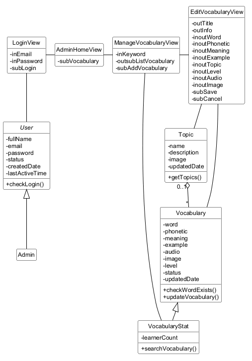
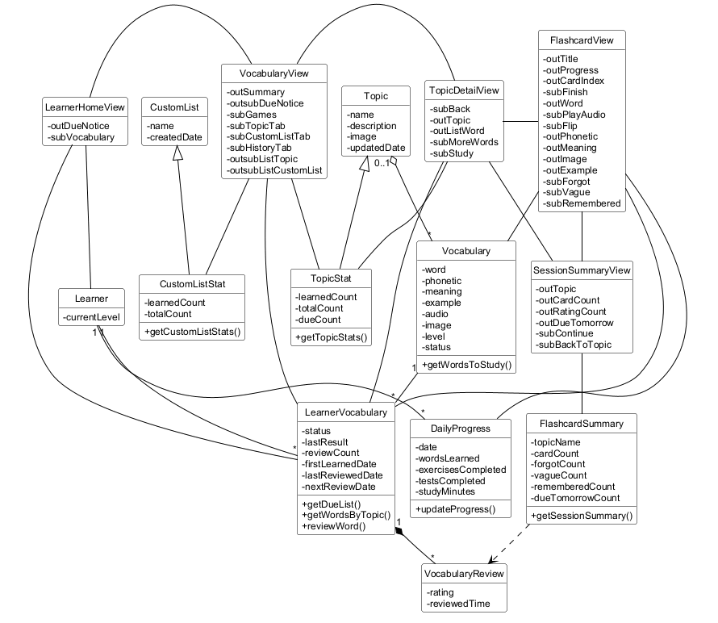
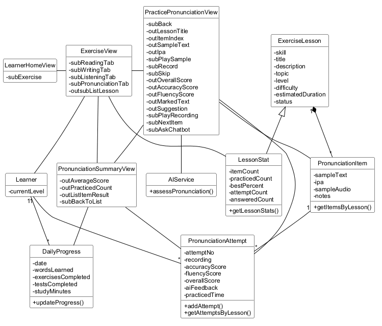
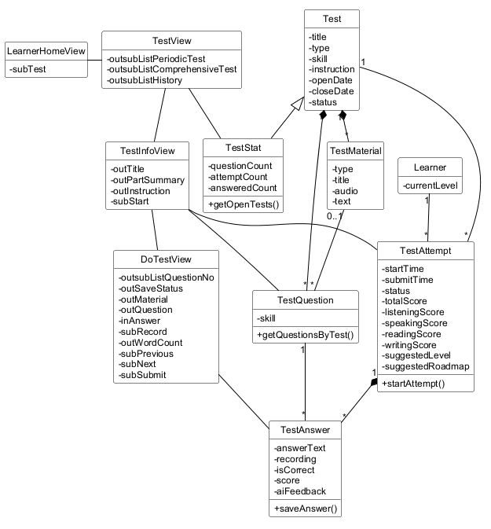
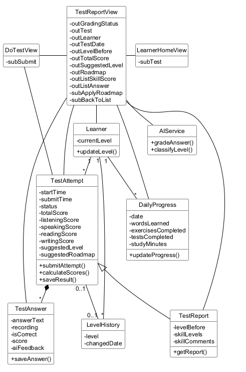
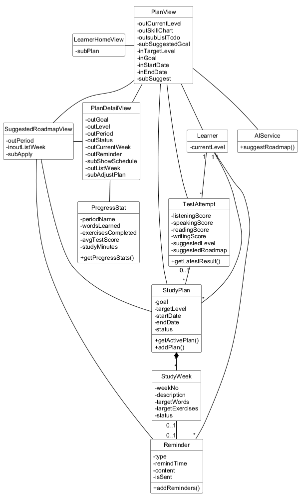

# Biểu đồ lớp (phân tích)

## Các bước thực hiện

- Bước 1: Mỗi giao diện (trừ hộp thông báo, cảnh báo, hộp xác nhận…) được đề xuất thành một lớp giao diện (view).
- Bước 2: Xét các phần tử cần có trên mỗi giao diện (xem lại kịch bản), đặt tên phần tử kèm tiền tố theo loại:
  - `in`: phần tử nhập (ô nhập văn bản, ô chọn ngày, danh sách chọn…),
  - `out`: phần tử hiển thị (bảng, nội dung…),
  - `sub`: phần tử gửi yêu cầu (nút, liên kết…),
  - hoặc kết hợp các loại trên, ví dụ `outsub` là bảng kết quả có thể click để chọn, `inout` là ô hiển thị giá trị hiện tại và cho sửa.
- Bước 3: Xét xem giao diện có cần hệ thống thực hiện một xử lý nào không. Với mỗi xử lý, trả lời bốn câu hỏi:
  - Tên phương thức là gì (đặt theo quy ước đặt tên trong code)?
  - Đầu vào là gì?
  - Đầu ra là gì?
  - Gán phương thức cho lớp nào? Theo nguyên tắc:
    - Nếu đầu ra là một lớp thực thể thì gán cho lớp thực thể đó.
    - Nếu không, xét đầu vào. Nếu đầu vào chỉ có một lớp thực thể thì gán cho lớp đó. Nếu có nhiều lớp thực thể, dựa vào biểu đồ lớp thực thể để chọn lớp có thể chứa tất cả các đầu vào.
- Bước 4: Vẽ biểu đồ lớp cho chức năng.

Ngoài các bước trên, hệ thống này có một số điểm mà mẫu case study không có. Ta áp dụng thêm các quy ước sau:

- **Lớp AIService** (đề xuất – cần nhóm chốt). Mẫu không có hệ thống bên ngoài, còn hệ thống này có actor gián tiếp Dịch vụ AI. Lớp giao diện là nơi người dùng tương tác với hệ thống; tương tự, ta đề xuất lớp AIService là nơi hệ thống giao tiếp với Dịch vụ AI. Mọi phương thức cần Dịch vụ AI chấm điểm, phân loại hoặc gợi ý đều được gán cho lớp này, thay vì gán cho lớp thực thể theo đầu ra. Kết quả AI trả về sau đó được lưu bằng phương thức của lớp thực thể tương ứng.
- **Số liệu tính theo người học.** Nhiều bảng trên giao diện hiển thị một lớp thực thể kèm số liệu tổng hợp, ví dụ "đã học/tổng số từ" của từng chủ đề. Ta làm như lớp RoomStat của mẫu: dùng lớp thống kê kế thừa lớp thực thể (VocabularyStat, TopicStat, CustomListStat, LessonStat, TestStat). Các lớp này đã được bổ sung vào `EntityClassExtraction.md`.
- **Thao tác chỉ xảy ra trên giao diện** không cần phương thức. Ví dụ: lật thẻ, nghe âm thanh đã tải, chuyển sang câu hoặc mục tiếp theo, kiểm tra ô bắt buộc không trống.
- Chức năng a phân tích cả bước đăng nhập. Các chức năng b–e bỏ qua bước này và bắt đầu từ giao diện chính của người học.
- Nếu một lớp thực thể xuất hiện trong nhiều hình, mỗi hình chỉ hiện các phương thức dùng trong chức năng của hình đó. Danh sách đầy đủ ở mục **Tổng hợp phương thức** cuối tài liệu.

**Giao diện theo hệ thống đang chạy (cập nhật 01/10/2026).** Kịch bản (`Scenarios.md`) nay mô tả giao diện theo hệ thống LinguaStep đang chạy, nên các lớp giao diện được đề xuất theo đúng các màn hình đó:

- Mỗi trang có đường dẫn riêng là một lớp giao diện.
- Một phần hiện ra trong trang sau một thao tác và có nút xử lý riêng cũng là một lớp giao diện: ngăn kéo sửa từ, thẻ tổng kết phiên học, thẻ kết quả bài luyện, khối xem trước lộ trình, khối "Kế hoạch của bạn".
- Tab chỉ đổi danh sách đang xem của một trang, nên mỗi tab là một phần tử `sub` của lớp giao diện trang đó, và nội dung của tab là phần tử của cùng lớp.
- Thanh bên có mặt trên mọi trang. Các mục của thanh bên được ghi là phần tử của giao diện chính (LearnerHomeView, AdminHomeView). Khi người dùng chọn một mục thanh bên từ một trang khác, lớp giao diện đang mở gọi lớp giao diện của mục đó.
- Hộp thoại xác nhận và thông báo hiện ở góc màn hình không tạo lớp.
- Phần tử mà hệ thống chưa có (đánh dấu **[Đề xuất]** trong kịch bản) vẫn được đưa vào lớp giao diện, kèm cùng dấu đó.

## Áp dụng

### a. Sửa thông tin từ vựng

Phân tích chức năng này (kịch bản 2 và 19):

- Vào hệ thống → trang "Đăng nhập" hiện ra → cần lớp **LoginView**:
  - ô "Email" → `inEmail`
  - ô "Mật khẩu" → `inPassword`
  - nút "Đăng nhập →" → `subLogin`
- Nhập email, mật khẩu và click "Đăng nhập →" → hệ thống phải kiểm tra thông tin đăng nhập → cần phương thức:
  - tên: `checkLogin()`
  - đầu vào: email, password (của lớp User)
  - đầu ra: đối tượng User nếu email và mật khẩu đúng, rỗng nếu sai. Đầu ra là đối tượng thay vì boolean như mẫu vì hai lý do. Thứ nhất, lớp con của đối tượng (Admin hay Learner) cho biết cần mở giao diện chính nào. Thứ hai, tài khoản bị khóa vẫn được trả về, để giao diện báo đúng lỗi "tài khoản đã bị khóa" thay vì "sai mật khẩu" (kịch bản 2, nhánh 4b).
  - gán cho lớp: User (đầu ra là lớp thực thể User).
- Đăng nhập thành công bằng tài khoản admin → giao diện chính của admin (trang "Tổng quan hệ thống") hiện ra → cần lớp **AdminHomeView**, có ít nhất:
  - mục "Từ vựng" trên thanh bên → `subVocabulary`

  Các số liệu trên trang "Tổng quan hệ thống" thuộc chức năng xem thống kê (kịch bản 26), không phân tích ở đây.
- Chọn mục "Từ vựng" → trang "Từ vựng" của admin hiện ra → cần lớp **ManageVocabularyView**, có ít nhất:
  - ô "Tìm từ trong toàn bộ kho" → `inKeyword`
  - bảng "Kết quả tìm kiếm" (từ, nghĩa, chủ đề, trình độ, có/thiếu câu ví dụ, có/thiếu âm thanh, số người học), mỗi dòng có thao tác "Sửa", "Xóa" → `outsubListVocabulary`
  - nút "+ Thêm từ" → `subAddVocabulary` (use case Thêm từ vựng, không phân tích ở đây)

  Bảng "Danh sách chủ đề" và nút "+ Thêm chủ đề" thuộc chức năng quản lý chủ đề (kịch bản 22), thao tác "Xóa" thuộc chức năng xóa từ (kịch bản 21), nên không phân tích ở đây. Trang này thay cho hai giao diện quản lý từ vựng và tìm kiếm từ vựng của bản trước: ô tìm kiếm nằm ngay trên trang, kết quả hiện khi gõ, không có nút tìm kiếm và không có danh sách chọn chủ đề. Muốn tìm trong một chủ đề, admin mở trang của chủ đề đó và dùng ô "Tìm trong chủ đề"; ô này gọi cùng phương thức tìm kiếm, với chủ đề đã chọn.
- Gõ từ khóa vào ô tìm kiếm → hệ thống tìm các từ có chứa từ khóa (trong từ hoặc nghĩa) → cần phương thức:
  - tên: `searchVocabulary()`
  - đầu vào: từ khóa, chủ đề (để trống nghĩa là mọi chủ đề)
  - đầu ra: danh sách VocabularyStat, tức từ vựng kèm số người học đang học từ đó (cột "Người học" của bảng)
  - gán cho lớp: VocabularyStat (đầu ra là lớp này). Bản trước gán cho Vocabulary vì bảng kết quả chưa có số người học.
- Click "Sửa" ở dòng của từ cần sửa → ngăn kéo sửa từ mở ra bên phải → cần lớp **EditVocabularyView**:
  - tiêu đề "Sửa từ “…”" và dòng phụ gồm chủ đề, lần cập nhật cuối, số người học đang học từ này → `outTitle`, `outInfo`
  - ô "Từ *", "Phiên âm", "Nghĩa *", "Câu ví dụ": hiển thị và cho sửa → `inoutWord`, `inoutPhonetic`, `inoutMeaning`, `inoutExample`
  - "Chủ đề *": danh sách chọn → `inoutTopic`
  - "Trình độ *": danh sách chọn A1–C2 → `inoutLevel`
  - âm thanh (nút nghe, nút "Thay file") và "Ảnh minh họa" (nút "Thay file") → `inoutAudio`, `inoutImage`
  - nút "Lưu" → `subSave`; nút "Hủy" → `subCancel`

  Dữ liệu điền sẵn lấy từ đối tượng VocabularyStat vừa chọn trong bảng kết quả, nên không cần truy vấn thêm. Lần cập nhật cuối là thuộc tính updatedDate mới của Vocabulary (xem `EntityClassExtraction.md`).
- Danh sách chọn chủ đề cần các chủ đề hiện có → cần phương thức:
  - tên: `getTopics()`
  - đầu vào: không có
  - đầu ra: danh sách Topic
  - gán cho lớp: Topic.
- Sửa một số thông tin và click "Lưu". Giao diện kiểm tra từ và nghĩa không trống (không cần phương thức). Sau đó hệ thống phải kiểm tra trong chủ đề chưa có từ nào trùng với từ vừa sửa (kịch bản 19, bước 12) → cần phương thức:
  - tên: `checkWordExists()`
  - đầu vào: từ, chủ đề, mã của từ đang sửa (để không so với chính nó)
  - đầu ra: boolean
  - gán cho lớp: đầu vào gồm Vocabulary và Topic; lớp chứa được cả hai (vì mỗi từ vựng thuộc một chủ đề) là Vocabulary.
- Từ không trùng → hệ thống cập nhật từ vựng → cần phương thức:
  - tên: `updateVocabulary()`
  - đầu vào: đối tượng Vocabulary
  - đầu ra: boolean
  - gán cho lớp: Vocabulary. Phương thức ghi luôn thời điểm sửa vào updatedDate.
- Lưu xong → ngăn kéo đóng và hệ thống trở về ManageVocabularyView. Thông báo "Đã lưu · …" hiện ở góc màn hình (không tạo lớp); bảng kết quả tìm kiếm giữ nguyên, dòng của từ vừa sửa hiện nghĩa mới.

### b. Học flashcard theo chủ đề

Phân tích chức năng này, bỏ qua bước đăng nhập (kịch bản 5):

- Đăng nhập thành công bằng tài khoản người học → giao diện chính của người học (trang "Tiến độ") hiện ra → cần lớp **LearnerHomeView**, có ít nhất:
  - thẻ "Từ cần ôn hôm nay · N · Ôn tập ngay →" → `outDueNotice`
  - mục "Từ vựng" trên thanh bên → `subVocabulary`

  Các khối tiến độ khác của trang thuộc chức năng xem tiến độ (kịch bản 16), không phân tích ở đây.
- Để hiện thẻ từ cần ôn, hệ thống lấy các từ đã đến hạn ôn → cần phương thức:
  - tên: `getDueList()`
  - đầu vào: người học, ngày hiện tại
  - đầu ra: danh sách LearnerVocabulary có ngày ôn tiếp theo không muộn hơn ngày hiện tại (N là số phần tử)
  - gán cho lớp: LearnerVocabulary. Trang "Từ vựng" và chức năng ôn tập từ đến hạn cũng dùng lại phương thức này.
- Chọn mục "Từ vựng" → trang "Từ vựng" hiện ra → cần lớp **VocabularyView**:
  - dòng "Đã học x / y từ · n chủ đề" → `outSummary`
  - dải "Bạn có N từ cần ôn hôm nay · Ôn tập ngay →" → `outsubDueNotice` (mở use case Ôn tập từ đến hạn)
  - dải "Trò chơi từ vựng & Bảng xếp hạng · Chơi ngay →" → `subGames` (use case Chơi trò chơi từ vựng, không phân tích ở đây)
  - ba tab "Chủ đề có sẵn", "Danh sách của tôi (n)", "Lịch sử học" → `subTopicTab`, `subCustomListTab`, `subHistoryTab`
  - lưới thẻ chủ đề của tab "Chủ đề có sẵn" (ảnh minh họa hoặc chữ cái đầu, tên, dòng "số từ · phần trăm đã học"), click để chọn → `outsubListTopic`
  - các thẻ danh sách từ riêng của tab "Danh sách của tôi" (tên, dòng "số từ · phần trăm đã học"), click để chọn → `outsubListCustomList`

  Trang này thay cho hai giao diện học từ vựng và chọn chủ đề của bản trước. Tab "Chủ đề có sẵn" được chọn sẵn. Tab "Lịch sử học" và ô tìm kiếm "Tìm chủ đề hoặc từ…" không dùng trong chức năng này. Dải nhắc ôn dùng lại `getDueList()`.
- Để hiện lưới chủ đề → cần phương thức:
  - tên: `getTopicStats()`
  - đầu vào: người học, chủ đề (để trống nghĩa là mọi chủ đề)
  - đầu ra: danh sách TopicStat (chủ đề kèm số từ đã học, tổng số từ, số từ đến hạn ôn)
  - gán cho lớp: TopicStat. Dòng "Đã học x / y từ · n chủ đề" được cộng từ danh sách này nên không cần phương thức riêng.
- Để hiện các danh sách từ riêng và số danh sách trên nhãn tab "Danh sách của tôi (n)" → cần phương thức:
  - tên: `getCustomListStats()`
  - đầu vào: người học
  - đầu ra: danh sách CustomListStat
  - gán cho lớp: CustomListStat.
- Click một thẻ chủ đề → trang chủ đề hiện ra → cần lớp **TopicDetailView**:
  - liên kết "← Chủ đề" → `subBack`
  - tên và mô tả chủ đề → `outTopic`
  - danh sách từ của chủ đề, mỗi dòng gồm dấu đã học, "từ — nghĩa" và nhãn CEFR, sắp từ A1 đến C2 → `outListWord`
  - nút "Xem thêm từ" → `subMoreWords`
  - nút "Học N từ →", với N là số thẻ của phiên sắp lập → `subStudy`
- Trang chủ đề lấy số liệu của chủ đề bằng `getTopicStats()` (truyền vào chủ đề này). N trên nút học bằng số từ đến hạn ôn cộng số từ chưa học, tính từ TopicStat (kịch bản 5: 2 + 28 = 30). Nếu N bằng 0, thay cho nút học là khung "Bạn đã học hết chủ đề này…" (nhánh 6a). Để hiện danh sách từ → cần phương thức:
  - tên: `getWordsByTopic()`
  - đầu vào: người học, chủ đề, số từ đã hiện (để lấy tiếp khi click "Xem thêm từ")
  - đầu ra: danh sách LearnerVocabulary của người học với các từ của chủ đề, sắp từ A1 đến C2; từ người học chưa học có trạng thái "mới"
  - gán cho lớp: LearnerVocabulary (đầu ra là lớp này).
- Click "Học N từ →" → hệ thống lập phiên học: các từ đến hạn ôn xếp trước, các từ chưa học xếp sau, bỏ các từ chưa đến hạn và các từ đã ẩn → cần phương thức:
  - tên: `getWordsToStudy()`
  - đầu vào: người học, chủ đề hoặc danh sách từ riêng, ngày hiện tại
  - đầu ra: danh sách Vocabulary theo đúng thứ tự của phiên
  - gán cho lớp: Vocabulary.
- Giao diện học thẻ "Học chủ đề: …" hiện ra → cần lớp **FlashcardView**:
  - tiêu đề "Học chủ đề: …" → `outTitle`
  - thanh tiến độ (mỗi thẻ đã đánh giá là một chấm màu theo mức nhớ) và bộ đếm "i/n" → `outProgress`, `outCardIndex`
  - nút **[Đề xuất]** "Kết thúc" → `subFinish`
  - mặt trước: từ → `outWord`; nút "🔊 Nghe phát âm" → `subPlayAudio`; bấm vào thẻ (hoặc phím Space) để lật → `subFlip`
  - mặt sau: phiên âm, nghĩa, hình minh họa, câu ví dụ → `outPhonetic`, `outMeaning`, `outImage`, `outExample`
  - ba nút "Chưa nhớ", "Nhớ mơ hồ", "Nhớ rõ" (hoặc phím 1, 2, 3) → `subForgot`, `subVague`, `subRemembered`

  Nghe phát âm và lật thẻ chỉ dùng dữ liệu đã có trong đối tượng Vocabulary nên không cần phương thức.
- Click một nút đánh giá → hệ thống ghi một lượt ôn, cập nhật trạng thái học và tính ngày ôn tiếp theo theo quy tắc spaced repetition → cần phương thức:
  - tên: `reviewWord()`
  - đầu vào: người học, từ vựng, mức độ nhớ, ngày hiện tại
  - đầu ra: LearnerVocabulary đã cập nhật (trạng thái, ngày ôn tiếp theo)
  - gán cho lớp: LearnerVocabulary. Phương thức lưu kèm một VocabularyReview, vì lượt ôn là thành phần của LearnerVocabulary; cách này giống addBooking() của mẫu lưu kèm các BookedRoom.
- Thời gian học được cộng dồn vào tiến độ trong ngày → cần phương thức:
  - tên: `updateProgress()`
  - đầu vào: người học, ngày, số phút học thêm
  - đầu ra: không có
  - gán cho lớp: DailyProgress. Phương thức tạo bản ghi tiến độ của ngày nếu chưa có, rồi cộng thêm thời gian học. Các chức năng c và d cũng dùng lại phương thức này. Số từ đã học, số bài tập và số bài kiểm tra hoàn thành trong ngày không cần cộng dồn, vì được đếm trực tiếp từ các lượt ôn và lượt làm bài (xem bước 5 của `Design/Database.md`).
- Hết thẻ hoặc click "Kết thúc" → thẻ tổng kết hiện ra thay cho thẻ học → cần lớp **SessionSummaryView**:
  - tiêu đề "Hoàn thành phiên học · …", có tên chủ đề **[Đề xuất]** → `outTopic`
  - số thẻ đã học (vòng tròn lớn) → `outCardCount`
  - dòng "Chưa nhớ: … · Nhớ mơ hồ: … · Nhớ rõ: …" → `outRatingCount`
  - dòng **[Đề xuất]** "Cần ôn vào ngày mai (…): N từ" → `outDueTomorrow`
  - nút "Học tiếp" → `subContinue`; nút "Về chủ đề" → `subBackToTopic`
- Để có dữ liệu tổng kết → cần phương thức:
  - tên: `getSessionSummary()`
  - đầu vào: người học, chủ đề, thời điểm bắt đầu phiên
  - đầu ra: FlashcardSummary
  - gán cho lớp: FlashcardSummary.
- Click "Về chủ đề" → hệ thống trở về TopicDetailView và lấy lại số liệu bằng `getTopicStats()`, `getWordsByTopic()`, nên các từ vừa học có dấu đã học. Click "← Chủ đề" → hệ thống trở về VocabularyView và lấy lại lưới chủ đề bằng `getTopicStats()`. Click "Học tiếp" thì lập phiên mới bằng `getWordsToStudy()` (không có trong kịch bản chuẩn).

### c. Luyện phát âm

Phân tích chức năng này, bỏ qua bước đăng nhập (kịch bản 12):

- Giao diện chính của người học → **LearnerHomeView** có ít nhất:
  - mục "Bài tập" trên thanh bên → `subExercise`
- Chọn mục "Bài tập" → trang "Bài tập" hiện ra → cần lớp **ExerciseView**:
  - bốn tab "Đọc hiểu", "Viết", "Nghe hiểu", "Phát âm" (hai tab đầu **[Đề xuất]**, thay tab "Ngữ pháp" hiện có) → `subReadingTab`, `subWritingTab`, `subListeningTab`, `subPronunciationTab`
  - các bài của tab đang chọn, xếp thành cột theo mức CEFR từ A1 đến C2, cột ứng với trình độ của người học có nhãn "Trình độ của bạn"; click một thẻ để chọn bài → `outsubListLesson`. Ở tab "Phát âm", mỗi thẻ có tiêu đề, dòng "số mục · khoảng N phút" và dòng **[Đề xuất]** "Đã luyện x/y mục".

  Trang này thay cho giao diện làm bài tập và giao diện danh sách bài luyện phát âm của bản trước. Không còn danh sách chọn mức CEFR để lọc, vì các bài đã xếp theo cột CEFR. Nhãn "Trình độ của bạn" lấy từ trình độ hiện tại của đối tượng Learner đang đăng nhập.
- Để hiện các bài của một tab → cần phương thức:
  - tên: `getLessonStats()`
  - đầu vào: người học, kỹ năng (của tab đang chọn)
  - đầu ra: danh sách LessonStat
  - gán cho lớp: LessonStat. Trang mở ở tab đầu tiên "Đọc hiểu" nên phương thức được gọi cho tab này trước, rồi gọi lại khi người học chọn tab "Phát âm".
- Click một bài → hệ thống lấy các mục luyện của bài → cần phương thức:
  - tên: `getItemsByLesson()`
  - đầu vào: bài học
  - đầu ra: danh sách PronunciationItem
  - gán cho lớp: PronunciationItem.
- Giao diện luyện phát âm hiện ra → cần lớp **PracticePronunciationView**:
  - liên kết "← Bài tập phát âm" → `subBack`; tên bài → `outLessonTitle`
  - nhãn "Câu i/n" của mục đang luyện → `outItemIndex`
  - văn bản mẫu, phiên âm IPA → `outSampleText`, `outIpa`
  - nút "Nghe mẫu" → `subPlaySample`
  - nút micro (bấm để ghi âm, bấm lần nữa để dừng, tối đa 10 giây) → `subRecord`
  - nút "Bỏ qua mục này" → `subSkip`
  - kết quả chấm: vòng điểm tổng, dòng "Chính xác … · Trôi chảy …" → `outOverallScore`, `outAccuracyScore`, `outFluencyScore`
  - câu mẫu tô đỏ các từ đọc chưa đúng, kèm điểm và lỗi của từng từ → `outMarkedText`; danh sách gợi ý → `outSuggestion`
  - nút "▶ Nghe lại giọng bạn" → `subPlayRecording`
  - nút "Tiếp tục" (ở mục cuối là "Xem kết quả") → `subNextItem`
  - nút nổi "Hỏi trợ lý AI" → `subAskChatbot` (mở use case Hỏi chatbot, không phân tích trong chức năng này)

  Bản trước có danh sách các mục để chọn. Hệ thống cho luyện lần lượt từng mục, nên giao diện chỉ còn nhãn "Câu i/n" và nút bỏ qua; ghi âm lại dùng chính nút micro.
- Ghi âm xong và bấm dừng → hệ thống gửi bản ghi âm cùng văn bản mẫu đến Dịch vụ AI để chấm → cần phương thức:
  - tên: `assessPronunciation()`
  - đầu vào: file ghi âm, mục luyện (văn bản mẫu)
  - đầu ra: một PronunciationAttempt chưa lưu, chứa điểm tổng, điểm độ chính xác, điểm độ trôi chảy và nhận xét chi tiết theo từng từ
  - gán cho lớp: AIService (phương thức cần Dịch vụ AI).
- Có kết quả chấm → hệ thống lưu lượt luyện → cần phương thức:
  - tên: `addAttempt()`
  - đầu vào: đối tượng PronunciationAttempt (người học, mục luyện, bản ghi, các điểm, nhận xét)
  - đầu ra: boolean
  - gán cho lớp: PronunciationAttempt. Phương thức tự đặt attemptNo bằng số lần đã thử của mục này cộng 1, nên mỗi lần ghi âm lại tạo một lượt mới và các lượt cũ vẫn được giữ.
- Nghe mẫu, nghe lại giọng mình, bỏ qua mục và chuyển sang mục tiếp theo không cần phương thức. Ghi âm lại thì gọi lại `assessPronunciation()` và `addAttempt()`.
- Ở mục cuối click "Xem kết quả" → thẻ kết quả của bài hiện ra → cần lớp **PronunciationSummaryView**:
  - vòng điểm trung bình và dòng "Đã luyện x/n mục · điểm trung bình …" → `outAverageScore`, `outPracticedCount`
  - danh sách "Điểm tốt nhất từng mục" (văn bản mẫu, số lần thử **[Đề xuất]**, điểm cao nhất) → `outListItemResult`
  - nút "Về danh sách" → `subBackToList`
- Để có dữ liệu tổng kết → cần phương thức:
  - tên: `getAttemptsByLesson()`
  - đầu vào: người học, bài học
  - đầu ra: danh sách PronunciationAttempt
  - gán cho lớp: PronunciationAttempt. Giao diện gộp các lượt theo mục để tính số lần thử, điểm cao nhất và điểm trung bình; vì chỉ có vài mục trong một bài nên không cần lớp thống kê riêng.
- Bài được tính là hoàn thành → hệ thống cộng thời gian luyện của bài vào tiến độ ngày bằng `updateProgress()` của DailyProgress.
- Click "Về danh sách" → hệ thống trở về ExerciseView ở tab "Phát âm" và lấy lại danh sách bằng `getLessonStats()`.

### d. Làm kiểm tra tổng hợp

Phân tích chức năng này, bỏ qua bước đăng nhập (kịch bản 15):

- Giao diện chính của người học → **LearnerHomeView** có ít nhất:
  - mục "Kiểm tra" trên thanh bên → `subTest`
- Chọn mục "Kiểm tra" → trang "Kiểm tra" hiện ra → cần lớp **TestView**:
  - khối "Kiểm tra định kỳ" và khối "Kiểm tra tổng hợp". Mỗi đề đang mở là một thẻ gồm: tên đề; dòng "số câu · Còn N ngày · số lần đã làm" (hoặc "Đang làm dở · đã trả lời x/n câu"); nút "Bắt đầu", "Làm tiếp" hoặc "Làm lại" để chọn đề → `outsubListPeriodicTest`, `outsubListComprehensiveTest`
  - khối **[Đề xuất]** "Lịch sử kiểm tra" → `outsubListHistory` (mở lại báo cáo của các lượt đã nộp, không phân tích ở đây)

  Trang này thay cho giao diện kiểm tra và giao diện chọn đề của bản trước.
- Để hiện các thẻ đề → cần phương thức:
  - tên: `getOpenTests()`
  - đầu vào: người học, loại đề (để trống nghĩa là cả hai loại), ngày hiện tại
  - đầu ra: danh sách TestStat (các đề đang mở và chưa bị ẩn)
  - gán cho lớp: TestStat. Trang gọi phương thức một lần cho cả hai loại rồi chia các đề vào hai khối. Số ngày còn lại tính từ ngày đóng nên không cần phương thức.
- Click "Bắt đầu" ở thẻ một đề → màn giới thiệu đề hiện ra → cần lớp **TestInfoView**:
  - tên đề → `outTitle`
  - dòng "n câu … · Kỹ năng: Nghe, Nói, Đọc, Viết" và bảng **[Đề xuất]** cấu trúc đề theo phần (số câu, dạng câu, thang điểm của từng phần) → `outPartSummary`
  - hướng dẫn làm bài của đề và các lưu ý có sẵn → `outInstruction`
  - nút "Bắt đầu" → `subStart`
- Để có số câu từng phần và nội dung các phần → cần phương thức:
  - tên: `getQuestionsByTest()`
  - đầu vào: đề kiểm tra
  - đầu ra: danh sách TestQuestion, kèm đáp án lựa chọn và tài liệu (bài nghe, đoạn văn)
  - gán cho lớp: TestQuestion. Giao diện đếm số câu theo kỹ năng.
- Click "Bắt đầu" → hệ thống tạo một lượt làm bài → cần phương thức:
  - tên: `startAttempt()`
  - đầu vào: người học, đề kiểm tra
  - đầu ra: TestAttempt ở trạng thái đang làm. Nếu người học đã có một lượt làm dở của đề này, trả về lượt đó cùng các câu đã trả lời để làm tiếp (kịch bản 15, nhánh 5a; thẻ đề khi đó có nút "Làm tiếp").
  - gán cho lớp: TestAttempt.
- Giao diện làm bài hiện ra (cùng giao diện với kiểm tra định kỳ, kịch bản 14) → cần lớp **DoTestView**:
  - dãy nút số câu chia theo phần Nghe, Nói, Đọc, Viết **[Đề xuất: chia theo phần]**, câu đã trả lời được tô màu, click để chuyển câu → `outsubListQuestionNo`
  - dòng trạng thái lưu "Đang lưu…"/"Đã lưu" → `outSaveStatus`
  - tài liệu chung của phần **[Đề xuất]**: trình phát bài nghe (phần Nghe) hoặc đoạn văn (phần Đọc) → `outMaterial`
  - câu đang làm (nhãn "Câu i" và đề bài) → `outQuestion`
  - phần trả lời: các lựa chọn của câu trắc nghiệm, ô "Bài viết của bạn" của phần Viết → `inAnswer`; nút micro ghi âm tối đa 1 phút của phần Nói **[Đề xuất]** → `subRecord`; bộ đếm số từ của phần Viết **[Đề xuất]** → `outWordCount`
  - nút "← Câu trước", "Câu tiếp theo →" → `subPrevious`, `subNext`
  - nút "Nộp bài" (ở câu cuối) và "Nộp bài sớm" → `subSubmit`

  Bản trước có bốn giao diện riêng cho bốn phần và chỉ lưu câu trả lời khi chuyển phần. Hệ thống dùng một giao diện làm bài cho mọi câu và lưu ngay từng câu, đúng quy tắc "lượt làm bài được lưu theo từng câu" ở cuối `Scenarios.md`. Vì vậy bốn lớp được gộp thành một, và phương thức lưu đổi thành lưu một câu.
- Chọn hoặc gõ câu trả lời, hoặc ghi âm xong → hệ thống lưu ngay câu trả lời → cần phương thức:
  - tên: `saveAnswer()`
  - đầu vào: lượt làm bài, một TestAnswer (câu hỏi, đáp án được chọn, văn bản hoặc bản ghi âm)
  - đầu ra: boolean (dòng trạng thái chuyển sang "Đã lưu")
  - gán cho lớp: TestAnswer. Nếu câu đó đã có câu trả lời trong lượt, phương thức ghi đè câu trả lời cũ.
- Chuyển câu, phát bài nghe và đếm số từ không cần phương thức.
- Click "Nộp bài" → hộp thoại "Nộp bài kiểm tra?" hiện ra (không tạo lớp) → người học click "Nộp bài" trong hộp thoại → hệ thống nộp bài và chấm các câu có đáp án → cần phương thức:
  - tên: `submitAttempt()`
  - đầu vào: TestAttempt
  - đầu ra: TestAttempt đã ghi thời gian nộp, ở trạng thái đã nộp, có điểm nghe và điểm đọc
  - gán cho lớp: TestAttempt.
- Trang "Kết quả kiểm tra" hiện ra → cần lớp **TestReportView**:
  - trạng thái "Đang chấm phần Nói, Viết" khi Dịch vụ AI chưa chấm xong → `outGradingStatus`
  - tên đề → `outTest`; dòng **[Đề xuất]** "Người học · Ngày làm · Trình độ trước khi làm bài" → `outLearner`, `outTestDate`, `outLevelBefore`
  - tổng điểm, trình độ đề xuất → `outTotalScore`, `outSuggestedLevel`
  - khối "Lộ trình đề xuất" → `outRoadmap`
  - bảng điểm theo kỹ năng (điểm, trình độ, nhận xét **[Đề xuất]**) → `outListSkillScore`
  - khối "Xem lại bài làm" (câu, kỹ năng, câu trả lời, đáp án đúng, điểm) → `outListAnswer`
  - nút **[Đề xuất]** "Áp dụng lộ trình vào kế hoạch học →" → `subApplyRoadmap` (use case extend, chuyển sang chức năng e)
  - nút "← Về danh sách bài kiểm tra" → `subBackToList`
- Người học chờ kết quả ngay trên trang này, nên lớp TestReportView gọi lần lượt các bước chấm trong lúc hiện trạng thái đang chấm (bản trước giao việc này cho lớp giao diện phần viết):
  - gửi từng câu nói và câu viết đến Dịch vụ AI → cần phương thức:
    - tên: `gradeAnswer()`
    - đầu vào: câu trả lời (bản ghi âm hoặc bài viết), đề bài của câu
    - đầu ra: TestAnswer có điểm và nhận xét của AI
    - gán cho lớp: AIService. Kết quả được lưu lại bằng `saveAnswer()`.
  - tính điểm từng kỹ năng và tổng điểm → cần phương thức:
    - tên: `calculateScores()`
    - đầu vào: TestAttempt (đã có điểm từng câu)
    - đầu ra: TestAttempt có điểm nói (trung bình các đề nói), điểm viết và tổng điểm (trung bình bốn kỹ năng)
    - gán cho lớp: TestAttempt.
  - gửi điểm bốn kỹ năng đến Dịch vụ AI để phân loại trình độ → cần phương thức:
    - tên: `classifyLevel()`
    - đầu vào: điểm bốn kỹ năng, trình độ hiện tại
    - đầu ra: trình độ đề xuất, lộ trình đề xuất
    - gán cho lớp: AIService.
  - lưu kết quả → cần phương thức:
    - tên: `saveResult()`
    - đầu vào: TestAttempt có đủ điểm, trình độ đề xuất và lộ trình đề xuất
    - đầu ra: boolean; lượt làm bài chuyển sang trạng thái đã chấm
    - gán cho lớp: TestAttempt.
  - nếu trình độ đề xuất khác trình độ hiện tại, cập nhật trình độ (kịch bản 15, nhánh 16a) → cần phương thức:
    - tên: `updateLevel()`
    - đầu vào: người học, trình độ mới, lượt kiểm tra đã sinh ra trình độ này
    - đầu ra: boolean; trình độ hiện tại được cập nhật và thêm một LevelHistory
    - gán cho lớp: đầu vào gồm Learner và TestAttempt; lớp chứa được cả hai (qua LevelHistory) là Learner.
  - cộng thời gian làm bài vào tiến độ ngày bằng `updateProgress()` của DailyProgress.
- Để có dữ liệu báo cáo → cần phương thức:
  - tên: `getReport()`
  - đầu vào: TestAttempt
  - đầu ra: TestReport
  - gán cho lớp: TestReport.
- Click mục "Tiến độ" trên thanh bên → hệ thống trở về LearnerHomeView; khối "Trình độ hiện tại" của thanh bên hiển thị trình độ mới.

Chức năng này có 5 giao diện, 10 lớp thực thể và lớp AIService nên biểu đồ được chia làm hai hình: chọn đề và làm bài (d1); nộp bài, chấm và xem báo cáo (d2).

### e. Lập kế hoạch học cá nhân

Phân tích chức năng này, bỏ qua bước đăng nhập (kịch bản 17):

- Giao diện chính của người học → **LearnerHomeView** có ít nhất:
  - mục "Kế hoạch" trên thanh bên → `subPlan`
- Chọn mục "Kế hoạch" → hệ thống kiểm tra người học đã có kế hoạch đang thực hiện chưa → cần phương thức:
  - tên: `getActivePlan()`
  - đầu vào: người học
  - đầu ra: StudyPlan đang thực hiện, hoặc rỗng nếu chưa có
  - gán cho lớp: StudyPlan.

  Nếu đã có kế hoạch, trang hiện khối "Kế hoạch của bạn" (PlanDetailView). Nếu chưa có, trang hiện khối "Đặt mục tiêu học tập".
- Trang "Kế hoạch học cá nhân" hiện ra → cần lớp **PlanView**:
  - thẻ trình độ: trình độ hiện tại (lấy từ đối tượng Learner đang đăng nhập) và radar bốn kỹ năng của lần kiểm tra tổng hợp gần nhất → `outCurrentLevel`, `outSkillChart`
  - khối "Việc nên làm" → `outsubListTodo` (gợi ý việc học, không phân tích ở đây)
  - khối "Đặt mục tiêu học tập", gồm:
    - các thẻ mục tiêu gợi ý, chọn để điền nhanh trình độ mục tiêu và thời gian → `subSuggestedGoal`
    - thẻ "Mục tiêu khác" với danh sách chọn "Trình độ mục tiêu" A1–C2 → `inTargetLevel`
    - ô "Mô tả mục tiêu" **[Đề xuất: bắt buộc]** → `inGoal`
    - ô **[Đề xuất]** "Ngày bắt đầu", "Ngày kết thúc" → `inStartDate`, `inEndDate`
    - nút "Gợi ý lộ trình" → `subSuggest`

  Trang này thay cho giao diện tiến độ và kế hoạch, và giao diện lập kế hoạch của bản trước: hệ thống đặt "Kế hoạch" thành một mục riêng trên thanh bên.
- Radar bốn kỹ năng cần kết quả kiểm tra tổng hợp gần nhất → cần phương thức:
  - tên: `getLatestResult()`
  - đầu vào: người học
  - đầu ra: TestAttempt tổng hợp đã chấm gần nhất, hoặc rỗng nếu chưa có
  - gán cho lớp: TestAttempt. Kết quả này được dùng lại khi gợi ý lộ trình, nên không cần gọi lại.
- Nhập thông tin và click "Gợi ý lộ trình". Giao diện kiểm tra mục tiêu không trống và ngày hợp lệ (không cần phương thức). Sau đó hệ thống gửi mục tiêu, trình độ và kết quả kiểm tra đến Dịch vụ AI → cần phương thức:
  - tên: `suggestRoadmap()`
  - đầu vào: mục tiêu, trình độ hiện tại, trình độ mục tiêu, ngày bắt đầu, ngày kết thúc, kết quả kiểm tra gần nhất
  - đầu ra: danh sách StudyWeek (tuần thứ, mô tả nội dung học, mục tiêu số từ mới, mục tiêu số bài tập)
  - gán cho lớp: AIService.
- Khối xem trước lộ trình hiện ra dưới khối mục tiêu → cần lớp **SuggestedRoadmapView**:
  - dòng thời gian "… – … · n tuần" → `outPeriod`
  - danh sách các tuần (thời gian, nội dung học, hai ô mục tiêu số từ mới và số bài tập cho sửa **[Đề xuất: ô sửa]**) → `inoutListWeek`
  - nút "Áp dụng kế hoạch" → `subApply`

  Muốn lộ trình khác, người học bấm lại "Gợi ý lộ trình" trên PlanView (gọi lại `suggestRoadmap()`), nên giao diện này không còn nút gợi ý lại.
- Sửa mục tiêu của một vài tuần và click "Áp dụng kế hoạch". Giao diện kiểm tra các mục tiêu là số nguyên không âm. Sau đó hệ thống lưu kế hoạch → cần phương thức:
  - tên: `addPlan()`
  - đầu vào: đối tượng StudyPlan (mục tiêu, trình độ mục tiêu, thời gian, trạng thái đang thực hiện) kèm danh sách StudyWeek
  - đầu ra: boolean
  - gán cho lớp: StudyPlan (các tuần là thành phần của kế hoạch nên được lưu kèm).
- Hệ thống tạo các nhắc nhở học theo lịch → cần phương thức:
  - tên: `addReminders()`
  - đầu vào: danh sách Reminder (mỗi tuần một nhắc nhở loại kế hoạch vào 8:00 thứ Hai đầu tuần, gắn với tuần tương ứng)
  - đầu ra: boolean
  - gán cho lớp: Reminder.
- Đầu trang hiện thông báo xanh "Đã áp dụng kế hoạch mới. Chúc bạn học tốt!" (không tạo lớp), và khối "Kế hoạch của bạn" hiện ra thay cho khối mục tiêu → cần lớp **PlanDetailView**:
  - mục tiêu → `outGoal`; trình độ hiện tại → mục tiêu (ví dụ B1 → B2) → `outLevel`; thời gian → `outPeriod`; nhãn trạng thái "Đang thực hiện" → `outStatus`; tuần hiện tại, hoặc "chưa bắt đầu" **[Đề xuất]** khi chưa tới ngày bắt đầu → `outCurrentWeek`
  - dòng **[Đề xuất]** "Nhắc nhở: 8:00 thứ Hai đầu mỗi tuần" → `outReminder`
  - nút "Xem lịch trình ▾" mở danh sách các tuần với mục tiêu và tiến độ → `subShowSchedule`, `outListWeek`
  - nút "Điều chỉnh kế hoạch" → `subAdjustPlan` (use case extend Điều chỉnh kế hoạch, kịch bản 18)
- Để có tiến độ từng tuần → cần phương thức:
  - tên: `getProgressStats()`
  - đầu vào: người học, ngày bắt đầu, ngày kết thúc, kiểu kỳ (tuần)
  - đầu ra: danh sách ProgressStat
  - gán cho lớp: ProgressStat. Đây là lớp thống kê của chức năng xem tiến độ, được dùng lại ở đây.

## Tổng hợp phương thức

| Lớp | Phương thức | Đầu vào | Đầu ra | Chức năng |
|---|---|---|---|---|
| User | checkLogin() | email, mật khẩu | User hoặc rỗng | a (và mọi chức năng) |
| Topic | getTopics() | không có | danh sách Topic | a |
| VocabularyStat | searchVocabulary() | từ khóa, chủ đề | danh sách VocabularyStat | a |
| Vocabulary | checkWordExists() | từ, chủ đề, mã từ đang sửa | boolean | a |
| Vocabulary | updateVocabulary() | Vocabulary | boolean | a |
| Vocabulary | getWordsToStudy() | người học, chủ đề hoặc danh sách từ riêng, ngày | danh sách Vocabulary | b |
| LearnerVocabulary | getDueList() | người học, ngày | danh sách LearnerVocabulary | b |
| LearnerVocabulary | getWordsByTopic() | người học, chủ đề, số từ đã hiện | danh sách LearnerVocabulary | b |
| LearnerVocabulary | reviewWord() | người học, từ vựng, mức độ nhớ, ngày | LearnerVocabulary | b |
| TopicStat | getTopicStats() | người học, chủ đề | danh sách TopicStat | b |
| CustomListStat | getCustomListStats() | người học | danh sách CustomListStat | b |
| FlashcardSummary | getSessionSummary() | người học, chủ đề, thời điểm bắt đầu phiên | FlashcardSummary | b |
| DailyProgress | updateProgress() | người học, ngày, số phút học thêm | không có | b, c, d |
| LessonStat | getLessonStats() | người học, kỹ năng | danh sách LessonStat | c |
| PronunciationItem | getItemsByLesson() | bài học | danh sách PronunciationItem | c |
| PronunciationAttempt | addAttempt() | PronunciationAttempt | boolean | c |
| PronunciationAttempt | getAttemptsByLesson() | người học, bài học | danh sách PronunciationAttempt | c |
| TestStat | getOpenTests() | người học, loại đề, ngày | danh sách TestStat | d |
| TestQuestion | getQuestionsByTest() | đề kiểm tra | danh sách TestQuestion | d |
| TestAttempt | startAttempt() | người học, đề kiểm tra | TestAttempt | d |
| TestAnswer | saveAnswer() | lượt làm bài, TestAnswer | boolean | d |
| TestAttempt | submitAttempt() | TestAttempt | TestAttempt | d |
| TestAttempt | calculateScores() | TestAttempt | TestAttempt | d |
| TestAttempt | saveResult() | TestAttempt | boolean | d |
| Learner | updateLevel() | người học, trình độ mới, lượt kiểm tra | boolean | d |
| TestReport | getReport() | TestAttempt | TestReport | d |
| TestAttempt | getLatestResult() | người học | TestAttempt hoặc rỗng | e |
| StudyPlan | getActivePlan() | người học | StudyPlan hoặc rỗng | e |
| StudyPlan | addPlan() | StudyPlan kèm danh sách StudyWeek | boolean | e |
| Reminder | addReminders() | danh sách Reminder | boolean | e |
| ProgressStat | getProgressStats() | người học, ngày bắt đầu, ngày kết thúc, kiểu kỳ | danh sách ProgressStat | e |
| AIService | assessPronunciation() | file ghi âm, mục luyện | PronunciationAttempt chưa lưu | c |
| AIService | gradeAnswer() | câu trả lời nói hoặc viết, đề bài | TestAnswer có điểm và nhận xét | d |
| AIService | classifyLevel() | điểm bốn kỹ năng, trình độ hiện tại | trình độ đề xuất, lộ trình đề xuất | d |
| AIService | suggestRoadmap() | mục tiêu, trình độ, thời gian, kết quả kiểm tra gần nhất | danh sách StudyWeek | e |

## Truy vết use case – lớp giao diện

Mỗi use case trong các biểu đồ use case chi tiết (`Requirements/Use_case.md`) được thực hiện bởi các lớp giao diện và phương thức sau:

| Use case | Lớp giao diện | Phương thức chính |
|---|---|---|
| Đăng nhập | LoginView | User.checkLogin() |
| Quản lý từ vựng | AdminHomeView, ManageVocabularyView | |
| Tìm kiếm từ vựng | ManageVocabularyView (ô "Tìm từ trong toàn bộ kho", bảng "Kết quả tìm kiếm") | VocabularyStat.searchVocabulary() |
| Sửa từ vựng | EditVocabularyView (ngăn kéo "Sửa từ “…”") | Topic.getTopics(), Vocabulary.checkWordExists(), Vocabulary.updateVocabulary() |
| Học flashcard theo chủ đề | LearnerHomeView, VocabularyView, SessionSummaryView | LearnerVocabulary.getDueList(), FlashcardSummary.getSessionSummary() |
| Chọn chủ đề có sẵn, Chọn danh sách từ riêng | VocabularyView (tab "Chủ đề có sẵn", "Danh sách của tôi"), TopicDetailView | TopicStat.getTopicStats(), CustomListStat.getCustomListStats(), LearnerVocabulary.getWordsByTopic() |
| Học thẻ và đánh giá mức nhớ | FlashcardView | Vocabulary.getWordsToStudy(), LearnerVocabulary.reviewWord(), DailyProgress.updateProgress() |
| Luyện phát âm | ExerciseView, PronunciationSummaryView | PronunciationAttempt.getAttemptsByLesson(), DailyProgress.updateProgress() |
| Chọn mục luyện phát âm | ExerciseView (tab "Phát âm"), PracticePronunciationView | LessonStat.getLessonStats(), PronunciationItem.getItemsByLesson() |
| Ghi âm và chấm phát âm | PracticePronunciationView | AIService.assessPronunciation(), PronunciationAttempt.addAttempt() |
| Hỏi chatbot (extend) | nút nổi "Hỏi trợ lý AI" (`subAskChatbot`) trên PracticePronunciationView | không phân tích trong chức năng này |
| Kiểm tra tổng hợp | TestView, TestInfoView | TestQuestion.getQuestionsByTest(), TestAttempt.startAttempt() |
| Chọn đề kiểm tra | TestView (khối "Kiểm tra tổng hợp") | TestStat.getOpenTests() |
| Làm phần nghe, nói, đọc, viết | DoTestView | TestAnswer.saveAnswer(), TestAttempt.submitAttempt() |
| Xem báo cáo kết quả | TestReportView | AIService.gradeAnswer(), classifyLevel(); TestAttempt.calculateScores(), saveResult(); Learner.updateLevel(); TestReport.getReport() |
| Áp dụng lộ trình đề xuất (extend) | nút "Áp dụng lộ trình vào kế hoạch học →" (`subApplyRoadmap`) trên TestReportView | chuyển sang chức năng e |
| Quản lý kế hoạch học | PlanView, PlanDetailView | StudyPlan.getActivePlan(), ProgressStat.getProgressStats() |
| Lập kế hoạch mới | PlanView (khối "Đặt mục tiêu học tập"), SuggestedRoadmapView | TestAttempt.getLatestResult(), StudyPlan.addPlan(), Reminder.addReminders() |
| Nhận gợi ý lộ trình | PlanView, SuggestedRoadmapView | AIService.suggestRoadmap() |
| Điều chỉnh kế hoạch (extend) | nút "Điều chỉnh kế hoạch" (`subAdjustPlan`) trên PlanDetailView | không phân tích trong chức năng này |

## Thay đổi so với bản trước (01/10/2026)

Bản trước đề xuất giao diện theo kịch bản cũ. Bản này đề xuất theo giao diện của hệ thống đang chạy, nên một số lớp giao diện được gộp, tách hoặc đổi tên. Logic nghiệp vụ và các lớp thực thể giữ nguyên, trừ các lớp và thuộc tính thống kê ghi ở cuối `EntityClassExtraction.md`.

| Bản trước | Bản này | Lý do |
|---|---|---|
| ManageVocabularyView, SearchVocabularyView | ManageVocabularyView | Ô tìm kiếm nằm ngay trên trang "Từ vựng" của admin |
| EditVocabularyView (trang riêng) | EditVocabularyView (ngăn kéo) | Sửa từ trong ngăn kéo bên phải, lưu xong ở lại trang kết quả tìm kiếm |
| LearnVocabularyView, SelectTopicView | VocabularyView | Trang "Từ vựng" gom chủ đề, danh sách riêng, lịch sử học thành ba tab |
| (không có) | TopicDetailView | Chọn chủ đề thì mở trang chủ đề trước, phiên học bắt đầu từ nút "Học N từ →" |
| ExerciseHomeView, PronunciationLessonView | ExerciseView | Trang "Bài tập" chia bốn kỹ năng thành bốn tab, bài xếp theo cột CEFR |
| TestHomeView, SelectTestView | TestView | Trang "Kiểm tra" hiện các khối đề cùng lúc |
| ListeningPartView, SpeakingPartView, ReadingPartView, WritingPartView | DoTestView | Một giao diện làm bài cho mọi câu, lưu từng câu |
| ProgressPlanView, CreatePlanView | PlanView | "Kế hoạch" là mục riêng trên thanh bên; form mục tiêu là một khối của trang |

Thay đổi về phương thức:

- `searchVocabulary()` chuyển từ Vocabulary sang VocabularyStat, vì kết quả có thêm số người học.
- `getTopicStats()` thêm đầu vào chủ đề, để trang chủ đề lấy số liệu của riêng chủ đề đó.
- Thêm `getWordsByTopic()` của LearnerVocabulary cho danh sách từ trên trang chủ đề.
- `getLessonStats()` bỏ đầu vào mức CEFR.
- `saveAnswers()` (lưu cả phần) đổi thành `saveAnswer()` (lưu một câu).
- Các bước chấm bài kiểm tra tổng hợp chuyển từ lớp giao diện phần viết sang TestReportView.

Các tài liệu ở giai đoạn Design (`Design/ClassDiagram.md`, `Design/SequenceDiagram.md`, `Design/EntityClasses.md`, `Design/Database.md`) đã được cập nhật theo bảng trên cùng ngày.
