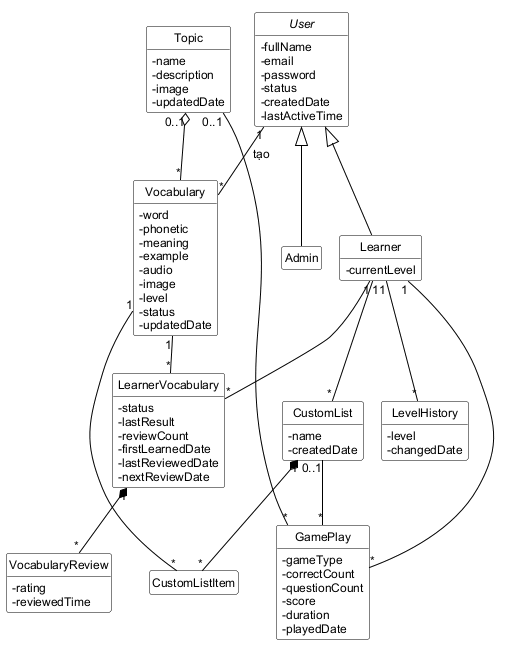
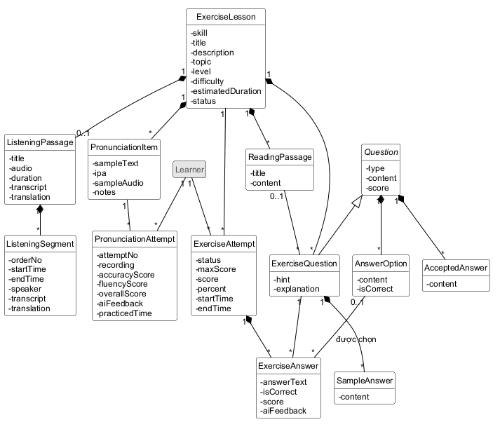
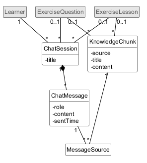
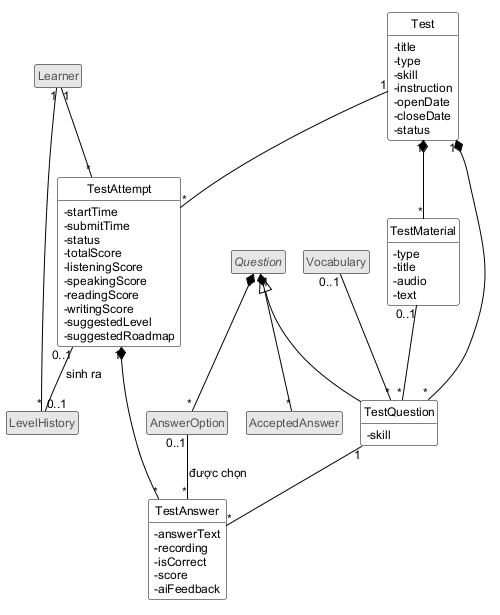
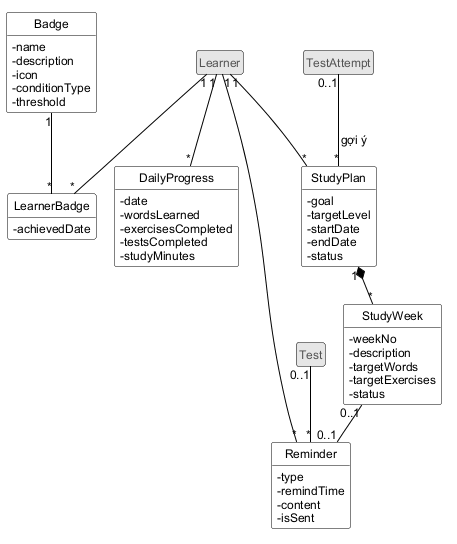
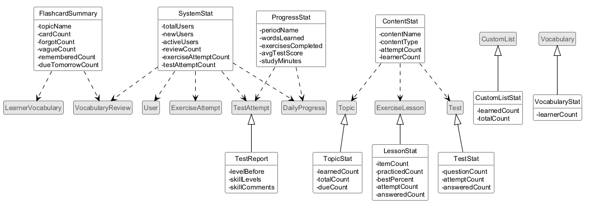

# Trích lớp thực thể (Entity class extraction)

## Phương pháp trích danh từ

- Bước 1: Mô tả các chức năng của hệ thống trong một đoạn văn ngắn nhưng đầy đủ.
- Bước 2: Trích tất cả các danh từ xuất hiện trong đoạn văn ở bước 1. Mỗi danh từ chỉ tính một lần.
- Bước 3: Phân loại các danh từ ở bước 2:
  - Danh từ có thể trở thành một lớp thực thể.
  - Danh từ có thể trở thành thuộc tính của một lớp thực thể.
  - Loại bỏ danh từ quá chung chung, quá trừu tượng hoặc nằm ngoài phạm vi của hệ thống.
- Bước 4: Xét quan hệ số lượng giữa các lớp thực thể:
  - Nếu là 1-1: giữ nguyên hoặc gộp hai lớp thành một.
  - Nếu là 1-n: giữ nguyên.
  - Nếu là n-n: tách thành ít nhất hai quan hệ 1-n bằng một lớp trung gian.
- Bước 5: Xác định quan hệ đối tượng giữa các lớp thực thể: generalization, aggregation, composition, association, dependency…

## Áp dụng

### Bước 1: Mô tả hệ thống trong một đoạn văn

Hệ thống hỗ trợ việc học tiếng Anh theo năng lực của từng người học trên nền web. Mỗi thành viên có một tài khoản để đăng nhập; thành viên gồm người học và admin. Người học đăng ký tài khoản và học từ vựng bằng flashcard theo chủ đề hoặc theo danh sách từ riêng. Mỗi lần người học đánh giá một thẻ, hệ thống tạo một lượt ôn từ và cập nhật trạng thái học của từ cùng ngày ôn tiếp theo. Người học ôn các từ đến hạn, xem tổng kết phiên học và chơi trò chơi từ vựng; mỗi ván chơi hết được lưu thành một lượt chơi. Người học làm bài tập theo bốn kỹ năng. Bài đọc hiểu gồm câu trắc nghiệm, câu điền từ và câu hỏi về bài đọc; câu trắc nghiệm có các đáp án lựa chọn, câu điền từ có các đáp án được chấp nhận. Bài viết gồm các câu viết được dịch vụ AI chấm dựa trên đề bài và câu trả lời mẫu. Bài nghe hiểu có bài nghe chia thành các đoạn kèm phụ đề và bản dịch. Bài luyện phát âm gồm các mục luyện; mỗi lần ghi âm tạo một lượt luyện phát âm do dịch vụ AI chấm điểm. Mỗi lần làm một bài tập tạo một lượt làm bài gồm các câu trả lời. Khi làm bài, người học có thể mở một phiên chat với chatbot; mỗi tin nhắn của AI có thể viện dẫn các đoạn kiến thức. Người học làm đề kiểm tra định kỳ và đề kiểm tra tổng hợp. Đề gồm các câu hỏi, có thể kèm tài liệu đề kiểm tra (bài nghe, đoạn văn); mỗi lượt làm bài kiểm tra gồm các câu trả lời. Lượt kiểm tra tổng hợp cho ra báo cáo kết quả, trình độ đề xuất và lộ trình đề xuất, đồng thời làm thay đổi trình độ của người học và được ghi vào lịch sử trình độ. Người học xem tiến độ theo ngày, tuần, tháng, nhận huy hiệu, lập kế hoạch học chia theo tuần và nhận nhắc nhở. Admin quản lý kho từ vựng và chủ đề, bài tập, đề kiểm tra; khóa và mở khóa tài khoản người học; xem thống kê hệ thống và thống kê nội dung được học nhiều nhất.

### Bước 2 và 3: Trích và phân loại danh từ

**Chung và tài khoản**

| Danh từ | Nhận xét | Kết quả |
|---|---|---|
| Hệ thống, nền web | Danh từ trừu tượng hoặc thuộc về công nghệ | Loại |
| Tiếng Anh, việc học, năng lực | Danh từ chung chung | Loại |
| Thành viên, tài khoản | Cần quản lý (đăng nhập, khóa/mở khóa) | Lớp **User** (trừu tượng) |
| Người học | Một loại thành viên, có thuộc tính riêng (trình độ hiện tại) và là chủ sở hữu của hầu hết dữ liệu học | Lớp **Learner**, kế thừa User |
| Admin | Một loại thành viên | Lớp **Admin**, kế thừa User |
| Trình độ | Một giá trị trên thang CEFR | Thuộc tính của Learner, LevelHistory, TestAttempt, StudyPlan |
| Lịch sử trình độ | Cần lưu mỗi lần trình độ thay đổi | Lớp **LevelHistory** |
| Dịch vụ AI, chatbot | Hệ thống bên ngoài (actor gián tiếp) | Loại |

**Học từ vựng**

| Danh từ | Nhận xét | Kết quả |
|---|---|---|
| Từ vựng | Cần quản lý | Lớp **Vocabulary** |
| Kho từ vựng | Chỉ là tập hợp các từ vựng | Loại |
| Chủ đề | Cần quản lý | Lớp **Topic** |
| Flashcard, thẻ | Chỉ là cách hiển thị một từ vựng | Loại |
| Trạng thái học của từ | Mỗi cặp người học – từ vựng có một trạng thái riêng | Lớp **LearnerVocabulary** |
| Ngày ôn tiếp theo | | Thuộc tính của LearnerVocabulary |
| Lượt ôn từ | Cần lưu mỗi lần đánh giá thẻ | Lớp **VocabularyReview** |
| Phiên học | Danh sách thẻ được lập lại mỗi lần học từ trạng thái học, không cần lưu | Loại |
| Tổng kết phiên học | Được tính từ các lượt ôn của phiên | Lớp thống kê **FlashcardSummary** |
| Danh sách từ riêng | Cần quản lý | Lớp **CustomList** |
| Trò chơi từ vựng | Tham số ván chơi cố định, câu hỏi lấy từ kho từ vựng, không cần quản lý | Loại; loại trò chơi là thuộc tính của GamePlay |
| Ván chơi, lượt chơi | Cần lưu điểm | Lớp **GamePlay** |

**Bài tập và chatbot**

| Danh từ | Nhận xét | Kết quả |
|---|---|---|
| Bài tập (bài học luyện tập) | Cần quản lý | Lớp **ExerciseLesson** |
| Kỹ năng (đọc hiểu, viết, nghe hiểu, phát âm) | Một giá trị phân loại bài tập | Thuộc tính skill của ExerciseLesson |
| Chủ đề của bài tập | Nhãn phân loại như "Thì động từ", "Cấu trúc câu" (kịch bản 9, 23), khác với chủ đề từ vựng | Thuộc tính topic của ExerciseLesson |
| Bài đọc | Cần quản lý | Lớp **ReadingPassage** |
| Bài nghe | Cần quản lý | Lớp **ListeningPassage** |
| Đoạn (của bài nghe) | Cần quản lý | Lớp **ListeningSegment** |
| Phụ đề, bản dịch | | Thuộc tính transcript, translation của ListeningPassage và ListeningSegment |
| Câu hỏi | Có ở cả bài tập và đề kiểm tra, với cùng thuộc tính (loại, nội dung, điểm) và cùng các đáp án lựa chọn, đáp án được chấp nhận | Lớp trừu tượng **Question**, có hai lớp con **ExerciseQuestion** và **TestQuestion** |
| Câu trắc nghiệm, câu điền từ, câu viết, câu hỏi về bài đọc | Các loại câu hỏi | Giá trị của thuộc tính type của Question |
| Đáp án lựa chọn | Cần quản lý | Lớp **AnswerOption** |
| Đáp án được chấp nhận | Cần quản lý | Lớp **AcceptedAnswer** |
| Câu trả lời mẫu | Cần quản lý | Lớp **SampleAnswer** |
| Đề bài | | Thuộc tính content của Question |
| Mục luyện phát âm | Cần quản lý | Lớp **PronunciationItem** |
| Lượt luyện phát âm | Cần lưu mỗi lần ghi âm được chấm | Lớp **PronunciationAttempt** |
| Lượt làm bài (bài tập) | Cần lưu | Lớp **ExerciseAttempt** |
| Câu trả lời (bài tập) | Cần lưu | Lớp **ExerciseAnswer** |
| Phiên chat | Cần lưu | Lớp **ChatSession** |
| Tin nhắn | Cần lưu | Lớp **ChatMessage** |
| Đoạn kiến thức | Cần quản lý | Lớp **KnowledgeChunk** |

**Kiểm tra**

| Danh từ | Nhận xét | Kết quả |
|---|---|---|
| Đề kiểm tra | Cần quản lý | Lớp **Test** |
| Đề kiểm tra định kỳ, đề kiểm tra tổng hợp | Hai loại đề có cùng dữ liệu, chỉ khác cách chấm và kết quả | Thuộc tính type của Test |
| Tài liệu đề kiểm tra (bài nghe, đoạn văn của đề) | Nhiều câu hỏi của một đề dùng chung một bài nghe hoặc một đoạn văn | Lớp **TestMaterial** |
| Lượt làm bài kiểm tra | Cần lưu | Lớp **TestAttempt** |
| Câu trả lời (kiểm tra) | Cần lưu | Lớp **TestAnswer** |
| Trình độ đề xuất, lộ trình đề xuất | | Thuộc tính của TestAttempt |
| Báo cáo kết quả | Được tổng hợp từ lượt làm bài và các câu trả lời | Lớp báo cáo **TestReport** |

**Tiến độ, kế hoạch và thống kê**

| Danh từ | Nhận xét | Kết quả |
|---|---|---|
| Tiến độ theo ngày | Cần lưu, mỗi người học một bản ghi mỗi ngày | Lớp **DailyProgress** |
| Tiến độ theo tuần, tháng | Được gộp từ tiến độ theo ngày | Lớp thống kê **ProgressStat** |
| Huy hiệu | Cần quản lý | Lớp **Badge** |
| Kế hoạch học | Cần quản lý | Lớp **StudyPlan** |
| Tuần (của kế hoạch) | Cần lưu mục tiêu và trạng thái từng tuần | Lớp **StudyWeek** |
| Mục tiêu (số từ mới, số bài tập) | | Thuộc tính của StudyWeek |
| Nhắc nhở | Cần lưu | Lớp **Reminder** |
| Thống kê hệ thống | Được tính từ dữ liệu hiện có | Lớp thống kê **SystemStat** |
| Thống kê nội dung được học nhiều nhất | Được tính từ dữ liệu hiện có | Lớp thống kê **ContentStat** |

Như vậy ta có các lớp thực thể ban đầu:

- Tài khoản: User, Learner, Admin, LevelHistory.
- Học từ vựng: Topic, Vocabulary, LearnerVocabulary, VocabularyReview, CustomList, GamePlay.
- Bài tập: ExerciseLesson, ReadingPassage, ListeningPassage, ListeningSegment, PronunciationItem, PronunciationAttempt, Question, ExerciseQuestion, AnswerOption, AcceptedAnswer, SampleAnswer, ExerciseAttempt, ExerciseAnswer.
- Chatbot: ChatSession, ChatMessage, KnowledgeChunk.
- Kiểm tra: Test, TestMaterial, TestQuestion, TestAttempt, TestAnswer.
- Tiến độ và kế hoạch: DailyProgress, Badge, StudyPlan, StudyWeek, Reminder.
- Các lớp thống kê và báo cáo (không cần lưu, được tính khi hiển thị): FlashcardSummary, TestReport, ProgressStat, SystemStat, ContentStat.

Bước 4 bổ sung thêm ba lớp trung gian: CustomListItem, MessageSource, LearnerBadge. Bước phân tích biểu đồ lớp bổ sung thêm năm lớp thống kê: VocabularyStat, TopicStat, CustomListStat, LessonStat, TestStat (xem mục cuối).

Bảng dưới đây liệt kê thuộc tính của từng lớp và đối tượng tương ứng trong Business model, dùng để truy vết khi thiết kế lớp thực thể và CSDL:

| Lớp | Đối tượng trong Business model | Thuộc tính |
|---|---|---|
| User | Người dùng (tài khoản) | fullName (họ tên), email, password (mật khẩu), status (hoạt động/bị khóa), createdDate (ngày tạo), lastActiveTime (thời điểm hoạt động gần nhất) |
| Learner | Người dùng có vai trò người học | currentLevel (trình độ hiện tại) |
| Admin | Người dùng có vai trò admin | không có thuộc tính riêng |
| LevelHistory | Lịch sử trình độ | level (trình độ), changedDate (ngày thay đổi) |
| Topic | Chủ đề từ vựng | name (tên), description (mô tả), image (hình minh họa), updatedDate (ngày cập nhật gần nhất) |
| Vocabulary | Từ vựng | word (từ), phonetic (phiên âm), meaning (nghĩa), example (câu ví dụ), audio (file âm thanh), image (hình minh họa), level (mức CEFR), status (hiển thị/đã ẩn), updatedDate (lần cập nhật gần nhất) |
| LearnerVocabulary | Trạng thái học từ của người học | status (mới/đang học/đã thuộc), lastResult (kết quả lần ôn gần nhất), reviewCount (số lần đã ôn), firstLearnedDate, lastReviewedDate, nextReviewDate |
| VocabularyReview | Lượt ôn từ | rating (mức độ nhớ), reviewedTime (thời điểm ôn) |
| CustomList | Danh sách từ riêng | name (tên danh sách), createdDate (ngày tạo) |
| CustomListItem | Các từ trong danh sách | không có thuộc tính riêng |
| GamePlay | Lượt chơi trò chơi | gameType (loại trò chơi), correctCount (số câu đúng), questionCount (tổng số câu), score (điểm), duration (thời gian chơi), playedDate (ngày chơi) |
| ExerciseLesson | Bài học luyện tập | skill (kỹ năng), title, description, topic (chủ đề), level (mức CEFR), difficulty (độ khó), estimatedDuration (thời lượng ước tính), status (nháp/đã xuất bản/đã ẩn) |
| ReadingPassage | Bài đọc | title (tiêu đề), content (nội dung đoạn văn) |
| ListeningPassage | Bài nghe | title, audio (file âm thanh), duration (thời lượng), transcript, translation (bản dịch) |
| ListeningSegment | Đoạn của bài nghe | orderNo (thứ tự), startTime, endTime, speaker (người nói), transcript, translation |
| PronunciationItem | Mục luyện phát âm | sampleText (văn bản mẫu), ipa (phiên âm IPA), sampleAudio (âm thanh mẫu), notes (ghi chú cách đọc) |
| PronunciationAttempt | Lượt luyện phát âm | attemptNo (lần thử thứ mấy), recording (file ghi âm), accuracyScore, fluencyScore, overallScore, aiFeedback (nhận xét của AI), practicedTime |
| Question | Phần chung của câu hỏi bài tập và câu hỏi đề kiểm tra | type (loại câu hỏi), content (nội dung), score (điểm) |
| ExerciseQuestion | Câu hỏi bài tập | hint (gợi ý), explanation (giải thích) |
| TestQuestion | Câu hỏi đề kiểm tra | skill (nghe/nói/đọc/viết) |
| AnswerOption | Đáp án lựa chọn | content, isCorrect (đúng/sai) |
| AcceptedAnswer | Đáp án được chấp nhận | content |
| SampleAnswer | Câu trả lời mẫu | content |
| ExerciseAttempt | Lượt làm bài tập | status (đang làm/đã nộp), maxScore (tổng điểm tối đa của bài), score (điểm đạt), percent (tỷ lệ phần trăm), startTime, endTime |
| ExerciseAnswer | Câu trả lời trong lượt làm bài tập | answerText (nội dung đã nhập), isCorrect (với câu trắc nghiệm và điền từ), score (điểm đạt), aiFeedback (với câu viết) |
| ChatSession | Phiên chat | title (tiêu đề) |
| ChatMessage | Tin nhắn | role (người học/AI), content, sentTime |
| KnowledgeChunk | Đoạn kiến thức | source (nguồn), title, content |
| MessageSource | Các đoạn kiến thức được viện dẫn | không có thuộc tính riêng |
| Test | Đề kiểm tra | title, type (định kỳ/tổng hợp), skill (kỹ năng), instruction (hướng dẫn làm bài), openDate, closeDate, status (nháp/hiển thị/đã ẩn) |
| TestMaterial | Tài liệu đề kiểm tra | type (bài nghe/đoạn văn), title, audio (file âm thanh), text (nội dung văn bản) |
| TestAttempt | Lượt làm bài kiểm tra | startTime, submitTime, status (đang làm/đã nộp/đã chấm), totalScore, listeningScore, speakingScore, readingScore, writingScore, suggestedLevel (trình độ đề xuất), suggestedRoadmap (lộ trình đề xuất) |
| TestAnswer | Câu trả lời trong lượt làm bài kiểm tra | answerText (văn bản), recording (file ghi âm), isCorrect, score, aiFeedback (với câu nói và câu viết) |
| DailyProgress | Tiến độ theo ngày | date, wordsLearned (số từ đã học), exercisesCompleted, testsCompleted, studyMinutes (thời gian học) |
| Badge | Huy hiệu | name, description, icon (biểu tượng), conditionType (loại điều kiện đạt), threshold (giá trị ngưỡng) |
| LearnerBadge | Huy hiệu của người học | achievedDate (ngày đạt) |
| StudyPlan | Kế hoạch học | goal (mô tả mục tiêu), targetLevel (trình độ mục tiêu), startDate, endDate, status (đang thực hiện/hoàn thành/tạm dừng) |
| StudyWeek | Lịch trình theo tuần của kế hoạch | weekNo (tuần thứ), description (mô tả), targetWords, targetExercises, status (chưa tới/đang làm/xong) |
| Reminder | Nhắc nhở | type (ôn từ/kiểm tra/kế hoạch), remindTime (thời gian nhắc), content, isSent (đã gửi hay chưa) |
| FlashcardSummary | Tổng kết phiên học flashcard | topicName, cardCount (số thẻ đã học), forgotCount, vagueCount, rememberedCount (số thẻ theo từng mức độ nhớ), dueTomorrowCount (số từ cần ôn ngày mai) |
| TestReport | Báo cáo kết quả kiểm tra tổng hợp | levelBefore (trình độ trước khi làm bài), skillLevels (trình độ từng kỹ năng), skillComments (nhận xét từng kỹ năng) |
| ProgressStat | Thống kê tiến độ theo kỳ | periodName (tên kỳ), wordsLearned, exercisesCompleted, avgTestScore, studyMinutes |
| SystemStat | Thống kê hệ thống theo khoảng thời gian | totalUsers, newUsers, activeUsers, reviewCount, exerciseAttemptCount, testAttemptCount |
| ContentStat | Thống kê nội dung được học nhiều nhất | contentName, contentType (chủ đề từ vựng/bài tập/đề kiểm tra), attemptCount (số lượt học), learnerCount (số người học) |
| VocabularyStat | Từ vựng kèm số người học (bảng tìm từ và ngăn kéo sửa từ của admin) | learnerCount (số người học đang học từ này) |
| TopicStat | Chủ đề kèm số từ đã học/tổng số từ (tab "Chủ đề có sẵn" và trang chủ đề) | learnedCount (số từ đã học), totalCount (tổng số từ), dueCount (số từ đến hạn ôn) |
| CustomListStat | Danh sách từ riêng kèm số từ đã học/tổng số từ | learnedCount, totalCount |
| LessonStat | Bài học kèm số liệu của người học (danh sách bài tập) | itemCount (số câu hoặc số mục), practicedCount (số mục đã luyện), bestPercent (điểm cao nhất), attemptCount (số lần đã làm), answeredCount (số câu đã trả lời của lượt đang làm dở) |
| TestStat | Đề kiểm tra kèm số câu và số lần đã làm (danh sách đề) | questionCount (số câu hỏi), attemptCount (số lần người học đã làm), answeredCount (số câu đã trả lời của lượt đang làm dở) |

Các thuộc tính mang tên một đối tượng khác trong Business model (ví dụ "người học", "chủ đề" của từ vựng, "bài học" của câu hỏi) không nằm trong bảng trên, vì chúng được thể hiện bằng quan hệ giữa các lớp ở bước 4 và 5.

### Bước 4 và 5: Quan hệ số lượng và quan hệ đối tượng giữa các lớp

**Tài khoản**

- User là lớp trừu tượng; Learner và Admin kế thừa User. Ta tách hai lớp con thay vì dùng một lớp User có thuộc tính vai trò vì hai lý do. Thứ nhất, trình độ hiện tại chỉ có ở người học. Thứ hai, mọi dữ liệu học (trạng thái học từ, lượt làm bài, kế hoạch…) chỉ thuộc về người học; nếu các quan hệ trỏ tới User thì về mặt mô hình, một kế hoạch học có thể thuộc về admin. Khi thiết kế CSDL, hai lớp con vẫn có thể được lưu chung một bảng người dùng với cột vai trò.
- Một Learner có nhiều LevelHistory, mỗi LevelHistory thuộc một Learner: Learner – LevelHistory là 1-n.
- Một TestAttempt sinh ra tối đa một LevelHistory, và một LevelHistory do tối đa một TestAttempt sinh ra: quan hệ 1-1 không bắt buộc ở cả hai phía. Ta giữ hai lớp riêng vì phần lớn lượt kiểm tra (kiểm tra định kỳ, hoặc tổng hợp nhưng trình độ không đổi) không sinh ra lịch sử trình độ.

**Học từ vựng**

- Một Topic có nhiều Vocabulary; một Vocabulary thuộc tối đa một Topic (từ người học tự nhập không thuộc chủ đề nào): Topic – Vocabulary là 1-n. Đây là quan hệ aggregation vì từ vựng không bị xóa theo chủ đề (không xóa được chủ đề còn từ) và có thể chuyển sang chủ đề khác.
- Một User tạo nhiều Vocabulary, mỗi Vocabulary có một người tạo (admin hoặc người học tự nhập): User – Vocabulary là 1-n.
- Một Learner học nhiều Vocabulary, một Vocabulary được nhiều Learner học: Learner – Vocabulary là n-n. Ta đề xuất lớp trung gian LearnerVocabulary. Một Learner và một Vocabulary xác định duy nhất một LearnerVocabulary; quan hệ này mang thông tin trạng thái học, số lần ôn và ngày ôn tiếp theo.
- Mỗi lần đánh giá một thẻ sinh ra một VocabularyReview cho đúng một cặp người học – từ: LearnerVocabulary – VocabularyReview là 1-n. Đây là quan hệ composition vì lượt ôn là lịch sử của chính trạng thái học đó.
- Một Learner tạo nhiều CustomList, mỗi danh sách thuộc một Learner: 1-n.
- Một CustomList chứa nhiều Vocabulary, một Vocabulary nằm trong nhiều danh sách: CustomList – Vocabulary là n-n. Ta đề xuất lớp trung gian CustomListItem; một danh sách và một từ xác định duy nhất một mục, nên một từ không lặp lại trong cùng một danh sách. CustomList – CustomListItem là composition: xóa danh sách thì xóa các mục (kịch bản 7, nhánh 2b), nhưng từ vựng và trạng thái học vẫn giữ nguyên.
- Một Learner có nhiều GamePlay: 1-n. Mỗi GamePlay gắn với đúng một trong hai: một Topic hoặc một CustomList. Topic – GamePlay và CustomList – GamePlay đều là 1-n, không bắt buộc ở phía lượt chơi.

**Bài tập**

- Một ExerciseLesson có nhiều ReadingPassage, PronunciationItem và ExerciseQuestion, và tối đa một ListeningPassage (chỉ bài nghe hiểu có); mỗi đối tượng này thuộc đúng một bài học. Ba quan hệ đầu là 1-n, quan hệ với ListeningPassage là 1-0..1; cả bốn đều là composition: các phần này chỉ có nghĩa trong bài học chứa chúng.
- Một ListeningPassage có nhiều ListeningSegment sắp theo thứ tự thời gian: 1-n, composition.
- Một ReadingPassage được nhiều câu hỏi về bài đọc dùng chung; câu trắc nghiệm ngữ pháp và câu điền chỗ trống không gắn bài đọc nào: ReadingPassage – ExerciseQuestion là 1-n, không bắt buộc ở phía câu hỏi. Bài đọc của câu hỏi phải thuộc chính bài học chứa câu hỏi.
- Câu hỏi bài tập và câu hỏi đề kiểm tra có cùng thuộc tính loại, nội dung, điểm, và cùng dùng đáp án lựa chọn (câu trắc nghiệm) và đáp án được chấp nhận (câu điền từ). Vì vậy ta đề xuất lớp trừu tượng Question, với ExerciseQuestion và TestQuestion kế thừa Question. Question – AnswerOption và Question – AcceptedAnswer là 1-n, composition. Riêng ExerciseQuestion – SampleAnswer là 1-n, composition, chỉ dùng cho câu viết.
- Một Learner luyện nhiều PronunciationItem, một PronunciationItem được nhiều Learner luyện, và mỗi cặp có thể luyện nhiều lần: Learner – PronunciationItem là n-n. Ta đề xuất lớp trung gian PronunciationAttempt. Khác với LearnerVocabulary, một cặp người học – mục luyện có nhiều PronunciationAttempt, phân biệt bằng thuộc tính attemptNo.
- Một Learner làm nhiều ExerciseLesson, một ExerciseLesson được nhiều Learner làm, và mỗi cặp có thể làm nhiều lần (làm lại): Learner – ExerciseLesson là n-n. Ta đề xuất lớp trung gian ExerciseAttempt.
- Một ExerciseAttempt trả lời nhiều ExerciseQuestion, một ExerciseQuestion được trả lời trong nhiều lượt: ExerciseAttempt – ExerciseQuestion là n-n. Ta đề xuất lớp trung gian ExerciseAnswer; một lượt và một câu hỏi xác định duy nhất một câu trả lời. ExerciseAttempt – ExerciseAnswer là composition.
- Với câu trắc nghiệm, câu trả lời trỏ tới đáp án được chọn: AnswerOption – ExerciseAnswer là 1-n, không bắt buộc ở phía câu trả lời.

**Chatbot**

- Một Learner có nhiều ChatSession: 1-n. Một phiên chat có thể gắn với bài học và câu hỏi đang làm: ExerciseLesson – ChatSession và ExerciseQuestion – ChatSession là 1-n, không bắt buộc ở phía phiên chat.
- Một ChatSession có nhiều ChatMessage: 1-n, composition.
- Một tin nhắn của AI viện dẫn nhiều KnowledgeChunk, một KnowledgeChunk được nhiều tin nhắn viện dẫn: ChatMessage – KnowledgeChunk là n-n. Ta đề xuất lớp trung gian MessageSource.
- Một đoạn kiến thức có thể liên quan đến một bài học hoặc một câu hỏi: ExerciseLesson – KnowledgeChunk và ExerciseQuestion – KnowledgeChunk là 1-n, không bắt buộc ở phía đoạn kiến thức.

**Kiểm tra**

- Một Test có nhiều TestQuestion và nhiều TestMaterial; mỗi câu hỏi và mỗi tài liệu thuộc đúng một đề: hai quan hệ 1-n, composition.
- Một TestMaterial được nhiều câu hỏi của chính đề đó dùng chung; câu nói, câu viết và câu hỏi của đề định kỳ không cần tài liệu: TestMaterial – TestQuestion là 1-n, không bắt buộc ở phía câu hỏi.
- Một câu hỏi kiểm tra có thể liên quan đến một từ vựng, một từ vựng xuất hiện trong nhiều câu hỏi: Vocabulary – TestQuestion là 1-n, không bắt buộc ở phía câu hỏi.
- Một Learner làm nhiều Test, một Test được nhiều Learner làm: Learner – Test là n-n. Ta đề xuất lớp trung gian TestAttempt.
- TestAttempt – TestQuestion là n-n. Ta đề xuất lớp trung gian TestAnswer; TestAttempt – TestAnswer là composition. Câu trắc nghiệm trỏ tới đáp án được chọn: AnswerOption – TestAnswer là 1-n, không bắt buộc ở phía câu trả lời.

**Tiến độ và kế hoạch**

- Một Learner có nhiều DailyProgress, tối đa một bản ghi cho mỗi ngày: 1-n.
- Một Learner đạt nhiều Badge, một Badge được nhiều Learner đạt: n-n. Ta đề xuất lớp trung gian LearnerBadge; một người học và một huy hiệu xác định duy nhất một LearnerBadge, nên mỗi huy hiệu chỉ được nhận một lần.
- Một Learner có nhiều StudyPlan: 1-n. Một StudyPlan có nhiều StudyWeek: 1-n, composition.
- Một StudyPlan có thể được tạo từ lộ trình đề xuất của một TestAttempt: TestAttempt – StudyPlan là 1-n, không bắt buộc ở phía kế hoạch.
- Một Learner có nhiều Reminder: 1-n. Nhắc nhở loại kiểm tra gắn với một Test: Test – Reminder là 1-n, không bắt buộc ở phía nhắc nhở. Nhắc nhở loại kế hoạch gắn với một StudyWeek, mỗi tuần có tối đa một nhắc nhở: quan hệ 1-1 không bắt buộc. Ta giữ hai lớp riêng vì nhắc nhở có vòng đời riêng (đã gửi hay chưa) và các loại nhắc khác không gắn với tuần nào. Nhắc nhở loại ôn từ không gắn đối tượng nào.

**Các lớp thống kê và báo cáo**

Theo mẫu case study, lớp thống kê kế thừa lớp thực thể nếu dùng lại thuộc tính của lớp đó, ngược lại chỉ phụ thuộc vào các lớp cung cấp dữ liệu:

- TestReport kế thừa TestAttempt: báo cáo dùng lại toàn bộ điểm, trình độ đề xuất và lộ trình đề xuất của lượt làm bài. Báo cáo chỉ thêm trình độ trước khi làm bài (lấy từ LevelHistory gần nhất trước lượt làm, hoặc để trống nếu chưa có) và nhận xét từng kỹ năng (tổng hợp từ nhận xét của AI trong các TestAnswer).
- FlashcardSummary phụ thuộc VocabularyReview (đếm số thẻ theo mức độ nhớ) và LearnerVocabulary (số từ đến hạn ôn ngày mai).
- ProgressStat phụ thuộc DailyProgress và TestAttempt (điểm trung bình kiểm tra).
- SystemStat phụ thuộc User, DailyProgress (người dùng hoạt động), VocabularyReview, ExerciseAttempt và TestAttempt.
- ContentStat phụ thuộc Topic, ExerciseLesson và Test, vì một dòng thống kê có thể là một chủ đề từ vựng, một bài tập hoặc một đề kiểm tra.
- TopicStat kế thừa Topic, CustomListStat kế thừa CustomList, LessonStat kế thừa ExerciseLesson, TestStat kế thừa Test: mỗi lớp dùng lại thuộc tính của lớp cha và thêm số liệu tính theo người học (bổ sung ở bước biểu đồ lớp). VocabularyStat kế thừa Vocabulary và thêm số người học đang học từ đó.

Biểu đồ lớp thực thể được chia theo module để dễ đọc. Trong mỗi hình, lớp tô xám là lớp thuộc module khác (thuộc tính của lớp này xem ở hình tương ứng).

Hình 1. Tài khoản và học từ vựng:

Hình 2. Bài tập:

Hình 3. Chatbot:

Hình 4. Kiểm tra:

Hình 5. Tiến độ và kế hoạch học:

Hình 6. Các lớp thống kê và báo cáo:

## Bổ sung vào Business model

Khi đối chiếu các lớp với kịch bản, ta thấy các kịch bản cần một số dữ liệu mà Business model chưa có. Các điểm sau đã được bổ sung vào Business model ngày 01/10/2026 và đang chờ nhóm chốt:

- Đối tượng mới **Tài liệu đề kiểm tra** (lớp TestMaterial). Phần nghe và phần đọc của đề tổng hợp có 10 câu hỏi dùng chung một file âm thanh hoặc một đoạn văn (kịch bản 15). Nếu đặt file âm thanh và đoạn văn vào từng câu hỏi thì dữ liệu sẽ bị lặp 10 lần.
- **Đáp án được chấp nhận** cho câu điền từ của đề kiểm tra, vì đề định kỳ có câu điền từ (kịch bản 14). Đây cũng là lý do để AcceptedAnswer gắn với lớp chung Question.
- **Trạng thái hiển thị/đã ẩn** của Vocabulary và Test, và giá trị "đã ẩn" trong trạng thái của ExerciseLesson. Đây là các thuộc tính cần để thực hiện quy tắc "xóa nội dung đã dùng thì chỉ ẩn" (kịch bản 21, 23, 24).
- **Hướng dẫn làm bài** của Test: đã xuất hiện trong luồng nghiệp vụ kiểm tra tổng hợp nhưng thiếu trong thông tin đối tượng.
- GamePlay gắn với **chủ đề hoặc danh sách từ riêng**, vì kịch bản 8 cho chọn danh sách từ riêng khi chơi.

## Bổ sung khi phân tích biểu đồ lớp

Khi phân tích biểu đồ lớp (`ClassDiagram.md`), nhiều bảng trên giao diện cần hiển thị thông tin của một lớp thực thể kèm số liệu tính theo người học. Làm theo cách mẫu case study xử lý RoomStat, ta bổ sung năm lớp thống kê, mỗi lớp kế thừa lớp thực thể tương ứng. Các lớp này không cần lưu và đã được thêm vào bảng thuộc tính và Hình 6:

- **VocabularyStat** (kế thừa Vocabulary): số người học đang học từng từ, ở bảng "Kết quả tìm kiếm" và ngăn kéo sửa từ của admin (kịch bản 19).
- **TopicStat** (kế thừa Topic): số từ đã học/tổng số từ của từng chủ đề ở tab "Chủ đề có sẵn" (kịch bản 5, bước 5), và số từ đến hạn ôn để tính số thẻ trên nút "Học N từ →" của trang chủ đề (kịch bản 5, bước 6).
- **CustomListStat** (kế thừa CustomList): số từ đã học/tổng số từ của từng danh sách từ riêng ở tab "Danh sách của tôi".
- **LessonStat** (kế thừa ExerciseLesson): số mục và số mục đã luyện ở tab "Phát âm" (kịch bản 12). Các thuộc tính bestPercent (điểm cao nhất), attemptCount (số lần đã làm) và answeredCount (số câu đã trả lời của lượt đang làm dở) phục vụ các thẻ "Tốt nhất …% · N lần" và "Đang làm dở · x/n câu" của bài đọc hiểu và bài viết (kịch bản 9, 10).
- **TestStat** (kế thừa Test): số câu hỏi và số lần người học đã làm ở các thẻ đề, cùng số câu đã trả lời của lượt đang làm dở cho dòng "Đang làm dở · đã trả lời x/n câu" (kịch bản 14, 15).

Khi kịch bản được cập nhật theo giao diện của hệ thống đang chạy (01/10/2026), ta thêm VocabularyStat và các thuộc tính dueCount (TopicStat), attemptCount, answeredCount (LessonStat), answeredCount (TestStat) nêu ở trên; các thuộc tính này đều tính được từ dữ liệu đã lưu. Ngoài ra, các giao diện còn cần hai thuộc tính mà Business model chưa có, cần nhóm chốt:

- **updatedDate** của Vocabulary: lần cập nhật gần nhất, hiện ở dòng phụ "cập nhật lần cuối …" của ngăn kéo sửa từ (kịch bản 19, bước 10). Phương thức `updateVocabulary()` ghi giá trị này. Bảng từ vựng ở `Design/Database.md` đã có thêm cột `updated_date` cho thuộc tính này.
- **skillLevels** của TestReport: trình độ của từng kỹ năng trong bảng điểm theo kỹ năng của báo cáo kiểm tra tổng hợp (kịch bản 15, bước 18). Giá trị này tính từ điểm từng kỹ năng, nên không cần lưu; cách quy đổi từ điểm sang trình độ cần nhóm chốt.

Khi đối chiếu khu quản trị với tài liệu (03/10/2026), ta thêm các thuộc tính mà giao diện đang dùng nhưng Business model
chưa có (đã bổ sung vào Business model, cần nhóm chốt):

- **difficulty** của ExerciseLesson: độ khó dễ/vừa/khó, bộ lọc và cột "Độ khó" của trang "Bài tập" (kịch bản 23).
- **speaker** của ListeningSegment và **notes** của PronunciationItem: người nói của từng đoạn và ghi chú cách đọc, đang
  hiện trên trang làm bài của người học (kịch bản 11, 12).
- **updatedDate** của Topic: ngày cập nhật gần nhất, cột "Cập nhật" của bảng chủ đề (kịch bản 19, 22).
- **lastActiveTime** của User: thời điểm hoạt động gần nhất, cột "Hoạt động gần nhất" (kịch bản 25).
- Giá trị "nháp" trong trạng thái của Test (kịch bản 24).

Quan hệ ExerciseLesson – ListeningPassage đổi từ 1-n thành 1-0..1, vì mỗi bài nghe hiểu có đúng một bài nghe.
