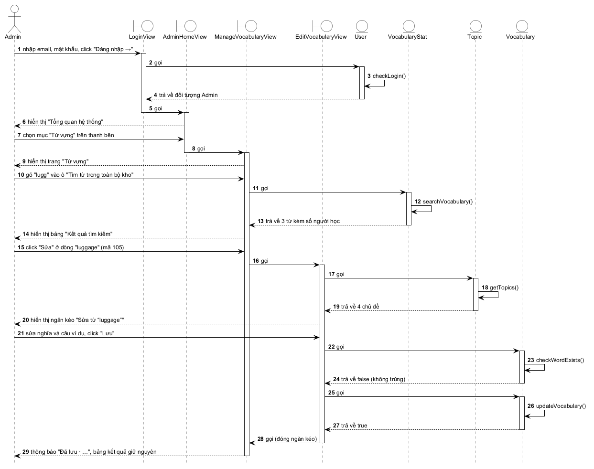
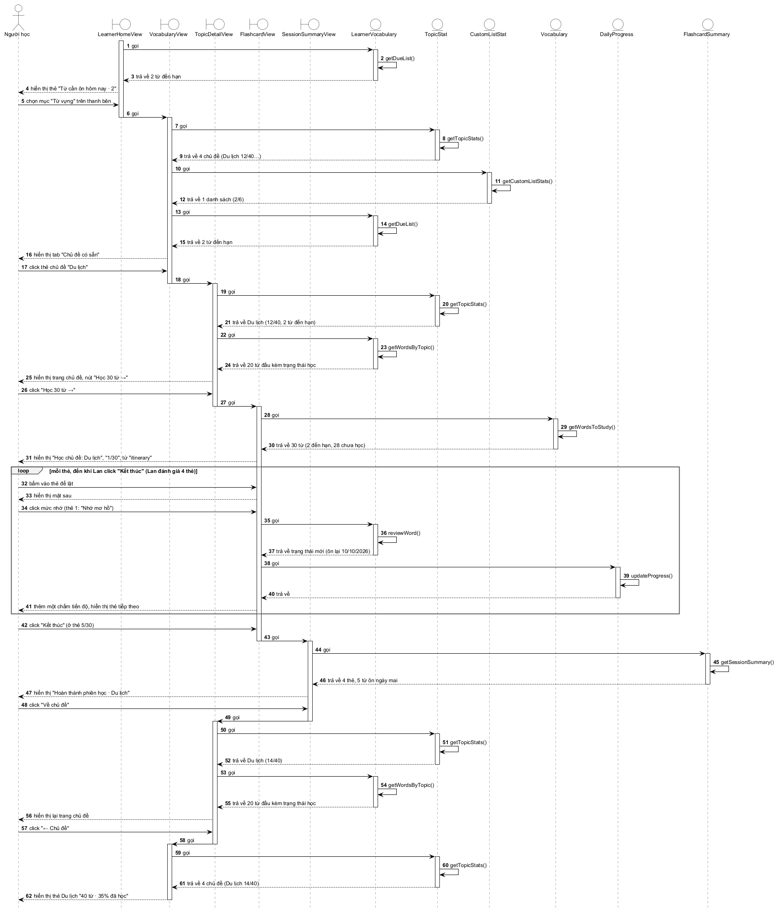
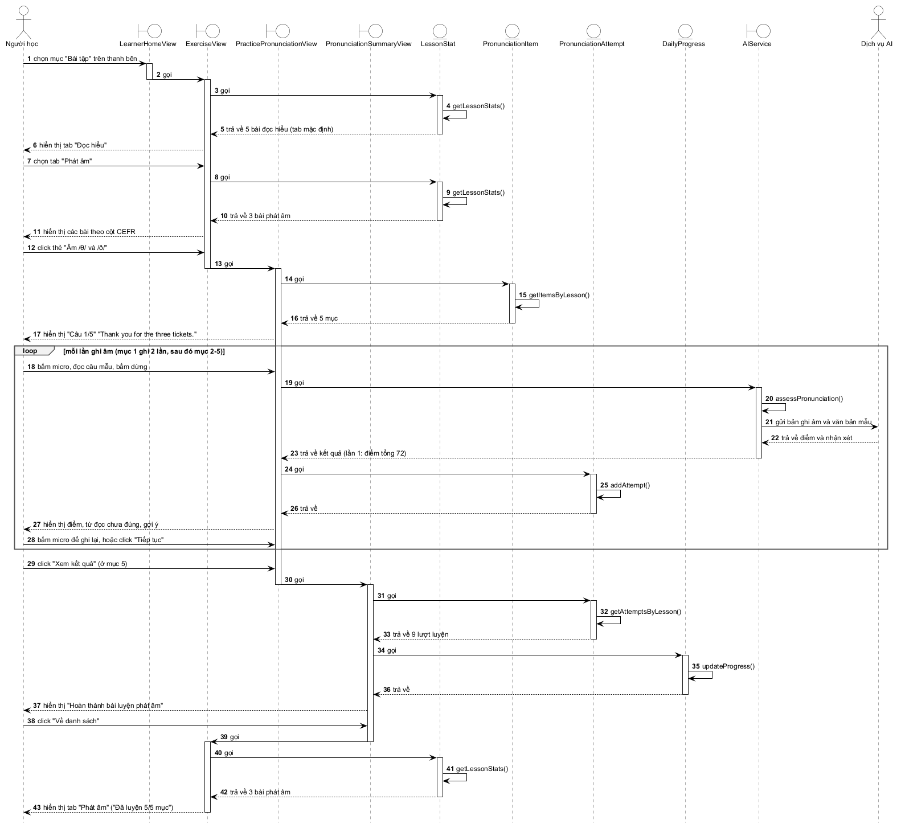
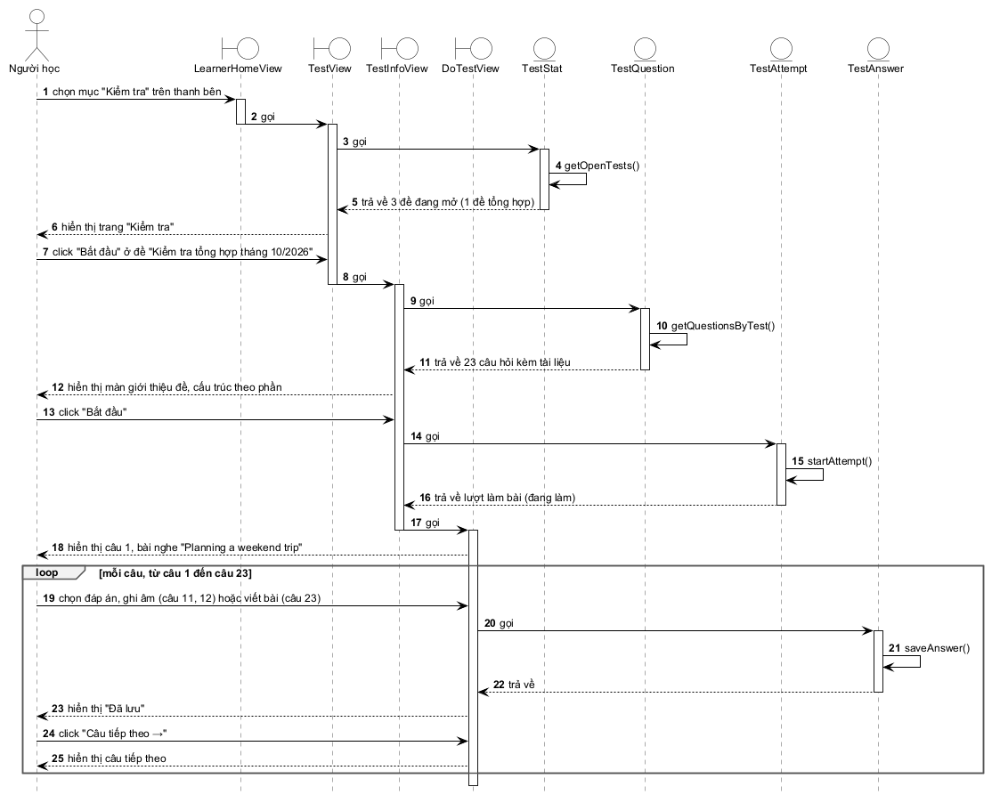
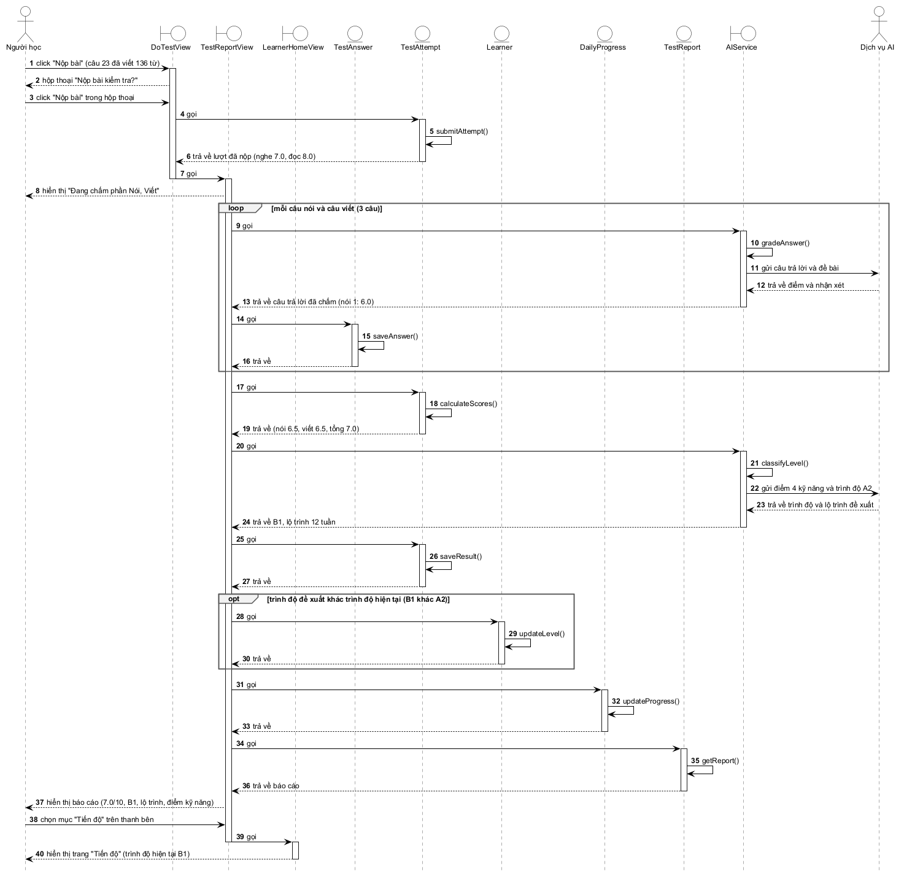
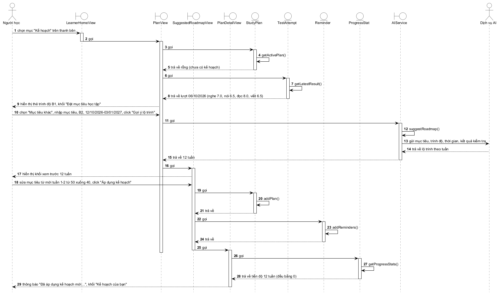

# Biểu đồ tuần tự (phân tích)

Mỗi chức năng tiêu biểu có một **kịch bản phiên bản 2**: kịch bản chuẩn được viết lại theo tương tác giữa actor, các lớp giao diện và các lớp thực thể đã có trong biểu đồ lớp phân tích (`ClassDiagram.md`). Biểu đồ tuần tự được vẽ theo kịch bản này.

Quy ước:

- Lớp giao diện dùng biểu tượng boundary, lớp thực thể dùng biểu tượng entity. Lời gọi phương thức được vẽ thành thông điệp tự gọi trên lớp được gán phương thức đó.
- Dịch vụ AI là actor gián tiếp, đặt ở bên phải. Lớp AIService (biểu tượng boundary) nhận yêu cầu từ lớp giao diện và chuyển yêu cầu sang Dịch vụ AI.
- Dữ liệu lấy từ bộ dữ liệu mẫu dùng chung và kịch bản tương ứng trong `Scenarios.md`: admin Lê Văn Hùng, người học Trần Thị Lan, ngày 06/10/2026.
- Tên nút, tên trang và thông báo ghi đúng chữ trên giao diện của hệ thống đang chạy (cập nhật 01/10/2026, theo `Scenarios.md`). Chọn một mục trên thanh bên được ghi là "chọn mục … trên thanh bên".
- Mẫu case study không dùng khung lặp. Ở đây, những đoạn lặp lại giống nhau nhiều lần (đánh giá từng thẻ, luyện từng mục, trả lời từng câu, chấm từng câu) được gom vào khung `loop`; bước chỉ xảy ra khi thỏa điều kiện được đặt trong khung `opt`.

## a. Sửa thông tin từ vựng

Kịch bản phiên bản 2 (kịch bản 19):

- Admin Hùng nhập email admin01@englishapp.vn, mật khẩu rồi click nút "Đăng nhập →".
- Lớp LoginView gọi lớp User để xử lý.
- Lớp User gọi phương thức checkLogin(). Đăng nhập thành công.
- Lớp User trả kết quả (một đối tượng Admin) về cho lớp LoginView.
- Lớp LoginView gọi lớp AdminHomeView.
- Lớp AdminHomeView hiển thị trang "Tổng quan hệ thống" cho Hùng.
- Hùng chọn mục "Từ vựng" trên thanh bên.
- Lớp AdminHomeView gọi lớp ManageVocabularyView.
- Lớp ManageVocabularyView hiển thị trang "Từ vựng" (4 chủ đề · 150 từ hệ thống) cho Hùng.
- Hùng gõ "lugg" vào ô "Tìm từ trong toàn bộ kho".
- Lớp ManageVocabularyView gọi lớp VocabularyStat để xử lý.
- Lớp VocabularyStat gọi phương thức searchVocabulary().
- Lớp VocabularyStat trả về 3 từ (luggage, hand luggage, luggage rack), mỗi từ kèm số người học, cho lớp ManageVocabularyView.
- Lớp ManageVocabularyView hiển thị bảng "Kết quả tìm kiếm" cho Hùng.
- Hùng click "Sửa" ở dòng từ "luggage" (mã 105).
- Lớp ManageVocabularyView gọi lớp EditVocabularyView.
- Lớp EditVocabularyView gọi lớp Topic để lấy danh sách chủ đề cho ô "Chủ đề *".
- Lớp Topic gọi phương thức getTopics() và trả về 4 chủ đề.
- Lớp EditVocabularyView hiển thị ngăn kéo "Sửa từ “luggage”" với thông tin hiện tại của từ cho Hùng.
- Hùng sửa nghĩa thành "hành lý (va li, túi xách mang theo khi đi xa)", sửa câu ví dụ thành "How many pieces of luggage are you checking in?" rồi click nút "Lưu".
- Lớp EditVocabularyView gọi lớp Vocabulary để kiểm tra từ trùng.
- Lớp Vocabulary gọi phương thức checkWordExists().
- Lớp Vocabulary trả về false (trong chủ đề Du lịch không có từ "luggage" nào khác) cho lớp EditVocabularyView.
- Lớp EditVocabularyView gọi lớp Vocabulary để lưu.
- Lớp Vocabulary gọi phương thức updateVocabulary().
- Lớp Vocabulary trả về cho lớp EditVocabularyView.
- Lớp EditVocabularyView đóng ngăn kéo và gọi lớp ManageVocabularyView.
- Lớp ManageVocabularyView hiển thị thông báo "Đã lưu · Nghĩa và câu ví dụ của “luggage” đã được cập nhật." ở góc màn hình cho Hùng; bảng kết quả tìm kiếm giữ nguyên, dòng "luggage" hiện nghĩa mới.

## b. Học flashcard theo chủ đề

Kịch bản phiên bản 2, bỏ qua bước đăng nhập (kịch bản 5):

- Sau khi Lan đăng nhập, lớp LearnerHomeView gọi lớp LearnerVocabulary để lấy các từ đến hạn ôn.
- Lớp LearnerVocabulary gọi phương thức getDueList().
- Lớp LearnerVocabulary trả về 2 từ (itinerary, passport) cho lớp LearnerHomeView.
- Lớp LearnerHomeView hiển thị trang "Tiến độ" cho Lan, kèm thẻ "Từ cần ôn hôm nay · 2 · Ôn tập ngay →".
- Lan chọn mục "Từ vựng" trên thanh bên.
- Lớp LearnerHomeView gọi lớp VocabularyView.
- Lớp VocabularyView gọi lớp TopicStat.
- Lớp TopicStat gọi phương thức getTopicStats().
- Lớp TopicStat trả về 4 chủ đề kèm số từ đã học/tổng số từ (Du lịch 12/40, Công việc 20/35, Gia đình 30/30, Thức ăn 25/45) cho lớp VocabularyView.
- Lớp VocabularyView gọi lớp CustomListStat.
- Lớp CustomListStat gọi phương thức getCustomListStats().
- Lớp CustomListStat trả về danh sách "Từ khó tuần này" (2/6) cho lớp VocabularyView.
- Lớp VocabularyView gọi lớp LearnerVocabulary; lớp LearnerVocabulary gọi phương thức getDueList() và trả về 2 từ.
- Lớp VocabularyView hiển thị trang "Từ vựng" cho Lan: dòng "Đã học 87 / 150 từ · 4 chủ đề", dải "Bạn có 2 từ cần ôn hôm nay", ba tab (trong đó "Danh sách của tôi (1)"), tab "Chủ đề có sẵn" với 4 thẻ chủ đề.
- Lan click thẻ chủ đề "Du lịch".
- Lớp VocabularyView gọi lớp TopicDetailView.
- Lớp TopicDetailView gọi lớp TopicStat; lớp TopicStat gọi phương thức getTopicStats() và trả về số liệu chủ đề Du lịch (đã học 12/40, 2 từ đến hạn ôn).
- Lớp TopicDetailView gọi lớp LearnerVocabulary.
- Lớp LearnerVocabulary gọi phương thức getWordsByTopic().
- Lớp LearnerVocabulary trả về 20 từ đầu tiên của chủ đề (sắp từ A1 đến C2) kèm trạng thái học của Lan cho lớp TopicDetailView.
- Lớp TopicDetailView hiển thị trang chủ đề "Du lịch" cho Lan, với nút "Học 30 từ →" (2 từ đến hạn ôn và 28 từ chưa học).
- Lan click nút "Học 30 từ →".
- Lớp TopicDetailView gọi lớp FlashcardView.
- Lớp FlashcardView gọi lớp Vocabulary để lập phiên học.
- Lớp Vocabulary gọi phương thức getWordsToStudy().
- Lớp Vocabulary trả về 30 từ (2 từ đến hạn ôn xếp trước, 28 từ chưa học xếp sau) cho lớp FlashcardView.
- Lớp FlashcardView hiển thị giao diện "Học chủ đề: Du lịch" cho Lan: bộ đếm "1/30", mặt trước của từ "itinerary".
- Các bước sau lặp lại cho từng thẻ; Lan đánh giá 4 thẻ:
  - Lan bấm vào thẻ để lật.
  - Lớp FlashcardView hiển thị mặt sau của thẻ cho Lan.
  - Lan click một mức nhớ (thẻ 1: "Nhớ mơ hồ").
  - Lớp FlashcardView gọi lớp LearnerVocabulary để xử lý.
  - Lớp LearnerVocabulary gọi phương thức reviewWord().
  - Lớp LearnerVocabulary trả về trạng thái mới (thẻ 1: đang học, ngày ôn tiếp theo 10/10/2026) cho lớp FlashcardView.
  - Lớp FlashcardView gọi lớp DailyProgress.
  - Lớp DailyProgress gọi phương thức updateProgress().
  - Lớp DailyProgress trả về cho lớp FlashcardView.
  - Lớp FlashcardView thêm một chấm vào thanh tiến độ và hiển thị thẻ tiếp theo cho Lan.
- Ở thẻ "5/30", Lan click nút "Kết thúc".
- Lớp FlashcardView gọi lớp SessionSummaryView.
- Lớp SessionSummaryView gọi lớp FlashcardSummary.
- Lớp FlashcardSummary gọi phương thức getSessionSummary().
- Lớp FlashcardSummary trả về kết quả (4 thẻ đã học; Chưa nhớ 1, Nhớ mơ hồ 1, Nhớ rõ 2; 5 từ cần ôn ngày 07/10/2026) cho lớp SessionSummaryView.
- Lớp SessionSummaryView hiển thị thẻ "Hoàn thành phiên học · Du lịch" cho Lan.
- Lan click nút "Về chủ đề".
- Lớp SessionSummaryView gọi lớp TopicDetailView.
- Lớp TopicDetailView gọi lớp TopicStat (getTopicStats()) và lớp LearnerVocabulary (getWordsByTopic()) để lấy lại số liệu; Du lịch đã học 14/40.
- Lớp TopicDetailView hiển thị lại trang chủ đề cho Lan; các từ vừa học có dấu đã học.
- Lan click liên kết "← Chủ đề".
- Lớp TopicDetailView gọi lớp VocabularyView.
- Lớp VocabularyView gọi lớp TopicStat; lớp TopicStat gọi phương thức getTopicStats() và trả về 4 chủ đề (Du lịch 14/40).
- Lớp VocabularyView hiển thị tab "Chủ đề có sẵn" cho Lan; thẻ Du lịch ghi "40 từ · 35% đã học".

## c. Luyện phát âm

Kịch bản phiên bản 2, bỏ qua bước đăng nhập (kịch bản 12):

- Lan chọn mục "Bài tập" trên thanh bên của giao diện LearnerHomeView.
- Lớp LearnerHomeView gọi lớp ExerciseView.
- Lớp ExerciseView gọi lớp LessonStat để lấy các bài của tab đầu tiên "Đọc hiểu".
- Lớp LessonStat gọi phương thức getLessonStats() và trả về 5 bài đọc hiểu cho lớp ExerciseView.
- Lớp ExerciseView hiển thị trang "Bài tập" ở tab "Đọc hiểu" cho Lan.
- Lan chọn tab "Phát âm".
- Lớp ExerciseView gọi lớp LessonStat.
- Lớp LessonStat gọi phương thức getLessonStats().
- Lớp LessonStat trả về 3 bài luyện phát âm cho lớp ExerciseView.
- Lớp ExerciseView hiển thị các bài xếp theo cột CEFR cho Lan; thẻ "Âm /θ/ và /ð/" ghi "Đã luyện 0/5 mục".
- Lan click thẻ "Âm /θ/ và /ð/".
- Lớp ExerciseView gọi lớp PracticePronunciationView.
- Lớp PracticePronunciationView gọi lớp PronunciationItem.
- Lớp PronunciationItem gọi phương thức getItemsByLesson().
- Lớp PronunciationItem trả về 5 mục luyện cho lớp PracticePronunciationView.
- Lớp PracticePronunciationView hiển thị mục 1 ("Câu 1/5") "Thank you for the three tickets." cho Lan.
- Các bước sau lặp lại cho mỗi lần ghi âm; mục 1 ghi âm 2 lần, sau đó lần lượt mục 2–5:
  - Lan bấm nút micro, đọc câu mẫu rồi bấm nút dừng.
  - Lớp PracticePronunciationView gọi lớp AIService.
  - Lớp AIService gọi phương thức assessPronunciation().
  - Lớp AIService gửi bản ghi âm và văn bản mẫu đến Dịch vụ AI.
  - Dịch vụ AI trả về điểm và nhận xét cho lớp AIService.
  - Lớp AIService trả kết quả (lần 1: điểm tổng 72, độ chính xác 68, độ trôi chảy 80) về cho lớp PracticePronunciationView.
  - Lớp PracticePronunciationView gọi lớp PronunciationAttempt.
  - Lớp PronunciationAttempt gọi phương thức addAttempt().
  - Lớp PronunciationAttempt trả về cho lớp PracticePronunciationView.
  - Lớp PracticePronunciationView hiển thị vòng điểm 72/100, dòng "Chính xác 68 · Trôi chảy 80", các từ phát âm chưa đúng ("the", "three") và gợi ý cải thiện cho Lan.
  - Lan bấm nút micro để ghi âm lại, hoặc click "Tiếp tục" sang mục tiếp theo.
- Ở mục 5, Lan click nút "Xem kết quả".
- Lớp PracticePronunciationView gọi lớp PronunciationSummaryView.
- Lớp PronunciationSummaryView gọi lớp PronunciationAttempt.
- Lớp PronunciationAttempt gọi phương thức getAttemptsByLesson().
- Lớp PronunciationAttempt trả về 9 lượt luyện của bài cho lớp PronunciationSummaryView.
- Lớp PronunciationSummaryView gọi lớp DailyProgress.
- Lớp DailyProgress gọi phương thức updateProgress().
- Lớp DailyProgress trả về cho lớp PronunciationSummaryView.
- Lớp PronunciationSummaryView hiển thị thẻ "Hoàn thành bài luyện phát âm" cho Lan: dòng "Đã luyện 5/5 mục · điểm trung bình 84" và danh sách "Điểm tốt nhất từng mục" (văn bản mẫu, số lần thử, điểm cao nhất).
- Lan click nút "Về danh sách".
- Lớp PronunciationSummaryView gọi lớp ExerciseView.
- Lớp ExerciseView gọi lớp LessonStat; lớp LessonStat gọi phương thức getLessonStats() và trả về 3 bài luyện phát âm.
- Lớp ExerciseView hiển thị tab "Phát âm" cho Lan; thẻ "Âm /θ/ và /ð/" ghi "Đã luyện 5/5 mục".

## d. Làm kiểm tra tổng hợp

Chức năng này dài nên kịch bản và biểu đồ được chia làm hai phần, giống biểu đồ lớp: chọn đề và làm bài (d1); nộp bài, chấm và xem báo cáo (d2).

Kịch bản phiên bản 2, phần d1, bỏ qua bước đăng nhập (kịch bản 15, bước 1–10):

- Lan chọn mục "Kiểm tra" trên thanh bên của giao diện LearnerHomeView.
- Lớp LearnerHomeView gọi lớp TestView.
- Lớp TestView gọi lớp TestStat.
- Lớp TestStat gọi phương thức getOpenTests().
- Lớp TestStat trả về 3 đề đang mở cho lớp TestView: 2 đề định kỳ, và 1 đề tổng hợp "Kiểm tra tổng hợp tháng 10/2026" (23 câu, đóng ngày 31/10/2026, Lan chưa làm lần nào).
- Lớp TestView hiển thị trang "Kiểm tra" cho Lan; khối "Kiểm tra tổng hợp" có thẻ "23 câu · Còn 25 ngày · Chưa làm lần nào".
- Lan click nút "Bắt đầu" ở thẻ "Kiểm tra tổng hợp tháng 10/2026".
- Lớp TestView gọi lớp TestInfoView.
- Lớp TestInfoView gọi lớp TestQuestion.
- Lớp TestQuestion gọi phương thức getQuestionsByTest().
- Lớp TestQuestion trả về 23 câu hỏi, kèm bài nghe và đoạn văn của đề, cho lớp TestInfoView.
- Lớp TestInfoView hiển thị màn giới thiệu đề cho Lan: dòng "23 câu … · Kỹ năng: Nghe, Nói, Đọc, Viết", cấu trúc đề theo phần (nghe 10, nói 2, đọc 10, viết 1) và các lưu ý.
- Lan click nút "Bắt đầu".
- Lớp TestInfoView gọi lớp TestAttempt.
- Lớp TestAttempt gọi phương thức startAttempt().
- Lớp TestAttempt trả về lượt làm bài mới ở trạng thái đang làm cho lớp TestInfoView.
- Lớp TestInfoView gọi lớp DoTestView.
- Lớp DoTestView hiển thị câu 1 của phần Nghe cho Lan, với bài nghe chung "Planning a weekend trip" và dãy số câu chia theo phần.
- Các bước sau lặp lại cho từng câu, từ câu 1 đến câu 23:
  - Lan trả lời câu đang hiện: chọn đáp án (phần Nghe, Đọc), ghi âm (câu 11: 45 giây, câu 12: 58 giây) hoặc viết bài (câu 23: 136 từ).
  - Lớp DoTestView gọi lớp TestAnswer.
  - Lớp TestAnswer gọi phương thức saveAnswer().
  - Lớp TestAnswer trả về cho lớp DoTestView.
  - Lớp DoTestView hiển thị "Đã lưu" và tô màu số câu đó cho Lan.
  - Lan click "Câu tiếp theo →". Lớp DoTestView hiển thị câu tiếp theo, kèm đoạn văn chung "Eco-tourism in Vietnam" khi sang phần Đọc.

Kịch bản phiên bản 2, phần d2 (kịch bản 15, bước 11–19):

- Lan đã viết xong bài 136 từ ở câu 23 và click nút "Nộp bài".
- Lớp DoTestView hiển thị hộp thoại "Nộp bài kiểm tra?" với dòng "Bạn đã trả lời tất cả các câu. Sau khi nộp, bạn không sửa được câu trả lời nữa." cho Lan.
- Lan click nút "Nộp bài" trong hộp thoại.
- Lớp DoTestView gọi lớp TestAttempt.
- Lớp TestAttempt gọi phương thức submitAttempt().
- Lớp TestAttempt trả về lượt làm bài đã nộp, có điểm nghe 7.0 và điểm đọc 8.0, cho lớp DoTestView.
- Lớp DoTestView gọi lớp TestReportView.
- Lớp TestReportView hiển thị trang "Kết quả kiểm tra" với tiêu đề "Đang chấm phần Nói, Viết" cho Lan.
- Các bước sau lặp lại cho mỗi câu nói và câu viết (3 câu):
  - Lớp TestReportView gọi lớp AIService.
  - Lớp AIService gọi phương thức gradeAnswer().
  - Lớp AIService gửi câu trả lời và đề bài đến Dịch vụ AI.
  - Dịch vụ AI trả về điểm và nhận xét cho lớp AIService.
  - Lớp AIService trả về câu trả lời đã chấm (đề nói 1: 6.0; đề nói 2: 7.0; bài viết: 6.5) cho lớp TestReportView.
  - Lớp TestReportView gọi lớp TestAnswer; lớp TestAnswer gọi phương thức saveAnswer() và trả về.
- Lớp TestReportView gọi lớp TestAttempt.
- Lớp TestAttempt gọi phương thức calculateScores().
- Lớp TestAttempt trả về điểm nói 6.5, điểm viết 6.5 và tổng điểm 7.0 cho lớp TestReportView.
- Lớp TestReportView gọi lớp AIService.
- Lớp AIService gọi phương thức classifyLevel().
- Lớp AIService gửi điểm bốn kỹ năng và trình độ hiện tại A2 đến Dịch vụ AI.
- Dịch vụ AI trả về trình độ và lộ trình đề xuất cho lớp AIService.
- Lớp AIService trả về trình độ đề xuất B1 và lộ trình 12 tuần cho lớp TestReportView.
- Lớp TestReportView gọi lớp TestAttempt.
- Lớp TestAttempt gọi phương thức saveResult() và trả về cho lớp TestReportView.
- Vì trình độ đề xuất B1 khác trình độ hiện tại A2:
  - Lớp TestReportView gọi lớp Learner.
  - Lớp Learner gọi phương thức updateLevel().
  - Lớp Learner trả về cho lớp TestReportView.
- Lớp TestReportView gọi lớp DailyProgress.
- Lớp DailyProgress gọi phương thức updateProgress() và trả về cho lớp TestReportView.
- Lớp TestReportView gọi lớp TestReport.
- Lớp TestReport gọi phương thức getReport().
- Lớp TestReport trả về báo cáo cho lớp TestReportView.
- Lớp TestReportView hiển thị báo cáo cho Lan: tổng điểm 7.0/10, trình độ đề xuất B1, khối "Lộ trình đề xuất", bảng điểm theo kỹ năng và khối "Xem lại bài làm".
- Lan chọn mục "Tiến độ" trên thanh bên.
- Lớp TestReportView gọi lớp LearnerHomeView.
- Lớp LearnerHomeView hiển thị trang "Tiến độ" cho Lan; khối "Trình độ hiện tại" ở thanh bên ghi B1.

## e. Lập kế hoạch học cá nhân

Kịch bản phiên bản 2, bỏ qua bước đăng nhập (kịch bản 17):

- Lan chọn mục "Kế hoạch" trên thanh bên của giao diện LearnerHomeView.
- Lớp LearnerHomeView gọi lớp PlanView.
- Lớp PlanView gọi lớp StudyPlan.
- Lớp StudyPlan gọi phương thức getActivePlan().
- Lớp StudyPlan trả về rỗng (Lan chưa có kế hoạch đang thực hiện) cho lớp PlanView.
- Lớp PlanView gọi lớp TestAttempt.
- Lớp TestAttempt gọi phương thức getLatestResult().
- Lớp TestAttempt trả về lượt kiểm tra tổng hợp ngày 06/10/2026 (nghe 7.0, nói 6.5, đọc 8.0, viết 6.5) cho lớp PlanView.
- Lớp PlanView hiển thị trang "Kế hoạch học cá nhân" cho Lan: thẻ trình độ B1 kèm radar bốn kỹ năng, khối "Đặt mục tiêu học tập".
- Lan chọn "Mục tiêu khác", nhập mô tả "Đạt B2 để phỏng vấn học bổng vào tháng 1/2027", chọn trình độ mục tiêu B2, ngày bắt đầu 12/10/2026, ngày kết thúc 03/01/2027 rồi click nút "Gợi ý lộ trình".
- Lớp PlanView gọi lớp AIService.
- Lớp AIService gọi phương thức suggestRoadmap().
- Lớp AIService gửi mục tiêu, trình độ, thời gian và kết quả kiểm tra đến Dịch vụ AI.
- Dịch vụ AI trả về lộ trình theo tuần cho lớp AIService.
- Lớp AIService trả về lộ trình 12 tuần cho lớp PlanView.
- Lớp PlanView gọi lớp SuggestedRoadmapView.
- Lớp SuggestedRoadmapView hiển thị khối xem trước "12/10/2026 – 03/01/2027 · 12 tuần" cho Lan.
- Lan sửa mục tiêu số từ mới của tuần 1 và tuần 2 từ 50 xuống 40 rồi click nút "Áp dụng kế hoạch".
- Lớp SuggestedRoadmapView gọi lớp StudyPlan.
- Lớp StudyPlan gọi phương thức addPlan().
- Lớp StudyPlan trả về cho lớp SuggestedRoadmapView.
- Lớp SuggestedRoadmapView gọi lớp Reminder.
- Lớp Reminder gọi phương thức addReminders() (12 nhắc nhở, 8:00 thứ Hai đầu mỗi tuần).
- Lớp Reminder trả về cho lớp SuggestedRoadmapView.
- Lớp SuggestedRoadmapView gọi lớp PlanDetailView.
- Lớp PlanDetailView gọi lớp ProgressStat.
- Lớp ProgressStat gọi phương thức getProgressStats().
- Lớp ProgressStat trả về tiến độ 12 tuần (đều bằng 0) cho lớp PlanDetailView.
- Lớp PlanDetailView hiển thị cho Lan thông báo xanh "Đã áp dụng kế hoạch mới. Chúc bạn học tốt!" và khối "Kế hoạch của bạn" (B1 → B2, 12/10/2026 – 03/01/2027, "Đang thực hiện", tuần hiện tại chưa bắt đầu).

