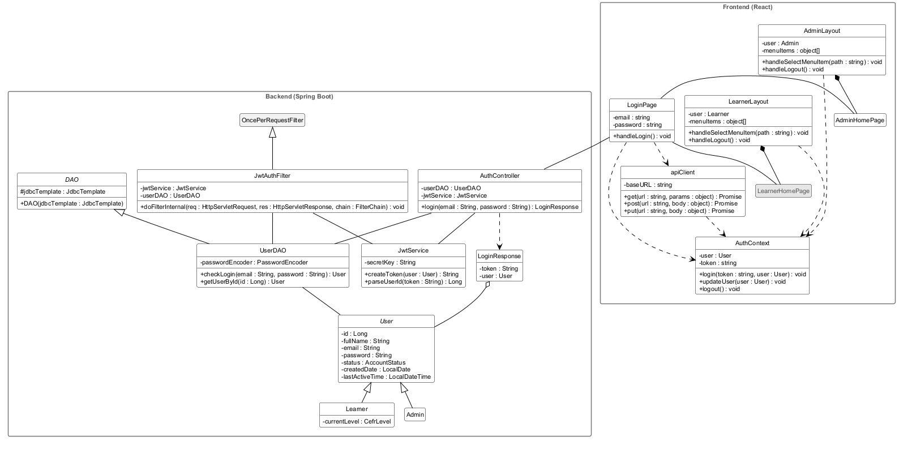
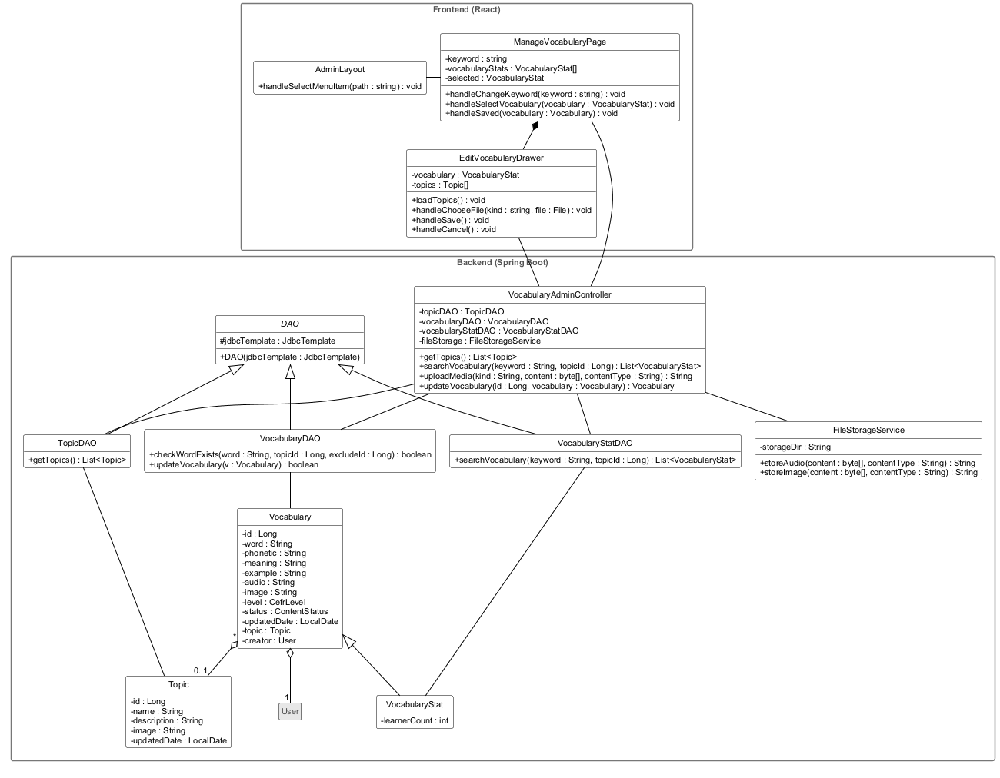
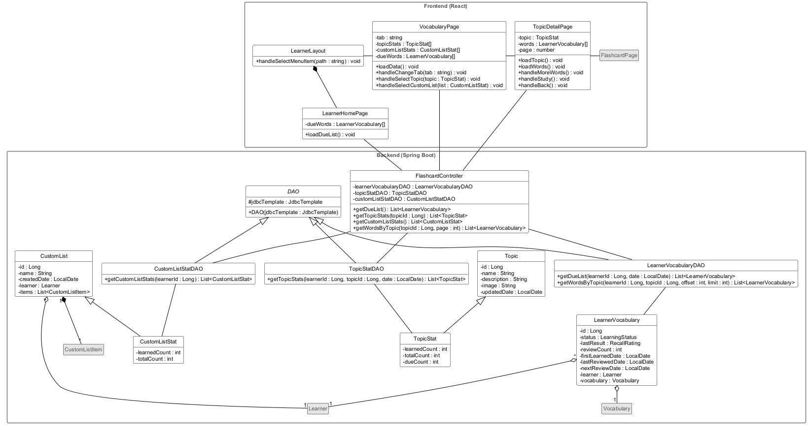
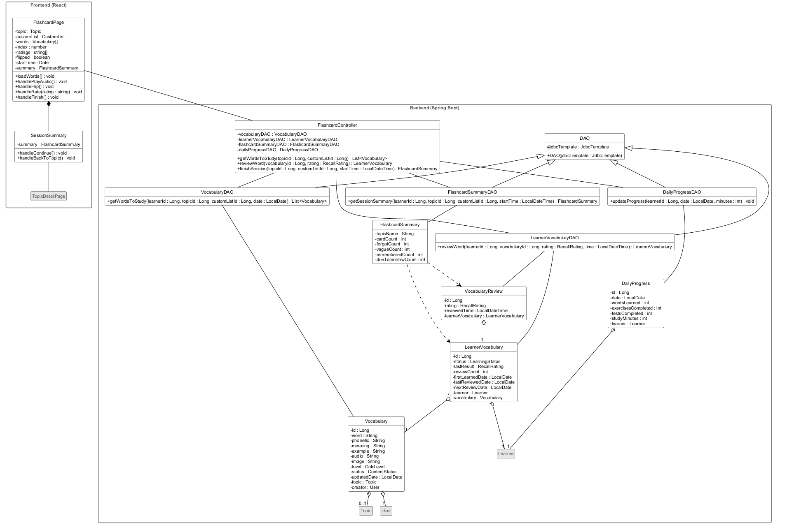
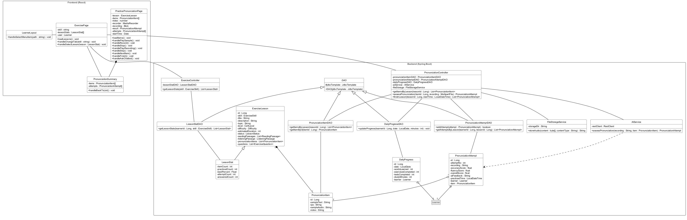
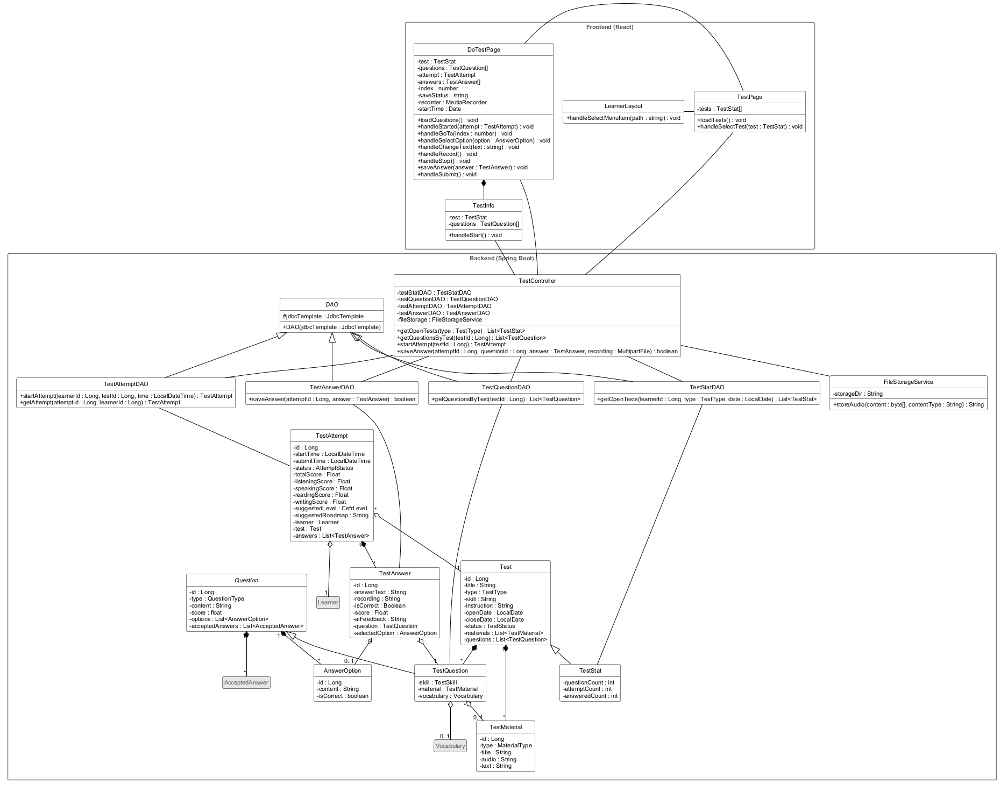
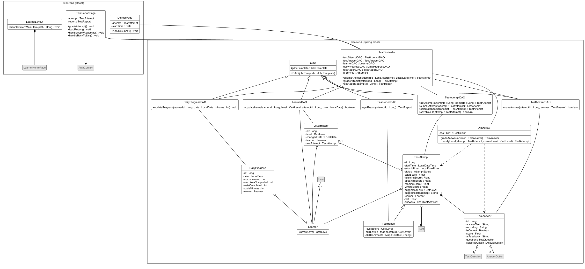
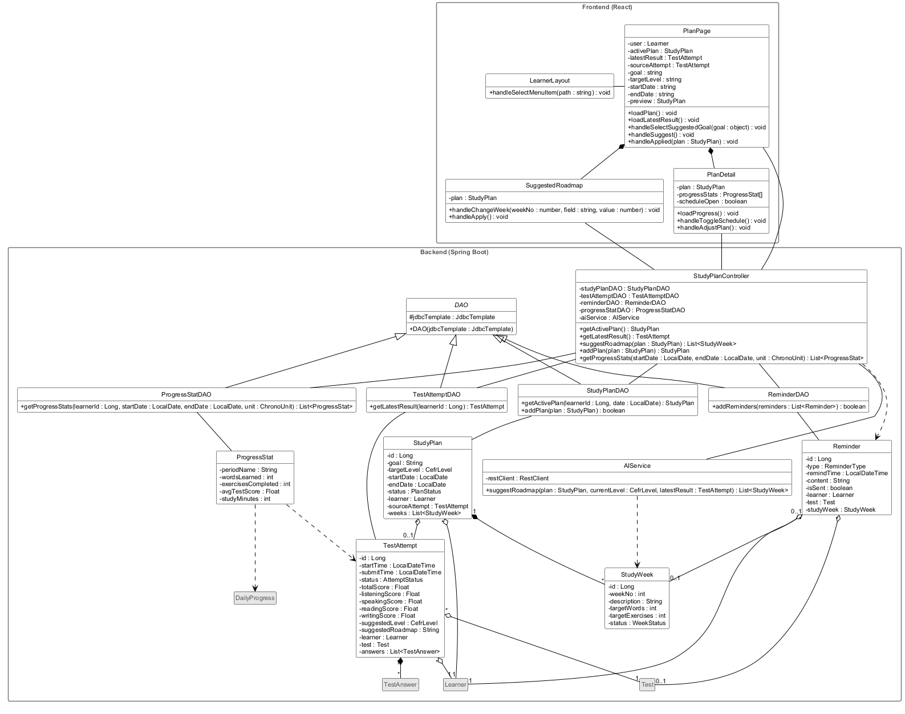

# Biểu đồ lớp (thiết kế)

Đầu vào của bước này gồm:

- biểu đồ lớp phân tích (`Analysis/ClassDiagram.md`): các lớp giao diện, phần tử giao diện và 35 phương thức của 5 chức năng tiêu biểu;
- lớp thực thể thiết kế (`Design/EntityClasses.md`);
- CSDL (`Design/Database.md`).

Giống mẫu case study, mỗi chức năng được thiết kế theo mô hình MVC. Điểm khác là hệ thống chạy trên hai phía: frontend React (JavaScript) chạy trong trình duyệt và backend Spring Boot (Java). Phần đầu tài liệu nêu cách chuyển mô hình của mẫu sang kiến trúc này; phần **Áp dụng** thiết kế từng chức năng.

Bản này được cập nhật ngày 01/10/2026, sau khi kịch bản và biểu đồ lớp phân tích được sửa theo giao diện của hệ thống đang chạy. Các thay đổi so với bản trước được ghi ở mục **Cập nhật theo giao diện đang chạy** cuối tài liệu.

## Kiến trúc và quy ước

### Chuyển mô hình MVC của mẫu sang React + Spring Boot

| Thành phần | Mẫu (Java Swing) | Hệ thống này |
|---|---|---|
| Lớp giao diện | `XxxFrm` kế thừa `JFrame` | component React: trang `XxxPage`, hoặc component con nằm trong một trang (ngăn kéo, thẻ tổng kết, khối nội dung) |
| Phần tử giao diện | thuộc tính kiểu `JTextField`, `JButton`, `JTable` | state của component (`useState`): ô nhập gắn với một state, bảng hiển thị một state dạng mảng; nút gắn với một hàm xử lý |
| Xử lý sự kiện | một hàm `actionPerformed(e)` cho mọi nút | mỗi nút một hàm `handleXxx()` |
| Nạp dữ liệu khi mở giao diện | trong hàm khởi tạo (ví dụ `RoomDetailFrm`) | hàm `loadXxx()`, gọi trong `useEffect` khi trang mở |
| Truyền dữ liệu sang giao diện khác | tham số của hàm khởi tạo, ví dụ `EditRoomFrm(u, r)` | sang trang khác: state của React Router; sang component con: props; người dùng đang đăng nhập được giữ trong `AuthContext` |
| Gọi xử lý | Frm gọi thẳng phương thức của DAO | trang gửi yêu cầu HTTP (JSON) qua `apiClient` tới controller; controller gọi DAO |
| Lớp điều khiển | các lớp DAO | controller (`@RestController`), DAO (`@Repository`), `AIService` (`@Service`) |
| Kết nối CSDL | `DAO.con : Connection` | `DAO.jdbcTemplate : JdbcTemplate` (Spring JDBC); thông tin kết nối PostgreSQL nằm trong `application.properties` |
| Lớp thực thể | lớp Java | lớp Java ở `EntityClasses.md`; frontend nhận dữ liệu của chúng dạng JSON |

### Quy tắc chuyển từ biểu đồ lớp phân tích

1. Lớp giao diện `XxxView` thành một component React, như mẫu đổi `EditRoomView` thành `EditRoomFrm`:
   - lớp ứng với một trang có đường dẫn riêng thành `XxxPage`, ví dụ VocabularyView thành VocabularyPage;
   - lớp ứng với một phần hiện ra trong trang thành component con, đặt tên theo vai trò và không có hậu tố Page, ví dụ EditVocabularyView (ngăn kéo sửa từ) thành EditVocabularyDrawer, SessionSummaryView (thẻ tổng kết) thành SessionSummary. Trang truyền dữ liệu và hàm xử lý cho component con qua props.
2. Phần tử giao diện chuyển theo tiền tố:
   - `inAbc`, `inoutAbc` → state `abc` gắn với ô nhập;
   - `outAbc` → dữ liệu được hiển thị;
   - `outsubListAbc` → state mảng `abcs` kèm hàm `handleSelectAbc(abc)`;
   - `subAbc` → hàm `handleAbc()`.

   Nhiều phần tử `out`/`inout` là các trường của cùng một đối tượng thì được giữ trong một state đối tượng. Ví dụ, 8 phần tử `inout` của ngăn kéo sửa từ là các trường của state `vocabulary`.
3. Phương thức `X.m()` của lớp thực thể (hoặc lớp thống kê) X ở bước phân tích thành phương thức `XDAO.m()`, giống mẫu chuyển `Room.searchRoom()` thành `RoomDAO.searchRoom()`. Mọi DAO kế thừa lớp `DAO`. Đầu vào "người học" thành `learnerId : Long`; đầu vào là đối tượng cần lưu thì giữ nguyên là đối tượng. Các phương thức của `AIService` vẫn thuộc `AIService`, nay là lớp service ở backend gọi Dịch vụ AI qua HTTP. Nhờ vậy khóa API của Dịch vụ AI chỉ nằm ở server, không lộ ra trình duyệt.
4. **Mỗi chức năng có một controller**, theo mẫu "use-case controller" của GRASP. Mỗi phương thức của controller xử lý một yêu cầu HTTP và làm phần việc mà `actionPerformed()` của mẫu làm sau khi người dùng click: gọi lần lượt các phương thức DAO và `AIService`, rồi quyết định phản hồi. Nhiều phương thức mà lớp giao diện phân tích gọi liên tiếp được gộp vào một yêu cầu khi chúng phải chạy cùng nhau ở server (xem mục **Thay đổi so với bước phân tích**). Riêng danh sách bài tập dùng chung cho bốn kỹ năng nên có controller riêng (ExerciseController).
5. Trang có gọi backend thì nối với controller; controller nối với các DAO và `AIService` nó dùng; DAO nối với lớp thực thể nó đóng gói.
6. **Thanh bên** có mặt trên mọi trang, nên được thiết kế một lần trong hai component khung `LearnerLayout` và `AdminLayout` (Hình 1). Bước phân tích ghi các mục thanh bên là phần tử của giao diện chính; ở đây chúng thuộc component khung, và chọn một mục là chuyển sang trang của mục đó.

### Lớp giao diện và code có sẵn

Tên lớp thiết kế giữ theo tên lớp phân tích để dễ truy vết. Hệ thống đang chạy đã có file cho hầu hết các lớp này (cột cuối); ở bước Coding, nhóm sửa tiếp các file đó cho khớp thiết kế, không viết lại. Đường dẫn tính từ `frontend/src/`.

| Lớp phân tích | Lớp thiết kế | Loại | File đang có |
|---|---|---|---|
| LoginView | LoginPage | trang | `features/auth/pages/LoginPage.jsx` |
| (thanh bên của người học) | LearnerLayout | khung | `components/layout/AppLayout.jsx`, `Sidebar.jsx` |
| (thanh bên của admin) | AdminLayout | khung | `features/admin/components/AdminLayout.jsx` |
| AdminHomeView | AdminHomePage | trang | `features/admin/pages/AdminOverviewPage.jsx` |
| ManageVocabularyView | ManageVocabularyPage | trang | `features/admin/pages/AdminTopicsPage.jsx` |
| EditVocabularyView | EditVocabularyDrawer | component con | `features/admin/components/vocabulary/WordDrawer.jsx` |
| LearnerHomeView | LearnerHomePage | trang | `pages/HomePage.jsx` |
| VocabularyView | VocabularyPage | trang | `features/vocabulary/pages/VocabularyPage.jsx`, `TopicsTab.jsx`, `ListsTab.jsx` |
| TopicDetailView | TopicDetailPage | trang | `features/vocabulary/pages/TopicDetailPage.jsx` |
| FlashcardView | FlashcardPage | trang | `features/vocabulary/pages/StudySessionPage.jsx`, `components/study/FlashcardSession.jsx` |
| SessionSummaryView | SessionSummary | component con | `features/vocabulary/components/study/SessionComplete.jsx` |
| ExerciseView | ExercisePage | trang | `features/exercises/pages/ExercisesPage.jsx` |
| PracticePronunciationView | PracticePronunciationPage | trang | `features/exercises/pages/LessonPage.jsx`, `pronunciation/PronunciationExercise.jsx` |
| PronunciationSummaryView | PronunciationSummary | component con | phần kết quả trong `pronunciation/PronunciationExercise.jsx` |
| TestView | TestPage | trang | `features/tests/pages/TestsPage.jsx` |
| TestInfoView | TestInfo | component con | `StartCard` trong `features/tests/pages/TestTakingPage.jsx` |
| DoTestView | DoTestPage | trang | `features/tests/pages/TestTakingPage.jsx` |
| TestReportView | TestReportPage | trang | `features/tests/pages/TestResultPage.jsx` |
| PlanView | PlanPage | trang | `features/plan/pages/PlanPage.jsx`, `components/GoalForm.jsx`, `LevelCard.jsx` |
| SuggestedRoadmapView | SuggestedRoadmap | component con | `features/plan/components/PlanPreview.jsx` |
| PlanDetailView | PlanDetail | component con | `features/plan/components/PlanOverview.jsx`, `WeekList.jsx` |

`AuthContext` và `apiClient` ứng với `features/auth/context/AuthProvider.jsx` và `api/httpClient.js`. Phần backend (controller, DAO) là thiết kế đề xuất, khác code đang chạy (xem mục **Các lựa chọn thiết kế**).

### Các lựa chọn thiết kế (đề xuất – cần nhóm chốt)

- **DAO dùng Spring JDBC (`JdbcTemplate`) thay vì Spring Data JPA**, vì ba lý do:
  - giữ đúng vai trò DAO của mẫu, nên bước Coding và JUnit bám được mẫu (DAO viết SQL, JUnit kiểm thử từng phương thức DAO);
  - 17 thuộc tính dẫn xuất không có cột (bước 5 của `Database.md`) và 10 lớp thống kê, trong đó 6 lớp kế thừa lớp thực thể. DAO tự đóng gói các giá trị này bằng truy vấn, như `RoomStatDAO` của mẫu. Nếu dùng JPA, phải xử lý bằng `@Transient`, `@Formula` hoặc projection;
  - truy vấn được viết rõ ràng, tránh lỗi N+1 của cơ chế nạp lười (lazy loading) khi đối tượng có nhiều danh sách thành phần như `Test` hay `Question`.

  Đổi lại, nhóm phải viết SQL cho mọi thao tác. Nếu code đang chạy trên nhánh `dev` đã dùng JPA, mỗi DAO ở đây có thể thành một repository kèm một service có cùng tên phương thức; biểu đồ giữ nguyên các phương thức.
- **Không thêm tầng service giữa controller và DAO.** Mỗi phương thức DAO là một giao dịch trọn vẹn; phương thức ghi nhiều bảng được đánh dấu `@Transactional`, ví dụ `reviewWord()` ghi lượt ôn và trạng thái học, `addPlan()` ghi kế hoạch và các tuần. Controller điều phối các bước.
  - Chỉ một yêu cầu cần nhiều thao tác ghi cùng thành công hoặc cùng thất bại: lưu kế hoạch kèm nhắc nhở. Phương thức `addPlan()` của controller được đánh dấu `@Transactional`.
  - Chấm bài kiểm tra **cố ý không** gói trong một giao dịch. Mỗi lần gọi Dịch vụ AI mất vài giây và có thể lỗi; mỗi bước được lưu riêng để khi AI lỗi, lượt làm bài vẫn ở trạng thái đã nộp và giữ các câu đã chấm (kịch bản 15, nhánh 14a).
  - Nếu ở bước Coding controller trở nên quá dài, có thể chuyển phần điều phối sang một lớp service mà không phải đổi DAO.
- **Xác thực bằng JWT.**
  - `AuthController.login()` trả về token và thông tin người dùng. `apiClient` gắn token vào header `Authorization` của mọi yêu cầu.
  - Với mỗi yêu cầu, `JwtAuthFilter` đọc id trong token và nạp người dùng bằng `UserDAO.getUserById()`, rồi đặt người dùng vào ngữ cảnh bảo mật của Spring Security. Tài khoản vừa bị khóa bị chặn ngay ở yêu cầu tiếp theo.
  - Controller lấy người học đang đăng nhập qua `@AuthenticationPrincipal`. **Controller không bao giờ nhận `learnerId` từ trình duyệt**, để người học không đọc hoặc sửa được dữ liệu của người khác. Tham số người học này có ở mọi phương thức controller của người học nhưng không được vẽ trên biểu đồ.
  - Các URL `/api/admin/**` chỉ tài khoản admin gọi được.
  - Mật khẩu được lưu dạng băm BCrypt. `checkLogin()` so sánh bằng `PasswordEncoder.matches()`, thay vì so sánh mật khẩu thô trong SQL như mẫu.
- **Ngày giờ hiện tại** được controller lấy từ bean `Clock` (`LocalDate.now(clock)`) và truyền vào DAO qua tham số. DAO không dùng `CURRENT_DATE` hay `now()` của PostgreSQL. Nhờ vậy JUnit và blackbox test cố định được ngày 06/10/2026 của bộ dữ liệu mẫu.
- **Dữ liệu nhạy cảm trong JSON:**
  - `User.password` không bao giờ được trả về (`@JsonProperty(access = WRITE_ONLY)`);
  - khi người học đang làm bài, `getQuestionsByTest()` không trả `AnswerOption.isCorrect` và `acceptedAnswers` (dùng `@JsonView`); chỉ báo cáo sau khi chấm xong mới có đáp án đúng;
  - JSON của người dùng có thêm trường `role` (LEARNER/ADMIN) cho biết lớp con (`@JsonTypeInfo` của Jackson). Trang đăng nhập dựa vào trường này để mở đúng giao diện chính.
- **Thời gian học** (`updateProgress()`):
  - trang ghi lại thời điểm bắt đầu (`startTime`) và gửi kèm khi kết thúc hoạt động: kết thúc phiên flashcard, luyện xong bài phát âm, nộp bài kiểm tra;
  - controller tính số phút học (làm tròn lên từ `startTime` đến thời điểm hiện tại) và từ chối `startTime` ở tương lai;
  - nếu người học đóng trình duyệt giữa chừng (kịch bản 5 nhánh 13a, 12 nhánh 12a, 15 nhánh 5a), thời gian của lần đó không được cộng; các lượt ôn, lượt luyện, câu trả lời vẫn được lưu.
- **Kiểu dữ liệu ở frontend.** JavaScript không khai báo kiểu; kiểu ghi trên biểu đồ chỉ để tài liệu hóa (khi code nên ghi bằng JSDoc). Các kiểu được dùng:
  - kiểu của JavaScript và trình duyệt: `string`, `number`, `boolean`, `Date`, `File`, `Blob`, `MediaRecorder`;
  - kiểu mang tên lớp thực thể, ví dụ `Vocabulary[]`, là mảng các object JSON có cùng cấu trúc với lớp đó;
  - giá trị enum được truyền dạng chuỗi, ví dụ `'VAGUE'`.

### Ký hiệu trên biểu đồ

- Hai gói **Frontend (React)** và **Backend (Spring Boot)** tách hai phía của hệ thống. Đường nối giữa trang và controller là một yêu cầu HTTP đi qua `apiClient`.
- Trang chứa component con được vẽ bằng quan hệ composition, hình thoi đặc ở phía trang. Đường nối thường giữa hai component là chuyển trang.
- **Không vẽ quan hệ từ trang tới lớp thực thể.** Mẫu vẽ aggregation từ Frm tới lớp thực thể (ví dụ `EditRoomFrm` có `r : Room`), vì Frm giữ đối tượng Java. Trang React chỉ giữ object JSON, không giữ đối tượng của lớp Java, nên vẽ aggregation qua ranh giới hai phía là sai ngữ nghĩa. Kiểu của thuộc tính (ví dụ `vocabularyStats : VocabularyStat[]`) đã cho biết dạng dữ liệu.
- Lớp tô xám là lớp thực thể chỉ được tham chiếu qua thuộc tính đối tượng, hoặc component thuộc hình khác. Lớp nền xám nhạt là lớp của framework, ví dụ `OncePerRequestFilter` (như `JFrame` của mẫu).
- Hàm khởi tạo của các DAO con chỉ chuyển `JdbcTemplate` lên lớp `DAO` nên không được vẽ. Nếu một lớp xuất hiện trong nhiều hình, mỗi hình chỉ hiện các phương thức dùng trong hình đó.
- Kiểu của các thuộc tính thực thể dùng đúng như `EntityClasses.md`.

## Áp dụng

### a. Sửa thông tin từ vựng

Chức năng này gồm bước đăng nhập và bước sửa từ. Bước đăng nhập tạo ra cơ chế xác thực và khung giao diện mà mọi chức năng khác dùng chung, nên được vẽ thành một hình riêng.

**Đăng nhập và khung giao diện**

Lớp giao diện:

- **LoginPage** là trang "Đăng nhập". Nó cần ô "Email" và ô "Mật khẩu" (state `email`, `password`, tương ứng `inEmail`, `inPassword`) và nút "Đăng nhập →" (`handleLogin()`, tương ứng `subLogin`). `handleLogin()` gửi email và mật khẩu tới AuthController. Nếu thành công, trang lưu token và người dùng vào AuthContext, rồi mở AdminHomePage hoặc LearnerHomePage theo vai trò. Nếu thất bại, đầu form hiện lỗi mà backend trả về.
- **AdminLayout** và **LearnerLayout** là khung bọc mọi trang của admin và của người học (route cha của React Router, trang con hiện trong `<Outlet/>`).
  - Thanh bên liệt kê các mục (`menuItems`). Click một mục gọi `handleSelectMenuItem()` để chuyển sang trang của mục đó.
  - LearnerLayout hiển thị khối "Trình độ hiện tại" từ `user.currentLevel` của AuthContext. Khi trình độ đổi (sau kiểm tra tổng hợp), khối này tự cập nhật.
  - Liên kết "← Đăng xuất" gọi `handleLogout()`, tức `AuthContext.logout()`.
- **AdminHomePage** là trang "Tổng quan hệ thống". Các số liệu của trang thuộc chức năng xem thống kê (kịch bản 26), không thiết kế ở đây.
- **AuthContext** giữ người dùng đang đăng nhập (`user`) và token, và cung cấp chúng cho mọi trang; nó tương đương thuộc tính `user` được truyền qua các Frm trong mẫu. `login()` lưu hai giá trị này; `updateUser()` thay thông tin người dùng khi thông tin đó đổi trong phiên làm việc (ví dụ trình độ sau khi kiểm tra); `logout()` xóa chúng.
- **apiClient** là đối tượng axios dùng chung, có `baseURL` là `/api` và ba phương thức `get()`, `post()`, `put()`. Nó tự gắn token vào mọi yêu cầu. Khi backend trả mã 401, nó gọi `logout()` và đưa người dùng về LoginPage. Mọi lời gọi từ trang tới controller ở các hình sau đều đi qua `apiClient`; các hình sau không vẽ lại lớp này.

Lớp điều khiển:

- **AuthController** có phương thức `login()`:
  - gọi `UserDAO.checkLogin()`; kết quả rỗng thì trả mã 401 "Email hoặc mật khẩu không đúng.";
  - tài khoản có trạng thái bị khóa thì trả mã 403 "Tài khoản của bạn đã bị khóa…" (kịch bản 2, nhánh 4b);
  - nếu đăng nhập được, gọi `JwtService.createToken()` và trả về một LoginResponse.
- **LoginResponse** gói token và người dùng để trả về cho frontend.
- **JwtService** tạo token chứa id người dùng, có hạn dùng (`createToken()`), và đọc id từ token (`parseUserId()`). Khóa ký token nằm trong cấu hình của server.
- **JwtAuthFilter** kế thừa `OncePerRequestFilter` của Spring và chạy trước mọi controller. Trong `doFilterInternal()`, nó đọc token, nạp người dùng bằng `UserDAO.getUserById()` và từ chối nếu token sai, đã hết hạn hoặc tài khoản đã bị khóa.
- **DAO** là lớp cha của mọi DAO. Nó giữ `jdbcTemplate` dùng chung, giống thuộc tính `con` của mẫu.
- **UserDAO** có hai phương thức:
  - `checkLogin()`: tìm người dùng theo email và so sánh mật khẩu với bản băm đã lưu. Kết quả là đối tượng Learner (kèm trình độ hiện tại, tính từ LevelHistory) hoặc Admin, hoặc rỗng nếu sai;
  - `getUserById()`: nạp người dùng theo id cho JwtAuthFilter.

Lớp thực thể: User, Learner, Admin.

Hình 1. Đăng nhập và khung giao diện (dùng chung cho mọi chức năng):

**Sửa từ vựng**

Lớp giao diện:

- **AdminLayout**: chọn mục "Từ vựng" trên thanh bên (`handleSelectMenuItem()`) thì mở ManageVocabularyPage.
- **ManageVocabularyPage** là trang "Từ vựng" của admin.
  - Ô "Tìm từ trong toàn bộ kho" gắn với state `keyword`; từ khóa được giữ trên URL (ví dụ `?q=lugg`) để tải lại trang vẫn giữ kết quả. Mỗi lần gõ gọi `handleChangeKeyword()`. Hàm chờ người dùng ngừng gõ khoảng 300 ms rồi mới gửi yêu cầu tìm kiếm, để không gửi một yêu cầu cho mỗi phím; từ khóa rỗng thì xóa bảng kết quả.
  - Bảng "Kết quả tìm kiếm" hiển thị `vocabularyStats`: từ, nghĩa, chủ đề, trình độ, có/thiếu câu ví dụ, có/thiếu âm thanh (tính trên trang từ `example`, `audio`), số người học (`learnerCount`). Không có từ nào khớp thì bảng báo "Không có từ nào khớp với “…”." (nhánh 8a).
  - Click "Sửa" ở một dòng gọi `handleSelectVocabulary()`: lưu từ đã chọn vào `selected` và mở EditVocabularyDrawer.
  - `handleSaved()` được ngăn kéo gọi sau khi lưu thành công: đóng ngăn kéo, thay dòng của từ đó trong `vocabularyStats` bằng dữ liệu mới, và hiện thông báo "Đã lưu · …" ở góc màn hình (toast, không phải lớp).

  Bảng "Danh sách chủ đề", nút "+ Thêm từ", "+ Thêm chủ đề" và thao tác "Xóa" thuộc các chức năng khác (kịch bản 20–22) nên không được thiết kế ở đây.
- **EditVocabularyDrawer** là ngăn kéo "Sửa từ “…”", component con của ManageVocabularyPage.
  - State `vocabulary` là bản sao của từ đã chọn. Tiêu đề, dòng phụ (chủ đề, `updatedDate`, `learnerCount`) và các ô "Từ *", "Phiên âm", "Nghĩa *", "Câu ví dụ", "Chủ đề *", "Trình độ *" gắn với các trường của nó.
  - `topics` là các lựa chọn của ô "Chủ đề *"; `loadTopics()` nạp chúng khi ngăn kéo mở.
  - Nút "Thay file" của âm thanh và ảnh gọi `handleChooseFile()`: file được tải lên ngay (`POST /api/admin/media`), đường dẫn trả về được gán vào `vocabulary`, nên admin nghe hoặc xem được file mới trước khi lưu. File sai loại hoặc quá lớn thì ô tải file báo lỗi và giữ file cũ (nhánh 12c).
  - Nút "Lưu" gọi `handleSave()`: ngăn kéo kiểm tra từ và nghĩa không trống (nhánh 12a) rồi gửi yêu cầu sửa.
    - Mã 409 → báo dưới ô "Từ *": "Từ “…” đã có trong chủ đề …" (nhánh 12b).
    - Lỗi khác → chân ngăn kéo báo "Chưa lưu được từ. Vui lòng thử lại." (nhánh 12d).
    - Thành công → gọi `handleSaved()` của ManageVocabularyPage, truyền từ đã lưu.
  - Nút "Hủy" gọi `handleCancel()`: nếu đã sửa thì hỏi trước khi bỏ thay đổi (hộp thoại, không phải lớp), rồi đóng ngăn kéo (nhánh 11a).

Lớp điều khiển:

- **VocabularyAdminController**, chỉ admin gọi được:
  - `getTopics()` gọi `TopicDAO.getTopics()`.
  - `searchVocabulary()` gọi `VocabularyStatDAO.searchVocabulary()`.
  - `uploadMedia()` nhận một file âm thanh hoặc ảnh, gọi `FileStorageService.storeAudio()` hoặc `storeImage()` và trả về đường dẫn của file; file sai loại hoặc quá lớn thì trả mã 400 (nhánh 12c).
  - `updateVocabulary()` nhận từ đã sửa (đường dẫn âm thanh, ảnh đã có sẵn từ `uploadMedia()`), rồi lần lượt:
    1. gọi `VocabularyDAO.checkWordExists()`; nếu trùng thì trả mã 409;
    2. gán `updatedDate` bằng ngày hiện tại, rồi gọi `VocabularyDAO.updateVocabulary()`.

    Ràng buộc `UNIQUE (topic_id, word)` của CSDL chặn trường hợp hai admin sửa cùng lúc lọt qua bước 1; lỗi này cũng được trả về mã 409.
- **FileStorageService** lưu file tải lên vào thư mục `storageDir` và trả về đường dẫn: `storeAudio()` cho file âm thanh, `storeImage()` cho file ảnh. Trước khi lưu, nó kiểm tra loại file và kích thước. Lớp này được dùng lại ở chức năng c và d.
- **TopicDAO** có `getTopics()` để lấy mọi chủ đề.
- **VocabularyStatDAO.searchVocabulary()** tìm các từ có từ khóa trong từ hoặc nghĩa, không phân biệt hoa thường; `topicId` rỗng nghĩa là mọi chủ đề. Chỉ tìm trong từ vựng có chủ đề, không tìm từ do người học tự nhập (từ tự nhập chỉ người tạo thấy). Mỗi từ được đóng gói thành VocabularyStat kèm số người học đang học từ đó.
- **VocabularyDAO** có hai phương thức:
  - `checkWordExists()`: kiểm tra trong chủ đề đã có từ trùng hay chưa, bỏ qua chính từ đang sửa;
  - `updateVocabulary()`: lưu các thay đổi của từ, gồm cả `updatedDate`.

Lớp thực thể: Topic, Vocabulary, VocabularyStat kế thừa Vocabulary. Vocabulary cần lớp thành phần Topic và User (người tạo).

Hình 2. Sửa từ vựng:

### b. Học flashcard theo chủ đề

Như ở bước phân tích, các chức năng b–e bỏ qua bước đăng nhập. Chức năng này được vẽ thành hai hình: chọn chủ đề (b1), học thẻ và tổng kết (b2).

**Chọn chủ đề**

Lớp giao diện:

- **LearnerHomePage** là trang "Tiến độ", giao diện chính của người học. `loadDueList()` nạp các từ đến hạn ôn (`dueWords`) khi trang mở, để hiện thẻ "Từ cần ôn hôm nay · N · Ôn tập ngay →", với N là số phần tử. Các khối tiến độ khác thuộc chức năng xem tiến độ (kịch bản 16).
- **LearnerLayout**: chọn mục "Từ vựng" trên thanh bên thì mở VocabularyPage.
- **VocabularyPage** là trang "Từ vựng".
  - `loadData()` nạp ba danh sách khi trang mở: chủ đề (`topicStats`), danh sách từ riêng (`customListStats`) và từ đến hạn ôn (`dueWords`, cho dải "Bạn có N từ cần ôn hôm nay"). Dòng "Đã học x / y từ · n chủ đề" được cộng từ `topicStats`.
  - `tab` là tab đang chọn ("Chủ đề có sẵn", "Danh sách của tôi (n)" hoặc "Lịch sử học"), được giữ trên URL; mặc định là "Chủ đề có sẵn". Click một tab gọi `handleChangeTab()`. Nhãn tab "Danh sách của tôi" ghi số phần tử của `customListStats`.
  - Click một thẻ chủ đề gọi `handleSelectTopic()` để mở TopicDetailPage, truyền chủ đề đã chọn. Thẻ chủ đề chưa có từ nào ghi "Chưa có từ" (nhánh 6b).
  - Click một thẻ danh sách gọi `handleSelectCustomList()` để mở trang danh sách (kịch bản 7, không thiết kế ở đây). Từ trang đó, nút "Học danh sách này →" mở FlashcardPage với danh sách đã chọn.

  Dải nhắc ôn, dải trò chơi và tab "Lịch sử học" thuộc các chức năng khác (kịch bản 6, 8) nên không được thiết kế ở đây.
- **TopicDetailPage** là trang chủ đề.
  - `loadTopic()` nạp số liệu của chủ đề (`topic`, một TopicStat): tên, mô tả, số từ đã học, tổng số từ, số từ đến hạn ôn.
  - `loadWords()` nạp 20 từ đầu tiên của chủ đề (`words`), mỗi từ kèm trạng thái học của người học; từ đã học có dấu đã học. Nút "Xem thêm từ" gọi `handleMoreWords()`, tăng `page` rồi nạp tiếp 20 từ.
  - Nút "Học N từ →" gọi `handleStudy()` để mở FlashcardPage, truyền chủ đề. N = `dueCount` + `totalCount` − `learnedCount`, tính trên trang. Nếu N bằng 0, trang hiện khung "Bạn đã học hết chủ đề này…" thay cho nút (nhánh 6a); nếu chủ đề chưa có từ nào, trang báo "Chủ đề này chưa có từ nào." (nhánh 6b).
  - Liên kết "← Chủ đề" gọi `handleBack()` để về VocabularyPage.

Lớp điều khiển:

- **FlashcardController** (phần dùng ở hình này) có bốn phương thức. Mỗi phương thức gọi phương thức cùng tên của DAO tương ứng, truyền id của người học đang đăng nhập:
  - `getDueList()` truyền thêm ngày hiện tại;
  - `getTopicStats()` nhận `topicId` (rỗng nghĩa là mọi chủ đề) và truyền thêm ngày hiện tại, vì số từ đến hạn ôn phụ thuộc vào ngày;
  - `getCustomListStats()`;
  - `getWordsByTopic()` nhận `topicId` và số trang, đổi thành `offset`, `limit` (20 từ mỗi trang).
- **LearnerVocabularyDAO** có hai phương thức:
  - `getDueList()`: lấy các trạng thái học có ngày ôn tiếp theo không muộn hơn ngày đã cho;
  - `getWordsByTopic()`: lấy các từ hiển thị của chủ đề, sắp từ A1 đến C2 rồi theo chữ cái, mỗi từ đóng gói thành một LearnerVocabulary của người học. Từ người học chưa học được trả về với trạng thái NEW và không có ngày ôn; DAO không lưu các đối tượng này.
- **TopicStatDAO.getTopicStats()** và **CustomListStatDAO.getCustomListStats()** đóng gói từng chủ đề hoặc danh sách kèm số từ đã học và tổng số từ, như `RoomStatDAO` của mẫu. TopicStat có thêm số từ đến hạn ôn.

Lớp thực thể: LearnerVocabulary, TopicStat kế thừa Topic, CustomListStat kế thừa CustomList.

Hình 3. Học flashcard – chọn chủ đề:

**Học thẻ và tổng kết**

Lớp giao diện:

- **FlashcardPage** là giao diện học thẻ "Học chủ đề: …". Trang nhận chủ đề (`topic`) hoặc danh sách từ riêng (`customList`) từ trang trước. State của trang:
  - `words`: các thẻ theo thứ tự của phiên;
  - `index`: vị trí thẻ đang hiện (bộ đếm "i/n");
  - `ratings`: mức nhớ của các thẻ đã đánh giá, dùng để vẽ thanh tiến độ (mỗi thẻ một chấm màu);
  - `flipped`: thẻ đang hiện mặt nào. Hai mặt thẻ hiển thị các trường của `words[index]`;
  - `startTime`: lúc bắt đầu phiên;
  - `summary`: kết quả tổng kết; khi có giá trị, trang hiện SessionSummary thay cho thẻ.

  Các hàm xử lý:
  - `loadWords()` nạp các thẻ khi trang mở. Mỗi khi mặt trước của một thẻ hiện ra, trang tự phát âm từ đó một lần.
  - `handlePlayAudio()` phát lại file âm thanh của từ ("🔊 Nghe phát âm"); nút này bị vô hiệu và trang không tự phát âm nếu từ không có file (nhánh 7a).
  - `handleFlip()` lật thẻ, khi người học bấm vào thẻ hoặc phím Space.
  - `handleRate()` xử lý ba nút mức nhớ (`subForgot`, `subVague`, `subRemembered`) và phím 1, 2, 3, truyền `'FORGOT'`, `'VAGUE'` hoặc `'REMEMBERED'`. Hàm gửi yêu cầu ghi lượt ôn và chỉ chuyển sang thẻ sau khi lưu thành công; nếu lỗi, dưới thẻ hiện "Chưa lưu được kết quả của thẻ này. Vui lòng đánh giá lại." (nhánh 11a). Nếu đó là thẻ cuối, hàm làm tiếp như `handleFinish()`.
  - `handleFinish()` xử lý nút "Kết thúc": gửi yêu cầu kết thúc phiên kèm `startTime`, rồi lưu kết quả tổng kết vào `summary`.
- **SessionSummary** là thẻ "Hoàn thành phiên học · …", component con của FlashcardPage. Nó hiển thị `summary`: tên chủ đề, số thẻ đã học, số thẻ theo từng mức nhớ, số từ cần ôn ngày mai. Thẻ này không gọi backend, vì kết quả tổng kết đã có từ yêu cầu kết thúc phiên.
  - Nút "Học tiếp" gọi `handleContinue()`: FlashcardPage xóa `summary` và lập phiên mới bằng `loadWords()`.
  - Nút "Về chủ đề" gọi `handleBackToTopic()` để mở TopicDetailPage. Trang chủ đề nạp lại số liệu và danh sách từ như ở hình b1, nên các từ vừa học có dấu đã học.

Lớp điều khiển:

- **FlashcardController** (phần dùng ở hình này) có ba phương thức:
  - `getWordsToStudy()` gọi `VocabularyDAO.getWordsToStudy()` với ngày hiện tại. Trong `topicId` và `customListId`, phải có đúng một tham số có giá trị; nếu không, trả mã 400.
  - `reviewWord()` gọi `LearnerVocabularyDAO.reviewWord()` với thời điểm hiện tại.
  - `finishSession()` tính số phút học từ `startTime`, gọi `DailyProgressDAO.updateProgress()`, rồi gọi `FlashcardSummaryDAO.getSessionSummary()` và trả về kết quả tổng kết.
- **VocabularyDAO.getWordsToStudy()** lập danh sách thẻ: từ đến hạn ôn xếp trước, từ chưa học xếp sau; bỏ các từ chưa đến hạn và các từ đã ẩn.
- **LearnerVocabularyDAO.reviewWord()** làm các việc sau trong một giao dịch:
  1. tạo trạng thái học nếu người học chưa học từ này;
  2. thêm một VocabularyReview;
  3. tính ngày ôn tiếp theo và trạng thái mới theo quy tắc spaced repetition (quy tắc tính ngày ôn ở mục "Dữ liệu mẫu dùng chung" của `Scenarios.md`, đang chờ chốt).

  Phương thức trả về LearnerVocabulary đã cập nhật. Các thuộc tính dẫn xuất như `reviewCount`, `lastResult` được tính từ các lượt ôn.
- **FlashcardSummaryDAO.getSessionSummary()** đếm các lượt ôn từ `startTime` theo từng mức nhớ, và đếm số từ đến hạn ôn vào ngày hôm sau.
- **DailyProgressDAO.updateProgress()** cộng số phút học vào bản ghi tiến độ của ngày. Nếu chưa có bản ghi thì tạo mới. Phương thức dùng một câu `INSERT … ON CONFLICT (learner_id, date) DO UPDATE`, để hai yêu cầu đến cùng lúc không tạo hai bản ghi của cùng một ngày.

Lớp thực thể: Vocabulary, LearnerVocabulary, VocabularyReview, FlashcardSummary, DailyProgress.

Hình 4. Học flashcard – học thẻ và tổng kết:

### c. Luyện phát âm

Lớp giao diện:

- **LearnerLayout**: chọn mục "Bài tập" trên thanh bên thì mở ExercisePage.
- **ExercisePage** là trang "Bài tập".
  - `skill` là tab đang chọn ("Đọc hiểu", "Viết", "Nghe hiểu", "Phát âm"), được giữ trên URL (ví dụ `?skill=PRONUNCIATION`); mặc định là tab đầu tiên "Đọc hiểu". Click một tab gọi `handleChangeTab()`.
  - `loadLessons()` nạp các bài của tab đang chọn (`lessonStats`) khi trang mở và khi đổi tab. Trang xếp các bài thành cột theo mức CEFR từ A1 đến C2; cột ứng với trình độ hiện tại (`user.currentLevel` của AuthContext) có nhãn "Trình độ của bạn".
  - Ở tab "Phát âm", mỗi thẻ bài ghi "số mục · khoảng N phút" và "Đã luyện x/y mục" (`practicedCount`, `itemCount`).
  - Click một thẻ bài gọi `handleSelectLesson()` để mở PracticePronunciationPage.
- **PracticePronunciationPage** là giao diện luyện phát âm. State của trang:
  - `lesson`, `items` (danh sách mục luyện), `index` (mục đang luyện, nhãn "Câu i/n"); văn bản mẫu và IPA là các trường của `items[index]`;
  - `recorder` (bộ ghi âm `MediaRecorder` của trình duyệt), `recording` (bản ghi vừa thu);
  - `result`: lượt luyện vừa chấm, gồm các điểm và nhận xét theo từng từ; trang dùng nhận xét này để tô đỏ các từ đọc chưa đúng và hiện gợi ý;
  - `attempts`: các lượt luyện của bài, có giá trị khi luyện xong; khi đó trang hiện PronunciationSummary;
  - `startTime`: lúc bắt đầu luyện.

  Các hàm xử lý:
  - `loadItems()` nạp các mục khi trang mở; trang hiện mục 1.
  - `handlePlaySample()` phát âm thanh mẫu ("Nghe mẫu").
  - Nút micro: khi chưa ghi thì gọi `handleRecord()`, khi đang ghi thì gọi `handleStop()`. Ghi âm lại cũng dùng nút này.
    - `handleRecord()` xin quyền dùng micro rồi bắt đầu ghi, tự dừng ở 10 giây. Nếu người học từ chối, trang hiện hướng dẫn cấp quyền (kịch bản 12, nhánh 6a).
    - `handleStop()` dừng ghi. Bản ghi ngắn hơn 1 giây thì bị báo lỗi và không gửi đi (nhánh 7a). Ngược lại, trang hiện trạng thái đang chấm và gửi bản ghi để chấm.
      - Mã 422 → báo "Không nhận diện được giọng nói…" (nhánh 9a).
      - Mã 503 → báo "Chưa chấm được lúc này…", kèm nút "Thử lại" dùng lại bản ghi vừa thu (nhánh 9b).
  - `handlePlayRecording()` phát lại bản ghi của người học ("▶ Nghe lại giọng bạn").
  - `handleSkip()` bỏ qua mục đang luyện ("Bỏ qua mục này").
  - `handleNextItem()` chuyển sang mục kế tiếp ("Tiếp tục").
  - `handleFinish()` xử lý nút "Xem kết quả" ở mục cuối: gửi yêu cầu kết thúc bài kèm `startTime`, rồi lưu các lượt luyện của bài vào `attempts`.
  - `handleAskChatbot()` mở khung "Trợ lý AI" (use case Hỏi chatbot, không thiết kế trong chức năng này).
- **PronunciationSummary** là thẻ "Hoàn thành bài luyện phát âm", component con của PracticePronunciationPage. Nó gộp `attempts` theo mục để có số lần thử và điểm cao nhất của mỗi mục, và tính điểm trung bình của các điểm cao nhất. Nút "Về danh sách" gọi `handleBackToList()` để mở ExercisePage ở tab "Phát âm".

Lớp điều khiển:

- **ExerciseController** có `getLessonStats()`, gọi `LessonStatDAO.getLessonStats()` với kỹ năng của tab. Controller này phục vụ danh sách bài của cả bốn kỹ năng (use case Làm bài tập).
- **PronunciationController** có ba phương thức:
  - `getItemsByLesson()` gọi `PronunciationItemDAO.getItemsByLesson()`.
  - `assessPronunciation()` lần lượt:
    1. từ chối bản ghi rỗng (mã 400);
    2. nạp mục luyện bằng `PronunciationItemDAO.getItemById()` (mã 404 nếu không có). Văn bản mẫu được lấy ở server, không lấy từ trình duyệt;
    3. lưu bản ghi bằng `FileStorageService`;
    4. gọi `AIService.assessPronunciation()`. Dịch vụ AI không nhận diện được giọng nói thì trả mã 422; lỗi hoặc quá thời gian chờ thì trả mã 503 và **không lưu lượt luyện** (Business model: lượt luyện chỉ được lưu khi AI chấm thành công);
    5. gán người học, mục luyện, thời điểm luyện rồi gọi `PronunciationAttemptDAO.addAttempt()`.

    File ghi âm của lần chấm lỗi không gắn với lượt luyện nào; việc dọn các file này được để lại cho bước Coding.
  - `finishLesson()` tính số phút học, gọi `DailyProgressDAO.updateProgress()`, rồi gọi `PronunciationAttemptDAO.getAttemptsByLesson()`.
- **AIService.assessPronunciation()** gửi bản ghi âm và văn bản mẫu tới Dịch vụ AI qua HTTP (`RestClient`, có đặt thời gian chờ). Kết quả là một PronunciationAttempt chưa lưu, chứa các điểm và nhận xét.
- **LessonStatDAO.getLessonStats()** đóng gói từng bài đã xuất bản của kỹ năng đã cho kèm số câu hoặc số mục, số mục đã luyện, điểm cao nhất, số lần đã làm và số câu đã trả lời của lượt đang làm dở.
- **PronunciationItemDAO** có `getItemsByLesson()` và `getItemById()`.
- **PronunciationAttemptDAO** có hai phương thức:
  - `addAttempt()`: lưu lượt luyện. `attemptNo` là thuộc tính dẫn xuất nên không được lưu; phương thức gán cho đối tượng trả về giá trị bằng số lượt trước đó của mục này cộng 1;
  - `getAttemptsByLesson()`: lấy các lượt luyện của người học với các mục của bài.
- **DailyProgressDAO.updateProgress()**: như ở chức năng b.

Lớp thực thể: LessonStat kế thừa ExerciseLesson, PronunciationItem, PronunciationAttempt, DailyProgress.

Hình 5. Luyện phát âm:

### d. Làm kiểm tra tổng hợp

Như ở bước phân tích, chức năng này được vẽ thành hai hình: chọn đề và làm bài (d1); nộp bài, chấm và xem báo cáo (d2).

**Chọn đề và làm bài**

Lớp giao diện:

- **LearnerLayout**: chọn mục "Kiểm tra" trên thanh bên thì mở TestPage.
- **TestPage** là trang "Kiểm tra".
  - `loadTests()` nạp mọi đề đang mở (`tests`) khi trang mở. Trang chia các đề vào khối "Kiểm tra định kỳ" và khối "Kiểm tra tổng hợp" theo loại đề. Khối không có đề nào báo "Hiện chưa có bài kiểm tra … nào đang mở" (kịch bản 15, nhánh 2a).
  - Mỗi thẻ đề ghi "số câu · Còn N ngày · số lần đã làm", với N tính trên trang từ ngày đóng. Đề có lượt đang làm dở (`answeredCount` > 0) ghi "Đang làm dở · đã trả lời x/n câu" và có nút "Làm tiếp"; đề đã làm có nút "Làm lại"; còn lại là nút "Bắt đầu".
  - Click nút của một thẻ gọi `handleSelectTest()` để mở DoTestPage, truyền đề đã chọn.

  Khối "Lịch sử kiểm tra" (đề xuất) mở lại báo cáo của các lượt đã nộp; nó dùng lại TestReportPage và không được thiết kế ở đây.
- **DoTestPage** là giao diện làm bài.
  - `loadQuestions()` nạp các câu hỏi của đề (`questions`) khi trang mở. Khi chưa có lượt làm bài (`attempt` rỗng), trang hiện TestInfo; khi đã có, trang hiện câu hỏi.
  - `handleStarted()` được TestInfo gọi khi bắt đầu xong: lưu lượt làm bài vào `attempt`, điền `answers` từ các câu trả lời đã lưu của lượt (khi làm tiếp, nhánh 5a), ghi `startTime` và hiện câu đầu tiên chưa trả lời.
  - Dãy nút số câu chia theo phần Nghe, Nói, Đọc, Viết; câu đã có trong `answers` được tô màu. Click một số, nút "← Câu trước" hoặc "Câu tiếp theo →" đều gọi `handleGoTo()` với vị trí câu cần hiện (`index`).
  - Phía trên câu hỏi là tài liệu chung của phần: trình phát bài nghe (phần Nghe) hoặc đoạn văn (phần Đọc), lấy từ `material` của câu hỏi.
  - Phần trả lời tùy loại câu:
    - câu trắc nghiệm: chọn một lựa chọn gọi `handleSelectOption()`;
    - câu viết: gõ vào ô "Bài viết của bạn" gọi `handleChangeText()`; trang đếm số từ khi nội dung đổi;
    - câu nói: nút micro gọi `handleRecord()` rồi `handleStop()` (tối đa 1 phút), như ở PracticePronunciationPage. Biến `recorder` giữ bộ ghi âm.
  - Mỗi câu trả lời được lưu ngay bằng `saveAnswer()`: chọn đáp án hoặc ghi âm xong thì lưu luôn; gõ chữ thì lưu khi người học ngừng gõ khoảng 1 giây. Các lần lưu được gửi lần lượt, không chồng nhau. `saveStatus` hiển thị dòng "Đang lưu…", "Đã lưu", hoặc "Không lưu được câu trả lời. Vui lòng thử lại." (nhánh 9a).
  - Nút "Nộp bài" (ở câu cuối) và "Nộp bài sớm" gọi `handleSubmit()`, thiết kế ở hình d2.
- **TestInfo** là màn giới thiệu đề, component con của DoTestPage. Nó hiển thị tên đề, dòng "n câu … · Kỹ năng: …" và bảng cấu trúc đề theo phần (số câu đếm từ `questions` theo kỹ năng), hướng dẫn làm bài của đề và các lưu ý có sẵn. Nút "Bắt đầu" gọi `handleStart()`: gửi yêu cầu bắt đầu, nhận một lượt làm bài (lượt mới, hoặc lượt đang làm dở) rồi gọi `handleStarted()` của DoTestPage.

Lớp điều khiển:

- **TestController** (phần dùng ở hình này) có bốn phương thức:
  - `getOpenTests()` gọi `TestStatDAO.getOpenTests()` với ngày hiện tại; `type` rỗng nghĩa là cả hai loại đề.
  - `getQuestionsByTest()` gọi `TestQuestionDAO.getQuestionsByTest()` và trả kết quả **không kèm đáp án đúng**.
  - `startAttempt()` gọi `TestAttemptDAO.startAttempt()` với thời điểm hiện tại.
  - `saveAnswer()` lần lượt:
    1. gọi `TestAttemptDAO.getAttempt()` để kiểm tra lượt làm bài thuộc người học đang đăng nhập (mã 404 nếu không) và còn ở trạng thái đang làm (mã 409 nếu không);
    2. nếu có file ghi âm, lưu bằng `FileStorageService` và gán đường dẫn vào câu trả lời;
    3. gọi `TestAnswerDAO.saveAnswer()`.
- **TestStatDAO.getOpenTests()** lấy các đề thuộc loại đã cho (hoặc mọi loại), chưa bị ẩn và đang trong thời gian mở. Mỗi đề kèm số câu hỏi, số lần người học đã làm và số câu đã trả lời của lượt đang làm dở.
- **TestQuestionDAO.getQuestionsByTest()** lấy các câu hỏi của đề, kèm các đáp án lựa chọn và tài liệu (bài nghe, đoạn văn).
- **TestAttemptDAO** có hai phương thức:
  - `startAttempt()`: nếu người học đang có lượt làm dở của đề này thì trả về lượt đó, kèm các câu trả lời đã lưu; nếu không thì tạo lượt mới ở trạng thái đang làm. Phương thức từ chối nếu đề đã đóng hoặc đã ẩn;
  - `getAttempt()`: lấy lượt làm bài kèm các câu trả lời, chỉ khi lượt đó thuộc người học đã cho; rỗng nếu không.
- **TestAnswerDAO.saveAnswer()** thêm hoặc cập nhật một câu trả lời theo cặp (lượt làm bài, câu hỏi), bằng câu `INSERT … ON CONFLICT (test_attempt_id, question_id) DO UPDATE`. Vì vậy một câu được lưu nhiều lần (người học đổi đáp án, gõ tiếp) mà không sinh câu trả lời trùng.

Lớp thực thể: TestStat kế thừa Test, TestMaterial, TestQuestion kế thừa Question, AnswerOption, TestAttempt, TestAnswer.

Hình 6. Làm kiểm tra tổng hợp – chọn đề và làm bài:

**Nộp bài, chấm và xem báo cáo**

Lớp giao diện:

- **DoTestPage**: `handleSubmit()` chờ lần lưu đang dở xong, rồi hiện hộp thoại "Nộp bài kiểm tra?" (không phải lớp) với số câu chưa trả lời. Khi người học click "Nộp bài" trong hộp thoại, hàm gửi yêu cầu nộp bài kèm `startTime`, rồi mở TestReportPage và truyền lượt đã nộp.
- **TestReportPage** là trang "Kết quả kiểm tra".
  - Khi trang mở với lượt ở trạng thái đã nộp, trang hiện tiêu đề "Đang chấm phần Nói, Viết" và gọi `gradeAttempt()` để gửi yêu cầu chấm. Kết quả trả về:
    - lượt đã chấm → gọi `loadReport()`;
    - lượt vẫn ở trạng thái đã nộp, tức Dịch vụ AI lỗi (nhánh 14a) → trang báo "Bài của bạn đang được chấm, kết quả sẽ có trong lịch sử kiểm tra" kèm nút về trang "Kiểm tra".
  - Mở trang với lượt đã chấm (ví dụ từ khối "Lịch sử kiểm tra") thì gọi thẳng `loadReport()`.
  - `loadReport()` nạp báo cáo (`report`). Trang hiển thị: tên đề; dòng người học, ngày làm, trình độ trước khi làm bài; tổng điểm, trình độ đề xuất; khối "Lộ trình đề xuất"; bảng điểm, trình độ và nhận xét từng kỹ năng; khối "Xem lại bài làm".
  - Sau khi nạp, trang gọi `AuthContext.updateUser()` để thay trình độ hiện tại của `user` bằng trình độ đề xuất. Nhờ vậy khối "Trình độ hiện tại" ở thanh bên hiển thị trình độ mới (kịch bản 15, bước 19).
  - Nút "Áp dụng lộ trình vào kế hoạch học →" gọi `handleApplyRoadmap()`: mở PlanPage, truyền trình độ mục tiêu và lượt kiểm tra này (kịch bản 17, nhánh 2a).
  - Nút "← Về danh sách bài kiểm tra" gọi `handleBackToList()`.
- **LearnerLayout**: chọn mục "Tiến độ" trên thanh bên thì mở LearnerHomePage.

Lớp điều khiển:

- **TestController** (phần dùng ở hình này) có ba phương thức.

  `submitAttempt()` lần lượt:
  1. gọi `TestAttemptDAO.getAttempt()` để kiểm tra quyền sở hữu và trạng thái đang làm (mã 404, 409);
  2. đặt thời điểm nộp rồi gọi `TestAttemptDAO.submitAttempt()`;
  3. tính số phút học từ `startTime` và gọi `DailyProgressDAO.updateProgress()`. Bước này làm ngay khi nộp, vì thời gian làm bài không phụ thuộc Dịch vụ AI;
  4. trả về lượt làm bài ở trạng thái đã nộp.

  `gradeAttempt()` lần lượt:
  1. gọi `getAttempt()` để kiểm tra quyền sở hữu. Lượt đã chấm thì trả về luôn; lượt chưa nộp thì trả mã 409;
  2. với mỗi câu nói và câu viết có câu trả lời mà chưa có điểm, gọi `AIService.gradeAnswer()` rồi lưu ngay câu đã chấm bằng `TestAnswerDAO.saveAnswer()`. Câu nói bỏ trống (nhánh 7a) được 0 điểm và không gửi đi. Nếu AI lỗi, dừng lại và trả về lượt ở trạng thái đã nộp (nhánh 14a); các câu đã chấm được giữ;
  3. gọi `TestAttemptDAO.calculateScores()`;
  4. gọi `AIService.classifyLevel()` với trình độ hiện tại của người học; nếu lỗi thì dừng như bước 2;
  5. gọi `TestAttemptDAO.saveResult()`;
  6. nếu trình độ đề xuất khác trình độ hiện tại, gọi `LearnerDAO.updateLevel()` (nhánh 16a);
  7. trả về lượt làm bài đã chấm.

  Vì chỉ chấm câu chưa có điểm và trả về luôn lượt đã chấm, việc gửi `gradeAttempt()` lặp lại (tải lại trang, React StrictMode) không làm chấm lại hay đổi trình độ hai lần. Hai yêu cầu chấm chạy cùng lúc có thể gọi Dịch vụ AI hai lần cho một câu; `saveResult()` chỉ cập nhật lượt còn ở trạng thái đã nộp nên kết quả cuối vẫn là một. Việc chấm lại các lượt còn ở trạng thái đã nộp khi người học không quay lại trang không thuộc chức năng này. Đề xuất: một tác vụ định kỳ (`@Scheduled`) gọi lại các bước 2–6 cho các lượt đó.

  `getReport()` kiểm tra quyền sở hữu bằng `getAttempt()`, rồi kiểm tra lượt đã được chấm (mã 409 nếu chưa), rồi gọi `TestReportDAO.getReport()`.
- **AIService** có hai phương thức:
  - `gradeAnswer()`: gửi câu trả lời (file ghi âm hoặc bài viết) và đề bài của câu tới Dịch vụ AI; kết quả là câu trả lời có điểm theo thang điểm của câu và có nhận xét;
  - `classifyLevel()`: gửi điểm bốn kỹ năng và trình độ hiện tại; kết quả là lượt làm bài có trình độ đề xuất và lộ trình đề xuất.
- **TestAttemptDAO** có ba phương thức:
  - `submitAttempt()`: chuyển lượt sang trạng thái đã nộp và ghi thời điểm nộp. Phương thức chấm các câu trắc nghiệm và điền từ theo đáp án (câu chưa trả lời được 0 điểm, nhánh 12a), rồi trả về lượt làm bài kèm các câu trả lời và đề bài của chúng;
  - `calculateScores()`: tính điểm từng kỹ năng và tổng điểm theo công thức ở bước 5 của `Database.md`. Các điểm này là thuộc tính dẫn xuất nên không được lưu;
  - `saveResult()`: lưu trạng thái đã chấm, trình độ đề xuất và lộ trình đề xuất, chỉ với lượt còn ở trạng thái đã nộp.
- **TestAnswerDAO.saveAnswer()**: như ở hình d1.
- **LearnerDAO.updateLevel()** thêm một LevelHistory gồm trình độ mới, ngày và lượt kiểm tra. Trình độ hiện tại là thuộc tính dẫn xuất, nên phương thức không cập nhật bảng người dùng.
- **DailyProgressDAO.updateProgress()**: như ở chức năng b.
- **TestReportDAO.getReport()** đóng gói TestReport (kế thừa TestAttempt) gồm:
  - lượt làm bài và các điểm;
  - các câu trả lời, kèm câu hỏi và đáp án đúng;
  - trình độ trước khi làm bài: bản ghi LevelHistory gần nhất trước lượt này;
  - trình độ từng kỹ năng, quy đổi từ điểm của kỹ năng (cách quy đổi cần nhóm chốt);
  - nhận xét từng kỹ năng. Phần nghe và đọc ghi số câu đúng; phần nói và viết lấy nhận xét của AI trong các câu trả lời.

Lớp thực thể: Learner, LevelHistory, TestAttempt, TestAnswer, TestReport, DailyProgress.

Hình 7. Làm kiểm tra tổng hợp – nộp bài, chấm và xem báo cáo:

### e. Lập kế hoạch học cá nhân

Lớp giao diện:

- **LearnerLayout**: chọn mục "Kế hoạch" trên thanh bên thì mở PlanPage.
- **PlanPage** là trang "Kế hoạch học cá nhân". Khi trang mở:
  - `loadPlan()` hỏi backend kế hoạch đang thực hiện (`activePlan`). Có kế hoạch thì trang hiện PlanDetail; backend trả mã 204 (chưa có kế hoạch) thì trang hiện khối "Đặt mục tiêu học tập".
  - `loadLatestResult()` nạp lượt kiểm tra tổng hợp gần nhất (`latestResult`) để vẽ radar bốn kỹ năng trên thẻ trình độ. Trình độ hiện tại lấy từ `user` của AuthContext.
  - Khi đến từ báo cáo kiểm tra (nhánh 2a), trang nhận thêm trình độ mục tiêu và lượt kiểm tra nguồn (`sourceAttempt`) và điền sẵn vào form.

  Khối "Đặt mục tiêu học tập" gồm:
  - các thẻ mục tiêu gợi ý; chọn một thẻ gọi `handleSelectSuggestedGoal()` để điền sẵn trình độ mục tiêu và thời gian;
  - danh sách chọn "Trình độ mục tiêu" (`targetLevel`), ô "Mô tả mục tiêu" (`goal`), ô "Ngày bắt đầu", "Ngày kết thúc" (`startDate`, `endDate`);
  - nút "Gợi ý lộ trình" gọi `handleSuggest()`. Hàm kiểm tra mục tiêu không trống và ngày hợp lệ, báo lỗi dưới ô tương ứng (nhánh 4a). Nếu trình độ mục tiêu không cao hơn trình độ hiện tại, hàm chỉ cảnh báo (nhánh 4b). Sau đó hàm gửi một StudyPlan chưa lưu để xin lộ trình.
    - Thành công → lưu kế hoạch kèm các tuần vào `preview`; trang hiện SuggestedRoadmap dưới khối mục tiêu.
    - Mã 503 → báo "Trợ lý AI chưa gợi ý được lộ trình lúc này…" kèm hai lựa chọn: bấm lại "Gợi ý lộ trình", hoặc "Tự lập kế hoạch". Nếu tự lập, trang tạo sẵn các tuần trống trong `preview` (nhánh 5a).

  Muốn lộ trình khác, người học bấm "Gợi ý lộ trình" lần nữa (nhánh 6a); `preview` cũ không được lưu.

  `handleApplied()` được SuggestedRoadmap gọi khi lưu xong: đặt `activePlan` bằng kế hoạch đã lưu, xóa `preview`, hiện thông báo xanh "Đã áp dụng kế hoạch mới. Chúc bạn học tốt!" ở đầu trang (không phải lớp).

  Khối "Việc nên làm" không thuộc chức năng này nên không được thiết kế ở đây.
- **SuggestedRoadmap** là khối xem trước lộ trình, component con của PlanPage. `plan` là kế hoạch kèm các tuần.
  - Trang hiển thị dòng thời gian "… – … · n tuần" và danh sách tuần.
  - Sửa ô mục tiêu của một tuần gọi `handleChangeWeek()`, hàm kiểm tra giá trị là số nguyên không âm (nhánh 8a).
  - Nút "Áp dụng kế hoạch" gọi `handleApply()`: gửi yêu cầu lưu kế hoạch, rồi gọi `handleApplied()` của PlanPage với kế hoạch đã lưu.
- **PlanDetail** là khối "Kế hoạch của bạn", component con của PlanPage.
  - Khối hiển thị mục tiêu, trình độ hiện tại → trình độ mục tiêu, thời gian, nhãn trạng thái, tuần hiện tại (tính từ ngày bắt đầu; "chưa bắt đầu" nếu chưa tới) và dòng "Nhắc nhở: 8:00 thứ Hai đầu mỗi tuần".
  - `loadProgress()` nạp tiến độ từng tuần (`progressStats`) trong khoảng thời gian của kế hoạch khi khối hiện ra.
  - Nút "Xem lịch trình ▾" gọi `handleToggleSchedule()` để mở hoặc đóng danh sách tuần.
  - Nút "Điều chỉnh kế hoạch" gọi `handleAdjustPlan()` (use case extend Điều chỉnh kế hoạch, không thiết kế trong chức năng này).

Lớp điều khiển:

- **StudyPlanController** có năm phương thức:
  - `getActivePlan()` gọi `StudyPlanDAO.getActivePlan()` với ngày hiện tại. Có kế hoạch thì trả về; không có thì trả mã 204.
  - `getLatestResult()` gọi `TestAttemptDAO.getLatestResult()`. Có kết quả thì trả về; không có thì trả mã 204 (thẻ trình độ không có radar).
  - `suggestRoadmap()` kiểm tra lại dữ liệu: mục tiêu không trống, ngày bắt đầu không trước hôm nay, ngày kết thúc sau ngày bắt đầu (mã 400 nếu sai). Sau đó phương thức gọi `TestAttemptDAO.getLatestResult()`, rồi gọi `AIService.suggestRoadmap()` với trình độ hiện tại của người học. Kết quả kiểm tra được lấy lại ở server thay vì nhận từ trình duyệt, để trình duyệt không gửi được điểm giả. AI lỗi thì trả mã 503.
  - `addPlan()` được đánh dấu `@Transactional` và lần lượt:
    1. kiểm tra mục tiêu các tuần là số nguyên không âm (mã 400 nếu sai);
    2. gán người học và trạng thái đang thực hiện cho kế hoạch;
    3. gọi `StudyPlanDAO.addPlan()`. Nếu người học đã có kế hoạch đang thực hiện, chỉ mục duy nhất có điều kiện của CSDL chặn lại và phương thức trả mã 409;
    4. tạo cho mỗi tuần một đối tượng Reminder loại kế hoạch vào 8:00 thứ Hai của tuần, nội dung là mục tiêu của tuần (quy tắc chờ chốt 9). Vì controller tự tạo các đối tượng này, hình có quan hệ phụ thuộc từ StudyPlanController tới Reminder;
    5. gọi `ReminderDAO.addReminders()` và trả về kế hoạch đã có id.
  - `getProgressStats()` gọi `ProgressStatDAO.getProgressStats()`.
- **AIService.suggestRoadmap()** gửi mục tiêu, trình độ hiện tại, trình độ mục tiêu, thời gian, kết quả kiểm tra gần nhất và lộ trình của lượt kiểm tra nguồn (nếu có) tới Dịch vụ AI. Kết quả là danh sách StudyWeek.
- **StudyPlanDAO** có hai phương thức:
  - `getActivePlan()`: lấy kế hoạch đang thực hiện kèm các tuần. Trạng thái tuần là thuộc tính dẫn xuất nên được tính từ ngày đã cho;
  - `addPlan()`: lưu kế hoạch và các tuần trong một giao dịch, rồi gán id vừa sinh cho kế hoạch và từng tuần, để controller tạo được nhắc nhở gắn với từng tuần.
- **TestAttemptDAO.getLatestResult()** lấy lượt kiểm tra tổng hợp đã chấm gần nhất của người học, kèm điểm bốn kỹ năng.
- **ReminderDAO.addReminders()** lưu các nhắc nhở.
- **ProgressStatDAO.getProgressStats()** tổng hợp tiến độ theo kỳ: chia khoảng thời gian thành các kỳ bắt đầu từ ngày bắt đầu, mỗi kỳ dài một ngày, một tuần hoặc một tháng theo `unit` (`ChronoUnit.DAYS`, `WEEKS`, `MONTHS`). Kiểu `ChronoUnit` có sẵn trong Java, nên không cần thêm enum cho "kiểu kỳ" của bước phân tích.

Lớp thực thể: StudyPlan, StudyWeek, Reminder, TestAttempt, ProgressStat.

Hình 8. Lập kế hoạch học cá nhân:

## Danh sách API

Mỗi phương thức controller tương ứng một yêu cầu HTTP. Dữ liệu gửi và nhận dạng JSON. File âm thanh và ảnh của admin được tải lên riêng trước khi lưu (`POST /api/admin/media`, thân yêu cầu là nguyên nội dung file); bản ghi âm dạng `multipart/form-data`. Đường dẫn của các API admin đã có theo code đang chạy (03/10/2026): sửa từ dùng endpoint sửa từ hiện có, chỉ admin gọi được. Các mã lỗi cũng là đầu ra mong đợi của blackbox test ở bước sau.

| Giao diện gọi | Yêu cầu HTTP | Phương thức controller | Mã lỗi (kịch bản ngoại lệ) |
|---|---|---|---|
| LoginPage | `POST /api/auth/login` | AuthController.login() | 401 sai email/mật khẩu; 403 tài khoản bị khóa (2-4b) |
| EditVocabularyDrawer | `GET /api/admin/topics` | VocabularyAdminController.getTopics() | |
| ManageVocabularyPage | `GET /api/admin/vocabulary?q=&topicId=` | VocabularyAdminController.searchVocabulary() | danh sách rỗng khi không tìm thấy (19-8a) |
| EditVocabularyDrawer | `POST /api/admin/media?kind=AUDIO` hoặc `kind=IMAGE` | VocabularyAdminController.uploadMedia() | 400 file sai loại hoặc quá lớn (19-12c) |
| EditVocabularyDrawer | `PUT /api/vocabulary/{id}` | VocabularyAdminController.updateVocabulary() | 400 dữ liệu không hợp lệ (19-12a); 409 từ đã tồn tại (19-12b) |
| LearnerHomePage, VocabularyPage | `GET /api/flashcard/due-words` | FlashcardController.getDueList() | |
| VocabularyPage, TopicDetailPage | `GET /api/flashcard/topics?topicId=` | FlashcardController.getTopicStats() | |
| VocabularyPage | `GET /api/flashcard/custom-lists` | FlashcardController.getCustomListStats() | |
| TopicDetailPage | `GET /api/flashcard/topics/{id}/words?page=` | FlashcardController.getWordsByTopic() | danh sách rỗng khi chủ đề chưa có từ (5-6b) |
| FlashcardPage | `GET /api/flashcard/words?topicId=` hoặc `?customListId=` | FlashcardController.getWordsToStudy() | danh sách rỗng (5-6a) |
| FlashcardPage | `POST /api/flashcard/reviews` | FlashcardController.reviewWord() | lỗi lưu → trang giữ thẻ để đánh giá lại (5-11a) |
| FlashcardPage | `POST /api/flashcard/sessions/finish` | FlashcardController.finishSession() | |
| ExercisePage | `GET /api/exercises/lessons?skill=` | ExerciseController.getLessonStats() | |
| PracticePronunciationPage | `GET /api/pronunciation/lessons/{id}/items` | PronunciationController.getItemsByLesson() | |
| PracticePronunciationPage | `POST /api/pronunciation/items/{id}/attempts` | PronunciationController.assessPronunciation() | 400 bản ghi rỗng (12-7a); 422 không nhận diện được (12-9a); 503 AI lỗi (12-9b) |
| PracticePronunciationPage | `POST /api/pronunciation/lessons/{id}/finish` | PronunciationController.finishLesson() | |
| TestPage | `GET /api/tests?type=` | TestController.getOpenTests() | danh sách rỗng (15-2a) |
| DoTestPage | `GET /api/tests/{id}/questions` | TestController.getQuestionsByTest() | |
| TestInfo | `POST /api/tests/{id}/attempts` | TestController.startAttempt() | trả lượt đang làm dở nếu có (15-5a) |
| DoTestPage | `PUT /api/test-attempts/{id}/answers/{questionId}` | TestController.saveAnswer() | 404 không phải lượt của mình; 409 lượt đã nộp |
| DoTestPage | `POST /api/test-attempts/{id}/submit` | TestController.submitAttempt() | 404; 409 lượt đã nộp |
| TestReportPage | `POST /api/test-attempts/{id}/grade` | TestController.gradeAttempt() | trạng thái trả về là đã nộp khi AI lỗi (15-14a); 409 lượt chưa nộp |
| TestReportPage | `GET /api/test-attempts/{id}/report` | TestController.getReport() | 409 lượt chưa chấm xong |
| PlanPage | `GET /api/study-plans/active` | StudyPlanController.getActivePlan() | 204 chưa có kế hoạch |
| PlanPage | `GET /api/study-plans/latest-result` | StudyPlanController.getLatestResult() | 204 chưa làm kiểm tra tổng hợp |
| PlanPage | `POST /api/study-plans/suggestions` | StudyPlanController.suggestRoadmap() | 400 dữ liệu sai (17-4a); 503 AI lỗi (17-5a) |
| SuggestedRoadmap | `POST /api/study-plans` | StudyPlanController.addPlan() | 400 mục tiêu tuần sai (17-8a); 409 đã có kế hoạch đang thực hiện |
| PlanDetail | `GET /api/study-plans/progress?startDate=&endDate=&unit=WEEKS` | StudyPlanController.getProgressStats() | |

## Truy vết phương thức phân tích → thiết kế

Cả 35 phương thức của bước phân tích đều có phương thức thiết kế tương ứng:

| Phương thức phân tích | Phương thức thiết kế | Được gọi từ |
|---|---|---|
| User.checkLogin() | UserDAO.checkLogin() | AuthController.login() |
| Topic.getTopics() | TopicDAO.getTopics() | VocabularyAdminController.getTopics() |
| VocabularyStat.searchVocabulary() | VocabularyStatDAO.searchVocabulary() | VocabularyAdminController.searchVocabulary() |
| Vocabulary.checkWordExists() | VocabularyDAO.checkWordExists() | VocabularyAdminController.updateVocabulary() |
| Vocabulary.updateVocabulary() | VocabularyDAO.updateVocabulary() | VocabularyAdminController.updateVocabulary() |
| Vocabulary.getWordsToStudy() | VocabularyDAO.getWordsToStudy() | FlashcardController.getWordsToStudy() |
| LearnerVocabulary.getDueList() | LearnerVocabularyDAO.getDueList() | FlashcardController.getDueList() |
| LearnerVocabulary.getWordsByTopic() | LearnerVocabularyDAO.getWordsByTopic() | FlashcardController.getWordsByTopic() |
| LearnerVocabulary.reviewWord() | LearnerVocabularyDAO.reviewWord() | FlashcardController.reviewWord() |
| TopicStat.getTopicStats() | TopicStatDAO.getTopicStats() | FlashcardController.getTopicStats() |
| CustomListStat.getCustomListStats() | CustomListStatDAO.getCustomListStats() | FlashcardController.getCustomListStats() |
| FlashcardSummary.getSessionSummary() | FlashcardSummaryDAO.getSessionSummary() | FlashcardController.finishSession() |
| DailyProgress.updateProgress() | DailyProgressDAO.updateProgress() | FlashcardController.finishSession(), PronunciationController.finishLesson(), TestController.submitAttempt() |
| LessonStat.getLessonStats() | LessonStatDAO.getLessonStats() | ExerciseController.getLessonStats() |
| PronunciationItem.getItemsByLesson() | PronunciationItemDAO.getItemsByLesson() | PronunciationController.getItemsByLesson() |
| PronunciationAttempt.addAttempt() | PronunciationAttemptDAO.addAttempt() | PronunciationController.assessPronunciation() |
| PronunciationAttempt.getAttemptsByLesson() | PronunciationAttemptDAO.getAttemptsByLesson() | PronunciationController.finishLesson() |
| TestStat.getOpenTests() | TestStatDAO.getOpenTests() | TestController.getOpenTests() |
| TestQuestion.getQuestionsByTest() | TestQuestionDAO.getQuestionsByTest() | TestController.getQuestionsByTest() |
| TestAttempt.startAttempt() | TestAttemptDAO.startAttempt() | TestController.startAttempt() |
| TestAnswer.saveAnswer() | TestAnswerDAO.saveAnswer() | TestController.saveAnswer(), TestController.gradeAttempt() |
| TestAttempt.submitAttempt() | TestAttemptDAO.submitAttempt() | TestController.submitAttempt() |
| TestAttempt.calculateScores() | TestAttemptDAO.calculateScores() | TestController.gradeAttempt() |
| TestAttempt.saveResult() | TestAttemptDAO.saveResult() | TestController.gradeAttempt() |
| Learner.updateLevel() | LearnerDAO.updateLevel() | TestController.gradeAttempt() |
| TestReport.getReport() | TestReportDAO.getReport() | TestController.getReport() |
| TestAttempt.getLatestResult() | TestAttemptDAO.getLatestResult() | StudyPlanController.getLatestResult(), StudyPlanController.suggestRoadmap() |
| StudyPlan.getActivePlan() | StudyPlanDAO.getActivePlan() | StudyPlanController.getActivePlan() |
| StudyPlan.addPlan() | StudyPlanDAO.addPlan() | StudyPlanController.addPlan() |
| Reminder.addReminders() | ReminderDAO.addReminders() | StudyPlanController.addPlan() |
| ProgressStat.getProgressStats() | ProgressStatDAO.getProgressStats() | StudyPlanController.getProgressStats() |
| AIService.assessPronunciation() | AIService.assessPronunciation() | PronunciationController.assessPronunciation() |
| AIService.gradeAnswer() | AIService.gradeAnswer() | TestController.gradeAttempt() |
| AIService.classifyLevel() | AIService.classifyLevel() | TestController.gradeAttempt() |
| AIService.suggestRoadmap() | AIService.suggestRoadmap() | StudyPlanController.suggestRoadmap() |

**Phương thức DAO thêm ở bước thiết kế** (không có ở bước phân tích, vì bước phân tích chưa xét việc frontend và backend tách nhau):

- `UserDAO.getUserById()`: JwtAuthFilter nạp người dùng của token ở mỗi yêu cầu.
- `PronunciationItemDAO.getItemById()`: server tự lấy văn bản mẫu để gửi Dịch vụ AI, thay vì tin văn bản do trình duyệt gửi lên.
- `TestAttemptDAO.getAttempt()`: kiểm tra lượt làm bài thuộc người học đang đăng nhập và đang ở đúng trạng thái trước khi lưu, nộp, chấm hoặc xem báo cáo.

**Phương thức controller không ứng với một phương thức phân tích riêng:**

- `AuthController.login()`, `JwtService` và `JwtAuthFilter`: cơ chế xác thực.
- `finishSession()` và `finishLesson()`: gộp việc cộng thời gian học với việc lấy dữ liệu tổng kết.
- `gradeAttempt()`: gộp các bước chấm mà lớp TestReportView của bước phân tích gọi lần lượt.

## Thay đổi so với bước phân tích

1. **Gộp các lời gọi liên tiếp thành một yêu cầu.** Ở bước phân tích, lớp giao diện gọi lần lượt từng phương thức. Ở đây các bước phải chạy cùng nhau được đưa về server:
   - kiểm tra từ trùng và lưu từ: một yêu cầu. Nếu để trình duyệt tự kiểm tra rồi mới lưu, một trình duyệt bỏ qua bước kiểm tra vẫn lưu được từ trùng;
   - lấy kết quả kiểm tra gần nhất và xin lộ trình từ Dịch vụ AI: một yêu cầu. Trang vẫn nạp kết quả kiểm tra riêng để vẽ radar, nhưng không gửi kết quả đó lên khi xin lộ trình;
   - lưu kế hoạch và tạo nhắc nhở: một yêu cầu, trong một giao dịch;
   - chấm phần nói, viết, tính điểm, phân loại trình độ và cập nhật trình độ (6 phương thức): một yêu cầu `gradeAttempt()`. Nộp bài là một yêu cầu riêng (`submitAttempt()`), để trang kết quả hiện ngay trạng thái "Đang chấm phần Nói, Viết" trong lúc chờ Dịch vụ AI.
2. **`updateProgress()` được gọi một lần khi kết thúc hoạt động**, không phải sau mỗi thẻ như biểu đồ tuần tự phân tích. `studyMinutes` là số nguyên phút; nếu cộng sau mỗi thẻ (chỉ vài giây), giá trị hoặc luôn bị làm tròn về 0, hoặc bị thổi phồng nếu làm tròn lên.
3. **Thẻ tổng kết không tự gọi backend.** Yêu cầu kết thúc phiên (hoặc kết thúc bài) cộng thời gian học và trả luôn dữ liệu tổng kết. Nếu thẻ tổng kết tự gửi yêu cầu có tác dụng ghi khi vừa hiện ra, việc tải lại trang sẽ cộng thời gian hai lần; React ở chế độ phát triển (StrictMode) cũng chạy `useEffect` hai lần.
4. **`getSessionSummary()` nhận thêm `customListId`**, như `getWordsToStudy()`, để dùng được cho phiên học danh sách từ riêng (use case Chọn danh sách từ riêng).
5. **Thêm tham số thời gian** cho `startAttempt()`, `updateLevel()`, `getActivePlan()` và `getTopicStats()`, theo quy ước ngày giờ hiện tại ở trên. `getActivePlan()` cần ngày để tính trạng thái tuần; `getTopicStats()` cần ngày để đếm số từ đến hạn ôn.
6. Đầu vào "người học" của mọi phương thức DAO là `learnerId`, được controller lấy từ người dùng đã xác thực.
7. **`getWordsByTopic()` nhận thêm vị trí trang** (`offset`, `limit`), vì chủ đề có thể có nhiều từ và trang chủ đề chỉ hiện 20 từ mỗi lần ("Xem thêm từ").

## Cập nhật theo giao diện đang chạy (01/10/2026)

Bản trước thiết kế theo các lớp giao diện của kịch bản cũ. Bản này theo `Analysis/ClassDiagram.md` mới. Lớp thực thể, CSDL và kiến trúc backend giữ nguyên, trừ các điểm ghi dưới đây.

| Bản trước | Bản này | Lý do |
|---|---|---|
| AdminHomePage có nút quản lý từ vựng; LearnerHomePage có bốn nút | AdminLayout, LearnerLayout (thanh bên) | Mục thanh bên có trên mọi trang |
| ManageVocabularyPage, SearchVocabularyPage | ManageVocabularyPage | Ô tìm kiếm nằm ngay trên trang, tìm khi gõ |
| EditVocabularyPage (trang riêng) | EditVocabularyDrawer (ngăn kéo) | Lưu xong ở lại trang kết quả tìm kiếm |
| LearnVocabularyPage, SelectTopicPage | VocabularyPage | Chủ đề, danh sách riêng, lịch sử học là ba tab |
| (không có) | TopicDetailPage | Phiên học bắt đầu từ nút "Học N từ →" của trang chủ đề |
| SessionSummaryPage (trang riêng) | SessionSummary (component con) | Thẻ tổng kết hiện ngay trên trang học thẻ |
| ExerciseHomePage, PronunciationLessonPage | ExercisePage | Bốn kỹ năng là bốn tab, bài xếp theo cột CEFR |
| PronunciationSummaryPage | PronunciationSummary (component con) | Thẻ kết quả hiện ngay trên trang luyện |
| TestHomePage, SelectTestPage | TestPage | Các khối đề hiện cùng lúc |
| TestInfoPage | TestInfo (component con của DoTestPage) | Màn giới thiệu và màn làm bài cùng một trang |
| ListeningPartPage, SpeakingPartPage, ReadingPartPage, WritingPartPage | DoTestPage | Một giao diện làm bài cho mọi câu, lưu từng câu |
| ProgressPlanPage, CreatePlanPage | PlanPage | "Kế hoạch" là mục riêng trên thanh bên |
| SuggestedRoadmapPage, PlanDetailPage | SuggestedRoadmap, PlanDetail (component con) | Hai khối của trang Kế hoạch |

Thay đổi ở backend:

- Thêm VocabularyStatDAO; `searchVocabulary()` trả về VocabularyStat (kèm số người học).
- `VocabularyAdminController.updateVocabulary()` gán `updatedDate`; bảng `tbl_vocabulary` có thêm cột `updated_date` (xem `Database.md`).
- Thêm `FlashcardController.getWordsByTopic()` và `LearnerVocabularyDAO.getWordsByTopic()`; `getTopicStats()` nhận thêm `topicId` và ngày.
- Thêm ExerciseController cho danh sách bài; `getLessonStats()` bỏ tham số mức CEFR.
- `TestController.saveAnswers()` (cả phần) đổi thành `saveAnswer()` (một câu), và `TestAnswerDAO` cũng vậy.
- Tách `submitAttempt()` thành `submitAttempt()` (nộp, chấm câu có đáp án, cộng thời gian) và `gradeAttempt()` (chấm bằng AI, phân loại trình độ).
- Thêm `StudyPlanController.getLatestResult()` cho radar trên trang Kế hoạch.

## Cập nhật theo khu quản trị (03/10/2026)

Đối chiếu khu quản trị đang chạy với tài liệu thiết kế cho các thay đổi sau ở chức năng sửa từ vựng:

| Bản trước | Bản này | Lý do |
|---|---|---|
| `GET /api/admin/vocabularies?keyword=` | `GET /api/admin/vocabulary?q=` | Theo đường dẫn của code đang chạy, giống `GET /api/vocabulary?q=` của người học |
| `PUT /api/admin/vocabularies/{id}` kèm file (`multipart/form-data`) | `PUT /api/vocabulary/{id}` (JSON); file tải riêng qua `POST /api/admin/media` | Endpoint sửa từ đã có, chỉ admin gọi được. Tải file riêng cho phép nghe, xem trước khi lưu và dùng chung cho ảnh chủ đề, âm thanh bài nghe |
| EditVocabularyDrawer có `audioFile`, `imageFile` | `handleChooseFile()` tải file lên ngay | Như trên |
| `updateVocabulary()` lưu file | `uploadMedia()` lưu file; `updateVocabulary()` chỉ kiểm tra trùng và lưu | Như trên |
| Topic: name, description, image | thêm `updatedDate` | Cột "Cập nhật" của bảng chủ đề (kịch bản 19, 22) |

Các thuộc tính mới khác (`User.lastActiveTime`, `ExerciseLesson.difficulty`, `ListeningSegment.speaker`, `PronunciationItem.notes`, `Test.status` kiểu `TestStatus`) được ghi ở `EntityClasses.md` và `Database.md`; các hình lớp của chức năng c, d đã vẽ lại theo.

## Sửa ngược vào các bước trước

- `Design/Database.md`, bước 5: công thức "số bài tập hoàn thành trong ngày" trước đây chỉ đếm lượt làm bài tập đã nộp. Công thức này bỏ sót bài luyện phát âm, vì luyện phát âm chỉ tạo lượt luyện phát âm, không tạo lượt làm bài tập. Trong khi đó kịch bản 12, bước 14 ghi "tiến độ ngày được cộng 1 bài tập hoàn thành". Đã bổ sung cách đếm bài phát âm hoàn thành.
- `Analysis/Scenarios.md`, kịch bản 15: nhận xét phần nghe trong báo cáo được sửa thành "Đúng 7/10 câu". Theo `EntityClassExtraction.md`, nhận xét từng kỹ năng được tổng hợp từ nhận xét của AI trong các câu trả lời. Câu nghe và câu đọc không có nhận xét AI, nên vế "còn nhầm ở các chi tiết số liệu" trước đây không tính được từ dữ liệu đã lưu.
- `Design/EntityClasses.md`, `Database.md` và `schema.sql` (01/10/2026): thêm `Vocabulary.updatedDate` (cột `updated_date`), lớp VocabularyStat và các thuộc tính thống kê mà giao diện mới cần (`dueCount`, `attemptCount`, `answeredCount`, `skillLevels`).

## Điểm cần nhóm chốt

1. **Kiến trúc backend:** controller + DAO dùng `JdbcTemplate`, không có tầng service, không dùng JPA. Cần đối chiếu với code đang chạy trên nhánh `dev` trước bước Coding.
2. **Xác thực bằng JWT** và cách lấy người học từ token (controller không nhận `learnerId` từ trình duyệt).
3. **Thời gian học** chỉ được tính khi hoạt động kết thúc bình thường; phiên bị bỏ giữa chừng không được cộng thời gian.
4. **Chấm bài kiểm tra:** trang kết quả gửi yêu cầu chấm sau khi nộp; khi AI lỗi (kịch bản 15, nhánh 14a), đề xuất dùng tác vụ định kỳ `@Scheduled` để chấm lại; tần suất và số lần thử lại chưa có trong Business model.
5. **Cột `updated_date` của từ vựng** và **cách quy đổi điểm kỹ năng sang trình độ** (`TestReport.skillLevels`): hai điểm mới do giao diện đang chạy cần, chưa có trong Business model.
