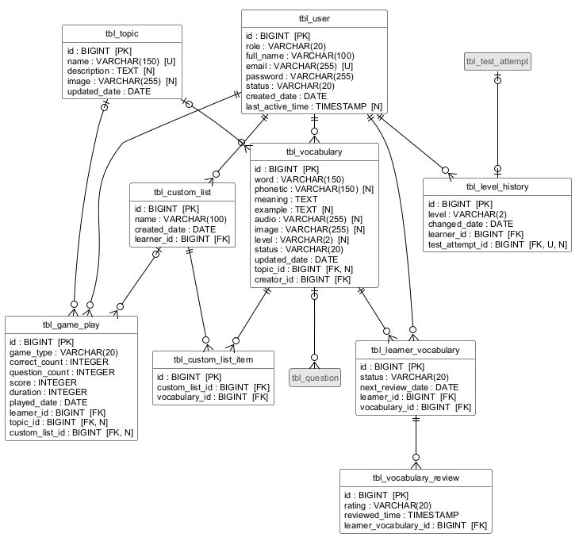
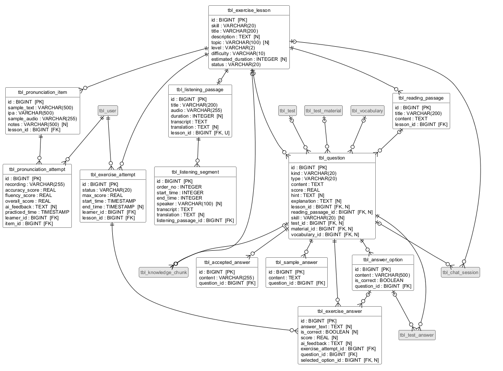
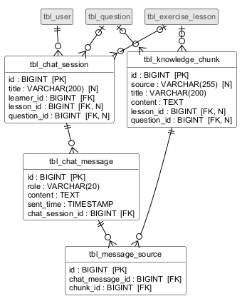
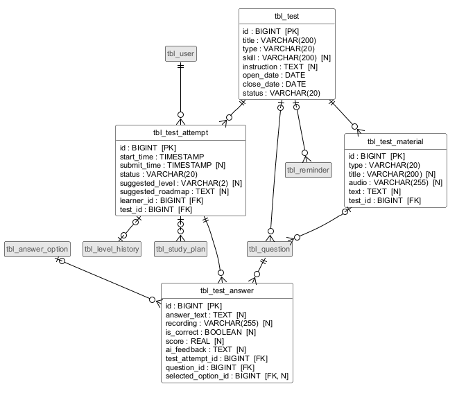
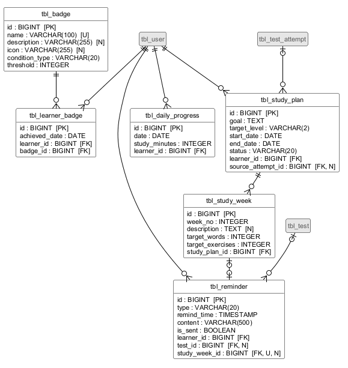

# Thiết kế cơ sở dữ liệu

Đầu vào là biểu đồ lớp thực thể ở bước thiết kế (`Design/EntityClasses.md`). Hệ quản trị CSDL là **PostgreSQL**. Kết quả gồm:

- script tạo bảng `Design/schema.sql`,
- các biểu đồ quan hệ giữa các bảng (ER) ở cuối tài liệu. Biểu đồ được sinh tự động từ `schema.sql` bằng `Design/diagrams/gen_er_from_schema.py`, nên luôn khớp với script.

## Các bước thực hiện

- Bước 1: Mỗi lớp thực thể tạo một bảng tương ứng.
- Bước 2: Đưa mọi thuộc tính **không phải đối tượng** của lớp thực thể thành cột của bảng tương ứng. Thuộc tính đối tượng (ví dụ `learner : Learner`, `items : List<CustomListItem>`) bị bỏ ở bước này.
- Bước 3: Xét quan hệ số lượng giữa các lớp thực thể, đó cũng là quan hệ giữa các bảng:
  - quan hệ 1-1: gộp hai bảng thành một, nhưng trong một số trường hợp có thể giữ riêng;
  - quan hệ 1-n: giữ hai bảng riêng;
  - quan hệ n-n: tạo bảng trung gian để tách thành các quan hệ 1-n (lẽ ra phải được xử lý từ bước phân tích).
- Bước 4: Thiết lập khóa:
  - khóa chính (PK): bảng nào có thuộc tính id thì dùng id làm khóa chính;
  - khóa ngoại (FK): nếu 1 bảng A có n bảng B thì bảng B có khóa ngoại tham chiếu tới khóa chính của bảng A.
- Bước 5: Loại bỏ thuộc tính gây dư thừa dữ liệu:
  - thuộc tính trùng lặp: không phải khóa, cùng thuộc về một đối tượng nhưng xuất hiện ở hai bảng;
  - thuộc tính dẫn xuất: tính được một cách cơ học từ các thuộc tính khác trong CSDL, ví dụ phần lớn thuộc tính của các lớp thống kê.

  Sau khi loại bỏ, bảng nào chỉ còn lại một khóa ngoại thì có thể bỏ luôn.

Mẫu case study viết cho MySQL/Java với tên kiểu `tblRoom`, `hotelID`. Ở đây các quy ước được điều chỉnh cho PostgreSQL và Spring Boot:

- **Tên bảng:** `tbl_` + tên lớp thực thể viết dạng snake_case, ví dụ lớp LearnerVocabulary thành bảng `tbl_learner_vocabulary`. PostgreSQL tự chuyển tên không đặt trong ngoặc kép về chữ thường, nên `tblLearnerVocabulary` sẽ thành `tbllearnervocabulary`, rất khó đọc. Spring Boot cũng mặc định đổi tên dạng camelCase sang snake_case. Tiền tố `tbl_` còn giúp tránh trùng với từ khóa `user` của PostgreSQL.
- **Tên cột:** tên thuộc tính viết dạng snake_case, ví dụ `nextReviewDate` thành `next_review_date`.
- **Khóa ngoại:** tên thuộc tính đối tượng + `_id`, ví dụ `learner` thành `learner_id`, `selectedOption` thành `selected_option_id`. Đây là dạng snake_case của quy ước "aId" trong mẫu.
- **Kiểu cột:**

| Kiểu Java | Kiểu PostgreSQL |
|---|---|
| `Long` (khóa chính) | `BIGINT GENERATED ALWAYS AS IDENTITY` (tự tăng, luôn dương) |
| `Long` (khóa ngoại) | `BIGINT` |
| `String` | `VARCHAR(n)` cho chuỗi ngắn có giới hạn, `TEXT` cho nội dung dài (đoạn văn, transcript, nhận xét của AI) |
| `int` | `INTEGER` |
| `float`, `Float` | `REAL` |
| `boolean`, `Boolean` | `BOOLEAN` |
| `LocalDate` | `DATE` |
| `LocalDateTime` | `TIMESTAMP` |
| enum | `VARCHAR(20)` kèm ràng buộc `CHECK` liệt kê các giá trị hợp lệ (Spring Boot lưu enum dạng chuỗi) |

- **Ký hiệu trong biểu đồ ER:** `[PK]` khóa chính, `[FK]` khóa ngoại, `[U]` giá trị duy nhất, `[N]` cho phép rỗng (giống ký hiệu N của mẫu); cột không có `[N]` là bắt buộc (`NOT NULL`). Quan hệ vẽ theo ký hiệu chân chim.

## Áp dụng

### Bước 1

Mỗi lớp thực thể cần lưu tạo một bảng tương ứng:

- Tài khoản: User → `tbl_user`, LevelHistory → `tbl_level_history`.
- Học từ vựng: Topic → `tbl_topic`, Vocabulary → `tbl_vocabulary`, LearnerVocabulary → `tbl_learner_vocabulary`, VocabularyReview → `tbl_vocabulary_review`, CustomList → `tbl_custom_list`, CustomListItem → `tbl_custom_list_item`, GamePlay → `tbl_game_play`.
- Bài tập: ExerciseLesson → `tbl_exercise_lesson`, ReadingPassage → `tbl_reading_passage`, ListeningPassage → `tbl_listening_passage`, ListeningSegment → `tbl_listening_segment`, PronunciationItem → `tbl_pronunciation_item`, PronunciationAttempt → `tbl_pronunciation_attempt`, Question → `tbl_question`, AnswerOption → `tbl_answer_option`, AcceptedAnswer → `tbl_accepted_answer`, SampleAnswer → `tbl_sample_answer`, ExerciseAttempt → `tbl_exercise_attempt`, ExerciseAnswer → `tbl_exercise_answer`.
- Chatbot: ChatSession → `tbl_chat_session`, ChatMessage → `tbl_chat_message`, MessageSource → `tbl_message_source`, KnowledgeChunk → `tbl_knowledge_chunk`.
- Kiểm tra: Test → `tbl_test`, TestMaterial → `tbl_test_material`, TestAttempt → `tbl_test_attempt`, TestAnswer → `tbl_test_answer`.
- Tiến độ và kế hoạch: DailyProgress → `tbl_daily_progress`, Badge → `tbl_badge`, LearnerBadge → `tbl_learner_badge`, StudyPlan → `tbl_study_plan`, StudyWeek → `tbl_study_week`, Reminder → `tbl_reminder`.

Hai cây kế thừa được lưu mỗi cây trong **một bảng**, kèm một cột phân loại cho biết bản ghi thuộc lớp con nào (đề xuất – cần nhóm chốt, mục chờ chốt 10):

- User, Learner, Admin → `tbl_user`, có thêm cột `role` (LEARNER/ADMIN). Cách này đúng như bảng người dùng trong tài liệu gốc của nhóm.
- Question, ExerciseQuestion, TestQuestion → `tbl_question`, có thêm cột `kind` (EXERCISE/TEST). Nhờ vậy `tbl_answer_option` và `tbl_accepted_answer` chỉ cần một khóa ngoại tới một bảng câu hỏi. Các cột riêng của mỗi lớp con phải rỗng ở lớp con kia; điều này được bảo đảm bằng một ràng buộc `CHECK`.

Các lớp thống kê và báo cáo (FlashcardSummary, TestReport, ProgressStat, SystemStat, ContentStat, VocabularyStat, TopicStat, CustomListStat, LessonStat, TestStat) bị loại ở bước 5.

Kết quả là 35 bảng.

### Bước 2

Đưa thuộc tính không phải đối tượng của lớp thực thể thành cột của bảng tương ứng. Cột `role` và `kind` là cột phân loại thêm ở bước 1. Các cột in đậm sẽ bị loại ở bước 5 vì là thuộc tính dẫn xuất.

| Bảng | Cột |
|---|---|
| tbl_user | id, role, full_name, email, password, status, created_date, last_active_time, **current_level** |
| tbl_topic | id, name, description, image, updated_date |
| tbl_vocabulary | id, word, phonetic, meaning, example, audio, image, level, status, updated_date |
| tbl_learner_vocabulary | id, status, **last_result**, **review_count**, **first_learned_date**, **last_reviewed_date**, next_review_date |
| tbl_vocabulary_review | id, rating, reviewed_time |
| tbl_custom_list | id, name, created_date |
| tbl_custom_list_item | id |
| tbl_game_play | id, game_type, correct_count, question_count, score, duration, played_date |
| tbl_exercise_lesson | id, skill, title, description, topic, level, difficulty, estimated_duration, status |
| tbl_reading_passage | id, title, content |
| tbl_listening_passage | id, title, audio, duration, transcript, translation |
| tbl_listening_segment | id, order_no, start_time, end_time, speaker, transcript, translation |
| tbl_pronunciation_item | id, sample_text, ipa, sample_audio, notes |
| tbl_pronunciation_attempt | id, **attempt_no**, recording, accuracy_score, fluency_score, overall_score, ai_feedback, practiced_time |
| tbl_test | id, title, type, skill, instruction, open_date, close_date, status |
| tbl_test_material | id, type, title, audio, text |
| tbl_question | id, kind, type, content, score, hint, explanation, skill |
| tbl_answer_option | id, content, is_correct |
| tbl_accepted_answer | id, content |
| tbl_sample_answer | id, content |
| tbl_exercise_attempt | id, status, max_score, **score**, **percent**, start_time, end_time |
| tbl_exercise_answer | id, answer_text, is_correct, score, ai_feedback |
| tbl_knowledge_chunk | id, source, title, content |
| tbl_chat_session | id, title |
| tbl_chat_message | id, role, content, sent_time |
| tbl_message_source | id |
| tbl_test_attempt | id, start_time, submit_time, status, **total_score**, **listening_score**, **speaking_score**, **reading_score**, **writing_score**, suggested_level, suggested_roadmap |
| tbl_test_answer | id, answer_text, recording, is_correct, score, ai_feedback |
| tbl_level_history | id, level, changed_date |
| tbl_daily_progress | id, date, **words_learned**, **exercises_completed**, **tests_completed**, study_minutes |
| tbl_badge | id, name, description, icon, condition_type, threshold |
| tbl_learner_badge | id, achieved_date |
| tbl_study_plan | id, goal, target_level, start_date, end_date, status |
| tbl_study_week | id, week_no, description, target_words, target_exercises, **status** |
| tbl_reminder | id, type, remind_time, content, is_sent |

### Bước 3

Chuyển quan hệ số lượng giữa các lớp thực thể thành quan hệ giữa các bảng. Mỗi thuộc tính đối tượng ở bước thiết kế lớp thực thể cho một quan hệ; "không bắt buộc" nghĩa là bản ghi ở phía n có thể không gắn với bản ghi nào ở phía 1.

Tài khoản và học từ vựng:

- 1 tbl_user – n tbl_level_history
- 1 tbl_topic – n tbl_vocabulary (không bắt buộc: từ người học tự nhập không có chủ đề)
- 1 tbl_user – n tbl_vocabulary (người tạo)
- 1 tbl_user – n tbl_learner_vocabulary
- 1 tbl_vocabulary – n tbl_learner_vocabulary
- 1 tbl_learner_vocabulary – n tbl_vocabulary_review
- 1 tbl_user – n tbl_custom_list
- 1 tbl_custom_list – n tbl_custom_list_item
- 1 tbl_vocabulary – n tbl_custom_list_item
- 1 tbl_user – n tbl_game_play
- 1 tbl_topic – n tbl_game_play (không bắt buộc)
- 1 tbl_custom_list – n tbl_game_play (không bắt buộc)

Bài tập:

- 1 tbl_exercise_lesson – n tbl_reading_passage, 0..1 tbl_listening_passage (mỗi bài nghe hiểu một bài nghe), n tbl_pronunciation_item
- 1 tbl_listening_passage – n tbl_listening_segment
- 1 tbl_user – n tbl_pronunciation_attempt; 1 tbl_pronunciation_item – n tbl_pronunciation_attempt
- 1 tbl_exercise_lesson – n tbl_question (không bắt buộc: chỉ câu hỏi bài tập)
- 1 tbl_reading_passage – n tbl_question (không bắt buộc)
- 1 tbl_question – n tbl_answer_option, n tbl_accepted_answer, n tbl_sample_answer
- 1 tbl_user – n tbl_exercise_attempt; 1 tbl_exercise_lesson – n tbl_exercise_attempt
- 1 tbl_exercise_attempt – n tbl_exercise_answer; 1 tbl_question – n tbl_exercise_answer
- 1 tbl_answer_option – n tbl_exercise_answer (không bắt buộc: chỉ câu trắc nghiệm)

Chatbot:

- 1 tbl_user – n tbl_chat_session
- 1 tbl_exercise_lesson – n tbl_chat_session, 1 tbl_question – n tbl_chat_session (không bắt buộc)
- 1 tbl_chat_session – n tbl_chat_message
- 1 tbl_chat_message – n tbl_message_source; 1 tbl_knowledge_chunk – n tbl_message_source
- 1 tbl_exercise_lesson – n tbl_knowledge_chunk, 1 tbl_question – n tbl_knowledge_chunk (không bắt buộc)

Kiểm tra:

- 1 tbl_test – n tbl_test_material
- 1 tbl_test – n tbl_question (không bắt buộc: chỉ câu hỏi đề kiểm tra)
- 1 tbl_test_material – n tbl_question (không bắt buộc)
- 1 tbl_vocabulary – n tbl_question (không bắt buộc)
- 1 tbl_user – n tbl_test_attempt; 1 tbl_test – n tbl_test_attempt
- 1 tbl_test_attempt – n tbl_test_answer; 1 tbl_question – n tbl_test_answer
- 1 tbl_answer_option – n tbl_test_answer (không bắt buộc)

Tiến độ và kế hoạch:

- 1 tbl_user – n tbl_daily_progress
- 1 tbl_user – n tbl_learner_badge; 1 tbl_badge – n tbl_learner_badge
- 1 tbl_user – n tbl_study_plan; 1 tbl_test_attempt – n tbl_study_plan (không bắt buộc)
- 1 tbl_study_plan – n tbl_study_week
- 1 tbl_user – n tbl_reminder; 1 tbl_test – n tbl_reminder (không bắt buộc)

Có hai quan hệ 1-1 (không bắt buộc ở cả hai phía). Theo mẫu, hai bảng có quan hệ 1-1 nên gộp làm một, nhưng ở đây giữ riêng:

- tbl_test_attempt – tbl_level_history: phần lớn lượt kiểm tra (đề định kỳ, hoặc đề tổng hợp mà trình độ không đổi) không sinh lịch sử trình độ. Nếu gộp, bảng lượt kiểm tra sẽ có các cột lịch sử bỏ trống ở hầu hết bản ghi.
- tbl_study_week – tbl_reminder: nhắc nhở có nhiều loại (ôn từ, kiểm tra, kế hoạch), chỉ loại kế hoạch mới gắn với tuần.

Không còn quan hệ n-n nào, vì tất cả đã được tách bằng lớp trung gian từ bước phân tích (LearnerVocabulary, CustomListItem, PronunciationAttempt, ExerciseAttempt, ExerciseAnswer, MessageSource, TestAttempt, TestAnswer, LearnerBadge).

### Bước 4

Khóa chính của cả 35 bảng là cột `id`, kiểu `BIGINT` tự tăng.

Khóa ngoại được thêm vào bảng ở phía n của mỗi quan hệ ở bước 3:

| Bảng | Khóa ngoại → bảng được tham chiếu |
|---|---|
| tbl_level_history | learner_id → tbl_user; test_attempt_id → tbl_test_attempt (duy nhất, có thể rỗng) |
| tbl_vocabulary | topic_id → tbl_topic (có thể rỗng); creator_id → tbl_user |
| tbl_learner_vocabulary | learner_id → tbl_user; vocabulary_id → tbl_vocabulary |
| tbl_vocabulary_review | learner_vocabulary_id → tbl_learner_vocabulary |
| tbl_custom_list | learner_id → tbl_user |
| tbl_custom_list_item | custom_list_id → tbl_custom_list; vocabulary_id → tbl_vocabulary |
| tbl_game_play | learner_id → tbl_user; topic_id → tbl_topic; custom_list_id → tbl_custom_list |
| tbl_reading_passage | lesson_id → tbl_exercise_lesson |
| tbl_listening_passage | lesson_id → tbl_exercise_lesson (duy nhất: mỗi bài học tối đa một bài nghe) |
| tbl_listening_segment | listening_passage_id → tbl_listening_passage |
| tbl_pronunciation_item | lesson_id → tbl_exercise_lesson |
| tbl_pronunciation_attempt | learner_id → tbl_user; item_id → tbl_pronunciation_item |
| tbl_test_material | test_id → tbl_test |
| tbl_question | lesson_id → tbl_exercise_lesson; reading_passage_id → tbl_reading_passage; test_id → tbl_test; material_id → tbl_test_material; vocabulary_id → tbl_vocabulary |
| tbl_answer_option | question_id → tbl_question |
| tbl_accepted_answer | question_id → tbl_question |
| tbl_sample_answer | question_id → tbl_question |
| tbl_exercise_attempt | learner_id → tbl_user; lesson_id → tbl_exercise_lesson |
| tbl_exercise_answer | exercise_attempt_id → tbl_exercise_attempt; question_id → tbl_question; selected_option_id → tbl_answer_option |
| tbl_knowledge_chunk | lesson_id → tbl_exercise_lesson; question_id → tbl_question |
| tbl_chat_session | learner_id → tbl_user; lesson_id → tbl_exercise_lesson; question_id → tbl_question |
| tbl_chat_message | chat_session_id → tbl_chat_session |
| tbl_message_source | chat_message_id → tbl_chat_message; chunk_id → tbl_knowledge_chunk |
| tbl_test_attempt | learner_id → tbl_user; test_id → tbl_test |
| tbl_test_answer | test_attempt_id → tbl_test_attempt; question_id → tbl_question; selected_option_id → tbl_answer_option |
| tbl_daily_progress | learner_id → tbl_user |
| tbl_learner_badge | learner_id → tbl_user; badge_id → tbl_badge |
| tbl_study_plan | learner_id → tbl_user; source_attempt_id → tbl_test_attempt |
| tbl_study_week | study_plan_id → tbl_study_plan |
| tbl_reminder | learner_id → tbl_user; test_id → tbl_test; study_week_id → tbl_study_week (duy nhất, có thể rỗng) |

**Khi xóa bản ghi được tham chiếu:** mặc định CSDL chặn việc xóa nếu còn bản ghi tham chiếu tới nó. Nội dung đã có lịch sử học chỉ bị ẩn (soft delete), không bị xóa. Chỉ các trường hợp sau được xóa theo (`ON DELETE CASCADE`) hoặc bỏ liên kết (`ON DELETE SET NULL`):

- Thành phần chỉ tồn tại trong lớp chứa, tức quan hệ composition ở bước thiết kế lớp thực thể, được xóa theo lớp chứa. Ví dụ: đoạn bài nghe theo bài nghe, đáp án theo câu hỏi, câu trả lời theo lượt làm bài, tuần theo kế hoạch, lượt ôn theo trạng thái học từ. Việc xóa hẳn các nội dung này chỉ xảy ra khi chưa có lịch sử học (kịch bản 21, 23, 24).
- Xóa danh sách từ riêng (kịch bản 7, nhánh 2b): các mục trong danh sách bị xóa theo; lượt chơi đã chơi với danh sách đó vẫn được giữ nhưng mất liên kết (`SET NULL`).
- Xóa tuần khi rút ngắn kế hoạch (kịch bản 18, nhánh 6b): nhắc nhở của tuần đó bị xóa theo.

**Ràng buộc từ quy tắc nghiệp vụ.** Ngoài khóa, các quy tắc sau được CSDL bảo đảm trực tiếp:

| Ràng buộc | Bảng | Quy tắc |
|---|---|---|
| `UNIQUE (email)` | tbl_user | email dùng để đăng nhập, không trùng (kịch bản 1) |
| `UNIQUE (name)` | tbl_topic, tbl_badge | tên chủ đề không trùng (kịch bản 22) |
| `UNIQUE (topic_id, word)` | tbl_vocabulary | trong một chủ đề không có hai từ trùng nhau (kịch bản 19, 20) |
| `UNIQUE (learner_id, vocabulary_id)` | tbl_learner_vocabulary | mỗi cặp người học – từ vựng chỉ có một trạng thái học |
| `UNIQUE (learner_id, name)` | tbl_custom_list | tên danh sách không trùng với danh sách khác của cùng người học (kịch bản 7) |
| `UNIQUE (custom_list_id, vocabulary_id)` | tbl_custom_list_item | một từ không lặp lại trong cùng một danh sách |
| `CHECK (topic_id IS NULL OR custom_list_id IS NULL)` | tbl_game_play | lượt chơi gắn với chủ đề hoặc danh sách từ riêng, không cả hai |
| `CHECK` theo `kind` | tbl_question | câu hỏi bài tập phải thuộc một bài học, câu hỏi kiểm tra phải thuộc một đề và có kỹ năng; loại câu hỏi đúng với từng lớp con |
| `UNIQUE (exercise_attempt_id, question_id)`, `UNIQUE (test_attempt_id, question_id)` | tbl_exercise_answer, tbl_test_answer | mỗi câu hỏi chỉ có một câu trả lời trong một lượt |
| `UNIQUE (test_attempt_id)` | tbl_level_history | một lượt kiểm tra sinh tối đa một bản ghi lịch sử trình độ |
| `CHECK (close_date > open_date)` | tbl_test | ngày đóng sau ngày mở (kịch bản 24) |
| `CHECK` theo `type` | tbl_test_material | bài nghe phải có file âm thanh, đoạn văn phải có nội dung |
| chỉ mục duy nhất có điều kiện `(learner_id) WHERE status = 'ACTIVE'` | tbl_study_plan | mỗi người học có tối đa một kế hoạch đang thực hiện |
| `UNIQUE (learner_id, date)` | tbl_daily_progress | mỗi người học có tối đa một bản ghi tiến độ mỗi ngày |
| `UNIQUE (learner_id, badge_id)` | tbl_learner_badge | mỗi huy hiệu chỉ được nhận một lần |
| `CHECK` giá trị không âm, trong khoảng | nhiều bảng | điểm phát âm 0–100, mục tiêu tuần là số nguyên không âm (kịch bản 17), điểm câu hỏi dương… |

Một số quy tắc liên quan tới nhiều bảng không thể viết bằng khóa ngoại hay `CHECK` đơn giản. Tầng ứng dụng (Spring Boot) phải kiểm tra các quy tắc này:

- Cột `learner_id` ở mọi bảng phải trỏ tới người dùng có `role = 'LEARNER'`.
- Loại câu hỏi phải phù hợp kỹ năng của bài học: bài đọc hiểu và nghe hiểu chỉ có câu trắc nghiệm và điền từ, bài viết chỉ có câu viết. Câu trả lời mẫu chỉ có ở câu viết.
- `reading_passage_id` của câu hỏi phải là bài đọc của chính bài học đó; `material_id` phải là tài liệu của chính đề đó; `selected_option_id` phải là đáp án của chính câu hỏi được trả lời.

### Bước 5

**Thuộc tính trùng lặp.** Không có thuộc tính nào bị loại vì trùng lặp. Có hai trường hợp trông như trùng lặp nhưng được giữ lại:

- `tbl_listening_passage.transcript`, `translation` và transcript, bản dịch của từng đoạn: danh sách đoạn không bắt buộc (bài nghe có thể không chia đoạn), nên transcript đầy đủ không phải lúc nào cũng ghép lại được từ các đoạn.
- `is_correct` của câu trả lời và `is_correct` của đáp án lựa chọn: câu trả lời lưu kết quả chấm **tại thời điểm làm bài**. Theo quy tắc chờ chốt, sửa đáp án bài tập không chấm lại các lượt cũ, nên kết quả này không suy ra được từ đáp án hiện tại.

**Thuộc tính dẫn xuất bị loại.** Mẫu case study đã bỏ các thuộc tính như điểm trung bình khỏi CSDL; ta làm tương tự. Các thuộc tính sau vẫn có trong lớp thực thể Java nhưng không có cột, và được tính khi đọc dữ liệu:

| Bảng | Cột bị loại | Cách tính |
|---|---|---|
| tbl_user | current_level | `level` của bản ghi `tbl_level_history` mới nhất của người học (sắp theo `changed_date`, rồi `id`); rỗng nếu chưa có. Trình độ chỉ thay đổi qua kiểm tra tổng hợp và mỗi lần đổi đều sinh một bản ghi lịch sử, nên luôn tính lại được. |
| tbl_learner_vocabulary | review_count, last_result, first_learned_date, last_reviewed_date | lần lượt là số lượt, mức nhớ của lượt mới nhất, ngày của lượt đầu tiên, ngày của lượt mới nhất trong `tbl_vocabulary_review` của trạng thái học đó |
| tbl_pronunciation_attempt | attempt_no | thứ tự của lượt theo `practiced_time` trong các lượt của cùng người học với cùng mục luyện |
| tbl_exercise_attempt | score, percent | score là tổng `score` của các câu trả lời, percent = score / max_score × 100. Khi còn câu viết chưa chấm (score rỗng), lượt chưa có điểm. |
| tbl_test_attempt | total_score, listening_score, speaking_score, reading_score, writing_score | phần nghe và đọc: tổng điểm đạt / tổng điểm câu hỏi × 10; phần nói: trung bình điểm các đề nói; phần viết: điểm bài viết; tổng điểm: trung bình bốn kỹ năng (quy tắc chờ chốt 8 trong Scenarios.md) |
| tbl_daily_progress | words_learned, exercises_completed, tests_completed | words_learned là số lượt ôn của người học trong ngày; tests_completed là số lượt kiểm tra đã nộp trong ngày. exercises_completed là số lượt làm bài tập đã nộp **cộng số bài phát âm hoàn thành** trong ngày, vì luyện phát âm chỉ tạo lượt luyện phát âm, không tạo lượt làm bài tập. Một bài phát âm hoàn thành vào ngày mục cuối cùng của bài có lượt luyện đầu tiên, tức lúc mọi mục đều đã có ít nhất một lượt chấm thành công (kịch bản 12, bước 14 và nhánh 12a). Nhờ đếm trực tiếp, quy tắc "mỗi hoạt động chỉ được đếm một lần" luôn đúng. |
| tbl_study_week | status | so ngày hiện tại với khoảng thời gian của tuần (`start_date` của kế hoạch + (week_no − 1) × 7 ngày) |

Việc bỏ các cột đếm trong `tbl_daily_progress` làm phương thức `updateProgress()` ở bước phân tích chỉ còn cộng thời gian học; `Analysis/ClassDiagram.md` đã được sửa theo.

Cách đếm bài phát âm hoàn thành được bổ sung ở bước thiết kế biểu đồ lớp. Hệ quả cần nhóm chốt: nếu admin thêm mục vào một bài mà người học đã luyện xong, bài không còn được tính là hoàn thành cho tới khi người học luyện mục mới, và số liệu của ngày cũ thay đổi theo. Nếu cần giữ nguyên số liệu cũ, phải lưu ngày hoàn thành bài (ví dụ thêm một bảng hoàn thành bài phát âm).

**Thuộc tính trông như dẫn xuất nhưng được giữ lại.** Các cột sau là kết quả tính **tại một thời điểm**, không suy ra lại được từ dữ liệu hiện có:

- `tbl_learner_vocabulary.status`, `next_review_date`: kết quả của quy tắc lặp lại ngắt quãng tại lần ôn gần nhất. Quy tắc này còn chờ chốt; nếu quy tắc thay đổi, các giá trị cũ vẫn phải giữ nguyên.
- `tbl_exercise_attempt.max_score`: tổng điểm của bài tại lúc làm. Bài học có thể được sửa sau đó (thêm, bớt câu hỏi), nên không tính lại được từ câu hỏi hiện tại.
- `tbl_game_play.score`, `question_count`: kết quả của một ván chơi đã kết thúc.
- `tbl_test_attempt.suggested_level`, `suggested_roadmap`: kết quả do Dịch vụ AI trả về, không tính được từ dữ liệu khác.

**Các lớp thống kê và báo cáo** (FlashcardSummary, TestReport, ProgressStat, SystemStat, ContentStat, VocabularyStat, TopicStat, CustomListStat, LessonStat, TestStat): mọi thuộc tính riêng đều là thuộc tính dẫn xuất, nên không tạo bảng. Dữ liệu của chúng được tính bằng truy vấn khi hiển thị. Ví dụ: `VocabularyStat.learnerCount` đếm các dòng `tbl_learner_vocabulary` của từ; `TopicStat.dueCount` đếm các trạng thái học của người học trong chủ đề có `next_review_date` không muộn hơn hôm nay; `answeredCount` của LessonStat, TestStat đếm câu trả lời của lượt đang làm dở.

**Bảng chỉ còn khóa ngoại.** `tbl_custom_list_item` và `tbl_message_source` chỉ còn id và hai khóa ngoại. Mẫu cho phép bỏ bảng chỉ còn **một** khóa ngoại; hai bảng này là bảng trung gian của quan hệ n-n nên vẫn phải giữ.

## Kết quả: CSDL toàn hệ thống

CSDL gồm 35 bảng, được tạo bằng `Design/schema.sql`. Script đã được chạy thử trên PostgreSQL 17 với dữ liệu lấy từ bộ dữ liệu mẫu dùng chung, cho kết quả sau:

- Script tạo đủ 35 bảng, không lỗi.
- Toàn bộ dữ liệu mẫu hợp lệ chèn được, gồm các trường hợp biên: cùng một từ ở hai chủ đề khác nhau; hai người học cùng tự nhập từ "icebreaker"; một kế hoạch đang thực hiện cùng một kế hoạch tạm dừng.
- 16 thao tác vi phạm quy tắc đều bị chặn, và bị chặn đúng ràng buộc tương ứng. Ví dụ: email trùng, từ trùng trong một chủ đề, kế hoạch đang thực hiện thứ hai, câu hỏi kiểm tra loại "dịch câu", bài nghe thiếu file âm thanh, điểm phát âm ngoài thang 0–100.
- Xóa danh sách từ riêng thì lượt chơi vẫn còn và mất liên kết; xóa một tuần thì nhắc nhở của tuần đó bị xóa theo.
- Các truy vấn tính thuộc tính dẫn xuất ở bước 5 cho kết quả đúng với dữ liệu mẫu. Ví dụ: trình độ hiện tại của Lan là B1; từ "luggage" có 2 lượt ôn, lần gần nhất 06/10/2026 với mức "nhớ mơ hồ".
- Chạy lại ngày 01/10/2026 sau khi thêm cột `tbl_vocabulary.updated_date`: script vẫn tạo đủ 35 bảng; từ mới chèn vào nhận ngày hiện tại làm giá trị mặc định, sửa từ thì cập nhật được ngày, và giá trị rỗng bị chặn.
- Chạy lại ngày 03/10/2026 sau khi đối chiếu khu quản trị: thêm cột `tbl_user.last_active_time`, `tbl_topic.updated_date`, `tbl_exercise_lesson.difficulty`, `tbl_listening_segment.speaker`, `tbl_pronunciation_item.notes`; `tbl_test.status` có thêm giá trị `DRAFT` (mặc định); mỗi bài học tối đa một bài nghe (`UNIQUE (lesson_id)`); độ dài tên chủ đề, từ, phiên âm nâng lên 150 ký tự và nghĩa, câu ví dụ, mô tả chủ đề đổi sang `TEXT`, khớp giao diện và CSDL đang chạy. Chạy thử trên một cụm PostgreSQL 17 tạm: script vẫn tạo đủ 35 bảng; người dùng mới có `last_active_time` rỗng, chủ đề mới nhận ngày hiện tại làm `updated_date`, bài học mới có độ khó `MEDIUM`, đề mới ở trạng thái `DRAFT`; tên chủ đề, từ 150 ký tự và nghĩa, câu ví dụ dài đều lưu được. Năm thao tác vi phạm bị chặn đúng ràng buộc: bài nghe thứ hai của cùng một bài học, độ khó ngoài EASY/MEDIUM/HARD, trạng thái đề ngoài DRAFT/VISIBLE/HIDDEN, tên chủ đề 151 ký tự, tên chủ đề trùng.

Biểu đồ quan hệ giữa các bảng được chia theo module như các bước trước; bảng tô xám thuộc hình khác. Các quan hệ tới `tbl_user` chỉ được vẽ ở hình chứa bảng giữ khóa ngoại, để hình tài khoản không bị rối.

Hình 1. Tài khoản và học từ vựng:

Hình 2. Bài tập:

Hình 3. Chatbot:

Hình 4. Kiểm tra:

Hình 5. Tiến độ và kế hoạch học:

