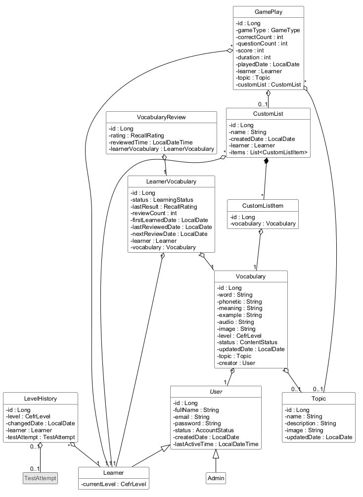
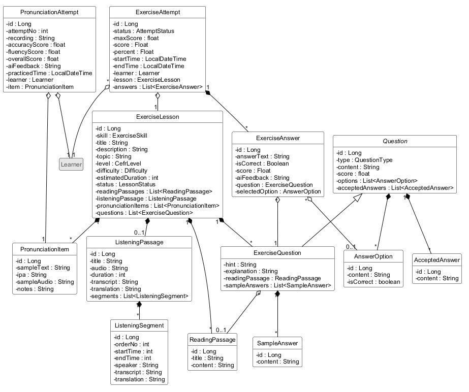
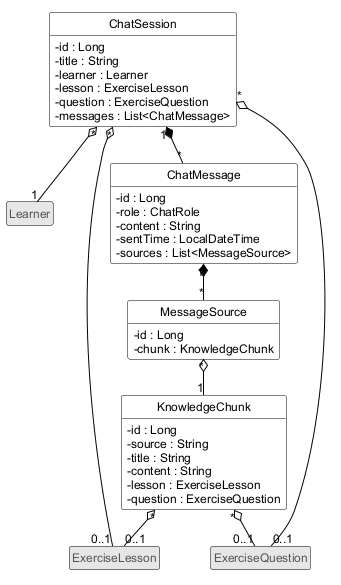
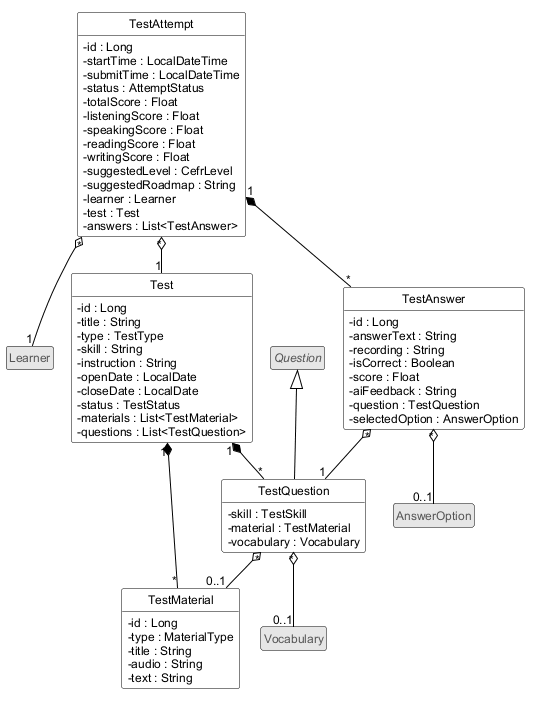
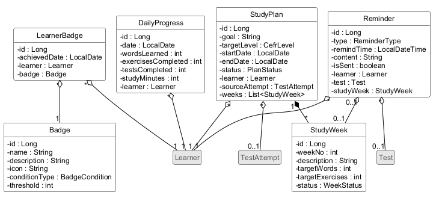
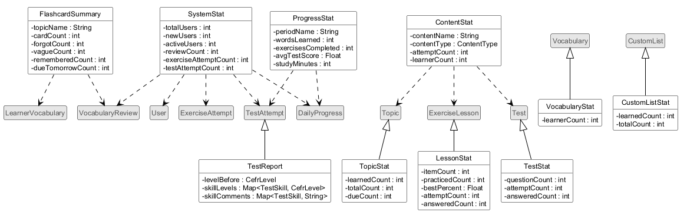
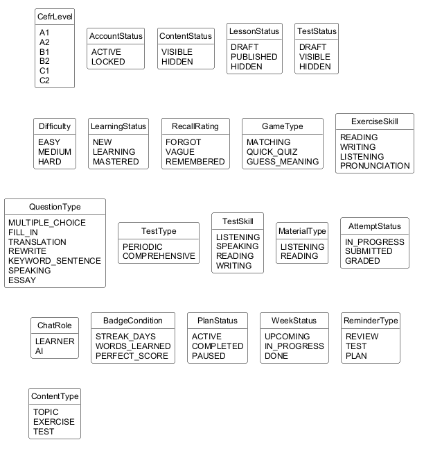

# Thiết kế lớp thực thể (Design of entity classes)

Đầu vào của bước này là biểu đồ lớp thực thể ở bước phân tích (`Analysis/EntityClassExtraction.md`). Backend của hệ thống dùng Spring Boot, nên các lớp thực thể được thiết kế thành lớp Java và kiểu dữ liệu là kiểu của Java. Ta thực hiện bốn bước:

- Bước 1: Thêm thuộc tính id cho các lớp không kế thừa lớp nào khác.
- Bước 2: Thêm kiểu dữ liệu cho mọi thuộc tính của mọi lớp.
- Bước 3: Chuyển các quan hệ association thành quan hệ aggregation/composition tương ứng.
- Bước 4: Thêm các thuộc tính đối tượng tương ứng với các quan hệ aggregation/composition.

## Bước 1: Thêm thuộc tính id

Thêm thuộc tính `id : Long` cho 35 lớp cần lưu và không kế thừa lớp nào:

- Tài khoản: User, LevelHistory.
- Học từ vựng: Topic, Vocabulary, LearnerVocabulary, VocabularyReview, CustomList, CustomListItem, GamePlay.
- Bài tập: ExerciseLesson, ReadingPassage, ListeningPassage, ListeningSegment, PronunciationItem, PronunciationAttempt, Question, AnswerOption, AcceptedAnswer, SampleAnswer, ExerciseAttempt, ExerciseAnswer.
- Chatbot: ChatSession, ChatMessage, MessageSource, KnowledgeChunk.
- Kiểm tra: Test, TestMaterial, TestAttempt, TestAnswer.
- Tiến độ và kế hoạch: DailyProgress, Badge, LearnerBadge, StudyPlan, StudyWeek, Reminder.

Mẫu case study dùng id kiểu int. Ở đây id dùng kiểu `Long` vì khóa chính trong CSDL là số nguyên 64 bit (quy ước đã chốt).

Các lớp sau không thêm id:

- Lớp kế thừa dùng id của lớp cha: Learner và Admin (của User); ExerciseQuestion và TestQuestion (của Question); VocabularyStat, TopicStat, CustomListStat, LessonStat, TestStat và TestReport (của Vocabulary, Topic, CustomList, ExerciseLesson, Test và TestAttempt).
- Lớp thống kê không lưu và không kế thừa lớp nào: FlashcardSummary, ProgressStat, SystemStat, ContentStat. Mẫu cũng làm vậy với IncomeStat.

## Bước 2: Thêm kiểu dữ liệu

Các thuộc tính được gán kiểu theo quy ước sau:

| Loại dữ liệu | Kiểu Java | Ví dụ |
|---|---|---|
| Khóa chính | `Long` | id |
| Văn bản | `String` | word, meaning, content, transcript, aiFeedback |
| File (âm thanh, hình, bản ghi âm) | `String`: đường dẫn hoặc URL của file đã lưu | audio, image, recording, sampleAudio |
| Số đếm, số thứ tự, số giây, số phút | `int` | reviewCount, orderNo, duration (giây), estimatedDuration (phút), studyMinutes, learnerCount, dueCount |
| Điểm, tỷ lệ phần trăm | `float` | score, overallScore, maxScore |
| Ngày | `LocalDate` | nextReviewDate, openDate, playedDate, updatedDate |
| Thời điểm | `LocalDateTime` | reviewedTime, startTime, remindTime, lastActiveTime |
| Đúng/sai | `boolean` | isCorrect của AnswerOption, isSent |
| Tập giá trị cố định trong Business model | kiểu liệt kê (enum) | status, level, type, rating |
| Danh sách thành phần | `List<X>` | items, answers, weeks |

Mẫu dùng `String` cho các thuộc tính như loại phòng hay chức vụ. Ở đây mọi thuộc tính có tập giá trị cố định đều dùng enum. Cách này giúp trình biên dịch bắt lỗi gõ sai giá trị, và Spring Boot (JPA) lưu được enum dưới dạng chuỗi. Mẫu dùng `Date`; ở đây dùng `LocalDate` và `LocalDateTime` của gói `java.time`, là kiểu mà Spring Boot khuyên dùng.

**Thuộc tính có thể chưa có giá trị** dùng kiểu bao `Float`, `Boolean` thay cho `float`, `boolean`, để phân biệt "chưa có" với 0 hoặc false:

- `ExerciseAttempt.score`, `percent`; `ExerciseAnswer.score`, `isCorrect`; `TestAttempt.totalScore` và bốn điểm kỹ năng; `TestAnswer.score`, `isCorrect`. Điểm chưa có khi Dịch vụ AI chưa chấm xong, vì theo Business model hệ thống không tự đặt điểm thay AI. isCorrect không áp dụng cho câu viết và câu nói.
- `LessonStat.bestPercent` khi người học chưa làm bài; `ProgressStat.avgTestScore` khi trong kỳ không có bài kiểm tra (giao diện hiển thị "–").
- Thuộc tính kiểu lớp hoặc enum (ví dụ `Learner.currentLevel`, `Vocabulary.topic`) vốn đã có thể rỗng nên không cần kiểu bao.

Các kiểu liệt kê:

| Kiểu liệt kê | Giá trị | Nghĩa trong Business model | Dùng ở |
|---|---|---|---|
| CefrLevel | A1, A2, B1, B2, C1, C2 | thang CEFR | Learner.currentLevel, LevelHistory.level, Vocabulary.level, ExerciseLesson.level, TestAttempt.suggestedLevel, StudyPlan.targetLevel, TestReport.levelBefore, TestReport.skillLevels |
| AccountStatus | ACTIVE, LOCKED | hoạt động, bị khóa | User.status |
| ContentStatus | VISIBLE, HIDDEN | hiển thị, đã ẩn | Vocabulary.status |
| LessonStatus | DRAFT, PUBLISHED, HIDDEN | nháp, đã xuất bản, đã ẩn | ExerciseLesson.status |
| TestStatus | DRAFT, VISIBLE, HIDDEN | nháp, hiển thị, đã ẩn | Test.status |
| LearningStatus | NEW, LEARNING, MASTERED | mới, đang học, đã thuộc | LearnerVocabulary.status |
| RecallRating | FORGOT, VAGUE, REMEMBERED | chưa nhớ, nhớ mơ hồ, nhớ rõ | VocabularyReview.rating, LearnerVocabulary.lastResult |
| GameType | MATCHING, QUICK_QUIZ, GUESS_MEANING | ghép từ, trắc nghiệm nhanh, đoán nghĩa | GamePlay.gameType |
| ExerciseSkill | READING, WRITING, LISTENING, PRONUNCIATION | đọc hiểu, viết, nghe hiểu, phát âm | ExerciseLesson.skill |
| Difficulty | EASY, MEDIUM, HARD | dễ, vừa, khó | ExerciseLesson.difficulty |
| QuestionType | MULTIPLE_CHOICE, FILL_IN, TRANSLATION, REWRITE, KEYWORD_SENTENCE, SPEAKING, ESSAY | trắc nghiệm, điền từ, dịch câu, viết lại câu, viết câu theo từ khóa, câu nói, bài viết | Question.type. Câu hỏi bài tập dùng năm giá trị đầu; câu hỏi đề kiểm tra dùng MULTIPLE_CHOICE, FILL_IN, SPEAKING, ESSAY |
| TestType | PERIODIC, COMPREHENSIVE | định kỳ, tổng hợp | Test.type |
| TestSkill | LISTENING, SPEAKING, READING, WRITING | nghe, nói, đọc, viết | TestQuestion.skill, TestReport.skillLevels, TestReport.skillComments |
| MaterialType | LISTENING, READING | bài nghe, đoạn văn | TestMaterial.type |
| AttemptStatus | IN_PROGRESS, SUBMITTED, GRADED | đang làm, đã nộp, đã chấm | ExerciseAttempt.status (hai giá trị đầu), TestAttempt.status |
| ChatRole | LEARNER, AI | người học, AI | ChatMessage.role |
| BadgeCondition | STREAK_DAYS, WORDS_LEARNED, PERFECT_SCORE | số ngày học liên tục, số từ đã học, điểm tuyệt đối | Badge.conditionType |
| PlanStatus | ACTIVE, COMPLETED, PAUSED | đang thực hiện, hoàn thành, tạm dừng | StudyPlan.status |
| WeekStatus | UPCOMING, IN_PROGRESS, DONE | chưa tới, đang làm, xong | StudyWeek.status |
| ReminderType | REVIEW, TEST, PLAN | ôn từ, kiểm tra, kế hoạch | Reminder.type |
| ContentType | TOPIC, EXERCISE, TEST | chủ đề từ vựng, bài tập, đề kiểm tra | ContentStat.contentType |

Một số lưu ý về kiểu dữ liệu:

- `Test.skill` vẫn là `String`, vì đây là mô tả nội dung của đề (ví dụ "Từ vựng và ngữ pháp", kịch bản 24). Thuộc tính này khác `TestQuestion.skill`, là kiểu `TestSkill`.
- `PronunciationAttempt.aiFeedback` lưu cả nhận xét theo từng từ để tô màu văn bản mẫu (kịch bản 12). Dạng lưu cụ thể, ví dụ JSON, sẽ quyết ở bước thiết kế CSDL.
- `TestReport.skillComments` có kiểu `Map<TestSkill, String>`: mỗi kỹ năng một nhận xét. Tương tự, `TestReport.skillLevels` có kiểu `Map<TestSkill, CefrLevel>`: mỗi kỹ năng một trình độ, quy đổi từ điểm của kỹ năng đó (cách quy đổi cần nhóm chốt).
- `Vocabulary.updatedDate` (thêm ngày 01/10/2026, khi kịch bản được cập nhật theo giao diện đang chạy) là ngày sửa gần nhất, hiện ở dòng "cập nhật lần cuối …" của ngăn kéo sửa từ (kịch bản 19). Từ chưa sửa lần nào thì giá trị là ngày tạo.
- Thêm ngày 03/10/2026, khi đối chiếu khu quản trị với tài liệu: `Topic.updatedDate` (`LocalDate`, cột "Cập nhật" của bảng chủ đề), `User.lastActiveTime` (`LocalDateTime`, rỗng khi chưa đăng nhập lần nào), `ExerciseLesson.difficulty` (`Difficulty`), `ListeningSegment.speaker` và `PronunciationItem.notes` (`String`, có thể rỗng). `Test.status` đổi sang kiểu `TestStatus`, có thêm giá trị DRAFT cho đề chưa mở với người học.
- Các thuộc tính thống kê thêm cùng đợt đều kiểu `int`: `VocabularyStat.learnerCount`, `TopicStat.dueCount`, `LessonStat.attemptCount`, `LessonStat.answeredCount`, `TestStat.answeredCount`. `answeredCount` bằng 0 khi người học không có lượt đang làm dở.
- Thuộc tính tổng điểm của ExerciseAttempt được **đổi tên từ totalScore thành maxScore** (tổng điểm tối đa của bài, ví dụ 10 trong "8/10"), vì `TestAttempt.totalScore` lại là điểm đạt (ví dụ 7.0). Hai thuộc tính trùng tên nhưng khác nghĩa rất dễ gây lỗi khi code. Tên mới đã được sửa ngược vào Business model và `EntityClassExtraction.md`.

## Bước 3: Chuyển quan hệ association thành aggregation/composition

Mẫu case study dùng quy ước: "A là thành phần của B" nghĩa là **lớp B giữ tham chiếu tới A**, hoặc là một đối tượng A hoặc là một danh sách A, và hình thoi đặt ở phía B. Ví dụ, trong mẫu Client là thành phần của Booking vì Booking giữ `client`. Hình thoi đặc (composition) dùng khi thành phần chỉ tồn tại trong lớp chứa nó và được lưu cùng lúc với lớp chứa (như Room trong Hotel); hình thoi rỗng (aggregation) dùng cho các trường hợp còn lại.

Việc chọn lớp nào giữ tham chiếu theo ba nguyên tắc, rút ra từ cách mẫu làm:

1. Thành phần thuộc hẳn về một lớp chứa, số lượng vừa phải và luôn được dùng cùng lớp chứa, thì lớp chứa có danh sách thành phần. Trong mẫu: Hotel có danh sách Room, Booking có danh sách BookedRoom.
2. Lớp ở phía n trỏ tới một đối tượng dùng chung ở phía 1, thì lớp phía n có một đối tượng đó. Trong mẫu: Booking có một Client, Bill có một User.
3. Dữ liệu tích lũy theo thời gian với số lượng không giới hạn thì mỗi bản ghi giữ tham chiếu tới lớp chủ, thay vì lớp chủ giữ danh sách. Trong mẫu: Bill giữ `booking`, còn Booking không có danh sách Bill. Ở hệ thống này, trạng thái học từ, lượt ôn, lượt làm bài, tiến độ ngày… của một người học tăng mãi theo thời gian. Vì vậy Learner **không** giữ danh sách nào; nạp toàn bộ lịch sử học mỗi khi dùng đối tượng Learner vừa không cần vừa rất tốn.

Áp dụng cho các lớp trung gian đã tách từ quan hệ n-n ở bước phân tích, giống cách mẫu xử lý BookedRoom và UsedService:

- Learner + Vocabulary → LearnerVocabulary được chuyển thành: Vocabulary là thành phần của LearnerVocabulary; Learner là thành phần của LearnerVocabulary (nguyên tắc 3).
- CustomList + Vocabulary → CustomListItem: Vocabulary là thành phần của CustomListItem; CustomListItem là thành phần (composition) của CustomList.
- Learner + PronunciationItem → PronunciationAttempt: PronunciationItem và Learner là thành phần của PronunciationAttempt.
- Learner + ExerciseLesson → ExerciseAttempt: ExerciseLesson và Learner là thành phần của ExerciseAttempt.
- ExerciseAttempt + ExerciseQuestion → ExerciseAnswer: ExerciseQuestion là thành phần của ExerciseAnswer; ExerciseAnswer là thành phần (composition) của ExerciseAttempt.
- ChatMessage + KnowledgeChunk → MessageSource: KnowledgeChunk là thành phần của MessageSource; MessageSource là thành phần (composition) của ChatMessage.
- Learner + Test → TestAttempt: Test và Learner là thành phần của TestAttempt.
- TestAttempt + TestQuestion → TestAnswer: TestQuestion là thành phần của TestAnswer; TestAnswer là thành phần (composition) của TestAttempt.
- Learner + Badge → LearnerBadge: Badge và Learner là thành phần của LearnerBadge.

Quan hệ LearnerVocabulary – VocabularyReview là composition ở bước phân tích. Theo nguyên tắc 3, ở bước này VocabularyReview giữ tham chiếu tới LearnerVocabulary, nên quan hệ được vẽ thành aggregation với hình thoi ở VocabularyReview. Lượt ôn vẫn phụ thuộc vào trạng thái học về mặt nghiệp vụ; ràng buộc này sẽ được thể hiện bằng khóa ngoại ở bước thiết kế CSDL.

## Bước 4: Thêm thuộc tính đối tượng

**Tài khoản**

- Learner là thành phần của LevelHistory, kiểu 1-n → LevelHistory có một Learner (`learner`).
- TestAttempt là thành phần của LevelHistory, kiểu 1-1 không bắt buộc → LevelHistory có một TestAttempt (`testAttempt`), có thể rỗng.

**Học từ vựng**

- Topic là thành phần của Vocabulary, kiểu 1-n → Vocabulary có một Topic (`topic`); rỗng với từ người học tự nhập.
- User là thành phần của Vocabulary, kiểu 1-n → Vocabulary có một User (`creator`).
- Learner là thành phần của LearnerVocabulary, kiểu 1-n → LearnerVocabulary có một Learner (`learner`).
- Vocabulary là thành phần của LearnerVocabulary, kiểu 1-n → LearnerVocabulary có một Vocabulary (`vocabulary`).
- LearnerVocabulary là thành phần của VocabularyReview, kiểu 1-n → VocabularyReview có một LearnerVocabulary (`learnerVocabulary`).
- Learner là thành phần của CustomList, kiểu 1-n → CustomList có một Learner (`learner`).
- CustomListItem là thành phần của CustomList, kiểu n-1 → CustomList có danh sách CustomListItem (`items`).
- Vocabulary là thành phần của CustomListItem, kiểu 1-n → CustomListItem có một Vocabulary (`vocabulary`).
- Learner, Topic, CustomList là thành phần của GamePlay, kiểu 1-n → GamePlay có một Learner (`learner`), một Topic (`topic`), một CustomList (`customList`). Trong hai thuộc tính topic và customList, đúng một thuộc tính có giá trị.

**Bài tập**

- ReadingPassage, PronunciationItem, ExerciseQuestion là thành phần của ExerciseLesson, kiểu n-1 → ExerciseLesson có ba danh sách: `readingPassages`, `pronunciationItems`, `questions`. ListeningPassage là thành phần của ExerciseLesson, kiểu 0..1-1 → ExerciseLesson có một ListeningPassage (`listeningPassage`), chỉ bài nghe hiểu có. Tùy kỹ năng của bài, chỉ một số thuộc tính này có giá trị.
- ListeningSegment là thành phần của ListeningPassage, kiểu n-1 → ListeningPassage có danh sách ListeningSegment (`segments`).
- ReadingPassage là thành phần của ExerciseQuestion, kiểu 1-n → ExerciseQuestion có một ReadingPassage (`readingPassage`); rỗng với câu ngữ pháp và câu điền chỗ trống.
- AnswerOption, AcceptedAnswer là thành phần của Question, kiểu n-1 → Question có danh sách AnswerOption (`options`) và danh sách AcceptedAnswer (`acceptedAnswers`). ExerciseQuestion và TestQuestion được thừa kế hai danh sách này.
- SampleAnswer là thành phần của ExerciseQuestion, kiểu n-1 → ExerciseQuestion có danh sách SampleAnswer (`sampleAnswers`).
- Learner, PronunciationItem là thành phần của PronunciationAttempt, kiểu 1-n → PronunciationAttempt có một Learner (`learner`), một PronunciationItem (`item`).
- Learner, ExerciseLesson là thành phần của ExerciseAttempt, kiểu 1-n → ExerciseAttempt có một Learner (`learner`), một ExerciseLesson (`lesson`).
- ExerciseAnswer là thành phần của ExerciseAttempt, kiểu n-1 → ExerciseAttempt có danh sách ExerciseAnswer (`answers`).
- ExerciseQuestion là thành phần của ExerciseAnswer, kiểu 1-n → ExerciseAnswer có một ExerciseQuestion (`question`).
- AnswerOption là thành phần của ExerciseAnswer, kiểu 1-n → ExerciseAnswer có một AnswerOption (`selectedOption`); rỗng nếu không phải câu trắc nghiệm.

**Chatbot**

- Learner, ExerciseLesson, ExerciseQuestion là thành phần của ChatSession, kiểu 1-n → ChatSession có một Learner (`learner`), một ExerciseLesson (`lesson`), một ExerciseQuestion (`question`); hai thuộc tính sau có thể rỗng.
- ChatMessage là thành phần của ChatSession, kiểu n-1 → ChatSession có danh sách ChatMessage (`messages`).
- MessageSource là thành phần của ChatMessage, kiểu n-1 → ChatMessage có danh sách MessageSource (`sources`).
- KnowledgeChunk là thành phần của MessageSource, kiểu 1-n → MessageSource có một KnowledgeChunk (`chunk`).
- ExerciseLesson, ExerciseQuestion là thành phần của KnowledgeChunk, kiểu 1-n → KnowledgeChunk có một ExerciseLesson (`lesson`), một ExerciseQuestion (`question`); cả hai có thể rỗng.

**Kiểm tra**

- TestMaterial, TestQuestion là thành phần của Test, kiểu n-1 → Test có danh sách TestMaterial (`materials`) và danh sách TestQuestion (`questions`).
- TestMaterial là thành phần của TestQuestion, kiểu 1-n → TestQuestion có một TestMaterial (`material`); rỗng với câu nói, câu viết và câu của đề định kỳ.
- Vocabulary là thành phần của TestQuestion, kiểu 1-n → TestQuestion có một Vocabulary (`vocabulary`), có thể rỗng.
- Learner, Test là thành phần của TestAttempt, kiểu 1-n → TestAttempt có một Learner (`learner`), một Test (`test`).
- TestAnswer là thành phần của TestAttempt, kiểu n-1 → TestAttempt có danh sách TestAnswer (`answers`).
- TestQuestion, AnswerOption là thành phần của TestAnswer, kiểu 1-n → TestAnswer có một TestQuestion (`question`), một AnswerOption (`selectedOption`); thuộc tính sau có thể rỗng.

**Tiến độ và kế hoạch**

- Learner là thành phần của DailyProgress, kiểu 1-n → DailyProgress có một Learner (`learner`).
- Learner, Badge là thành phần của LearnerBadge, kiểu 1-n → LearnerBadge có một Learner (`learner`), một Badge (`badge`).
- Learner, TestAttempt là thành phần của StudyPlan, kiểu 1-n → StudyPlan có một Learner (`learner`), một TestAttempt (`sourceAttempt`, lượt kiểm tra có lộ trình đã dùng để lập kế hoạch); thuộc tính sau có thể rỗng.
- StudyWeek là thành phần của StudyPlan, kiểu n-1 → StudyPlan có danh sách StudyWeek (`weeks`).
- Learner, Test, StudyWeek là thành phần của Reminder → Reminder có một Learner (`learner`), một Test (`test`), một StudyWeek (`studyWeek`); tùy loại nhắc nhở, test và studyWeek có thể rỗng.

**Các lớp thống kê và báo cáo** không có thuộc tính đối tượng, giống các lớp thống kê của mẫu. Quan hệ kế thừa và phụ thuộc được giữ như ở bước phân tích.

Biểu đồ lớp thực thể sau khi thiết kế được chia theo module như ở bước phân tích; lớp tô xám là lớp thuộc hình khác.

Hình 1. Tài khoản và học từ vựng:

Hình 2. Bài tập:

Hình 3. Chatbot:

Hình 4. Kiểm tra:

Hình 5. Tiến độ và kế hoạch học:

Hình 6. Các lớp thống kê và báo cáo:

Hình 7. Các kiểu liệt kê:

## Điểm cần chốt trước khi thiết kế CSDL

Các điểm sau không ảnh hưởng đến lớp thực thể nhưng phải chốt trước bước thiết kế CSDL (đề xuất – cần nhóm chốt):

1. **Hệ quản trị CSDL.** Hệ thống đang chạy dùng PostgreSQL (tài liệu `Analysis/Scenarios-he-thong.md` ghi "Docker Postgres"). Quy ước đã chốt lại yêu cầu khóa chính kiểu `BIGINT UNSIGNED`, nhưng PostgreSQL không có kiểu `UNSIGNED` (đây là kiểu của MySQL). Đề xuất: dùng PostgreSQL cho khớp với code; khóa chính dùng `BIGINT` tự tăng (`GENERATED ALWAYS AS IDENTITY`), vì giá trị tự tăng luôn dương nên không cần `UNSIGNED`.
2. **Cách lưu quan hệ kế thừa.** Đề xuất: lưu mỗi cây kế thừa trong một bảng, kèm cột phân loại. User, Learner, Admin dùng chung một bảng người dùng có cột vai trò, đúng như tài liệu gốc. ExerciseQuestion và TestQuestion dùng chung một bảng câu hỏi, để AnswerOption và AcceptedAnswer chỉ cần một khóa ngoại tới câu hỏi. Nếu tách hai bảng câu hỏi, hai bảng đáp án phải trỏ tới hai bảng khác nhau.
3. **Lớp thống kê và báo cáo** (VocabularyStat, TopicStat, TestReport, ProgressStat…) không có bảng riêng. Dữ liệu của chúng được tính bằng truy vấn khi hiển thị.
