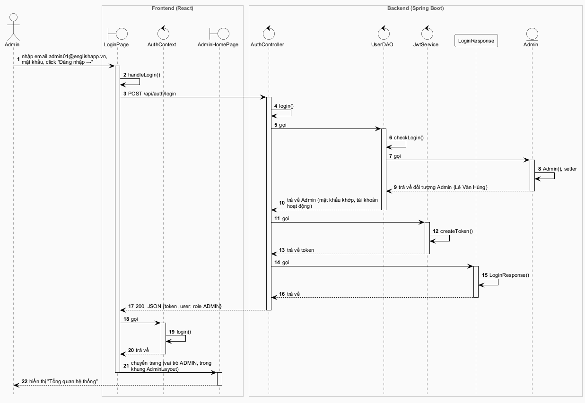
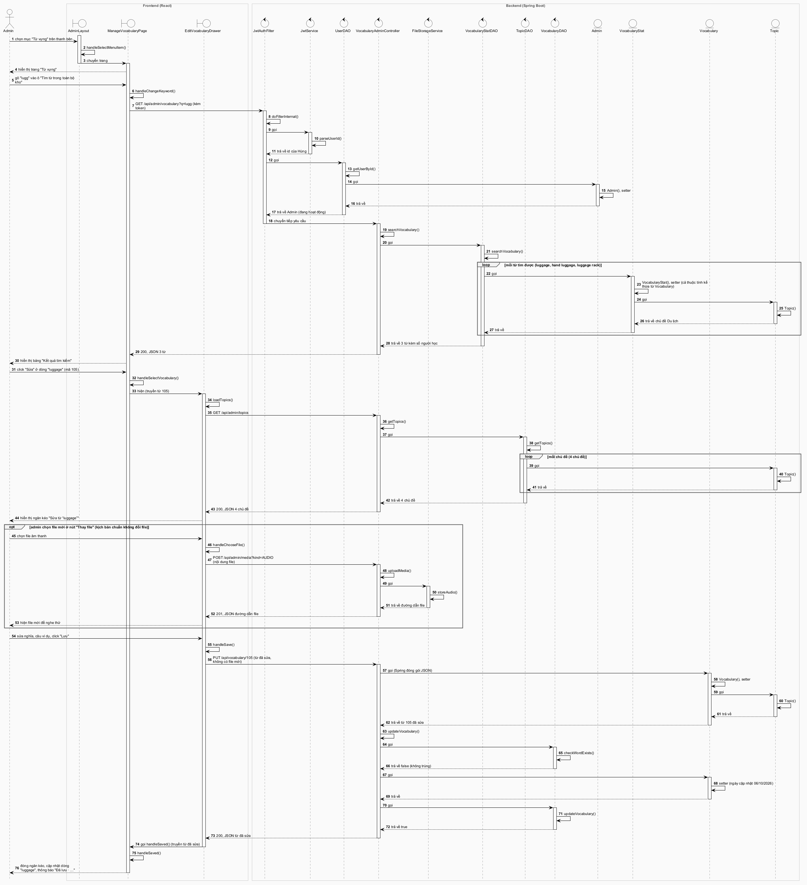
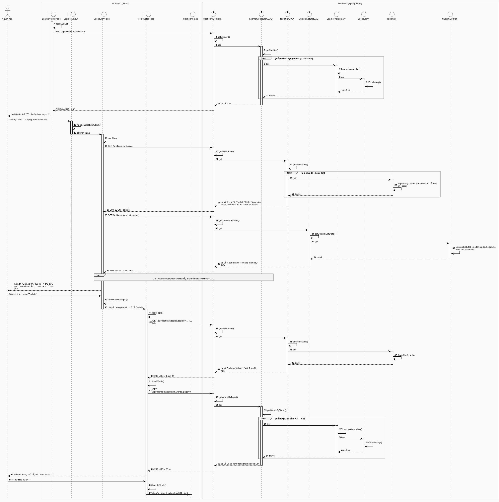
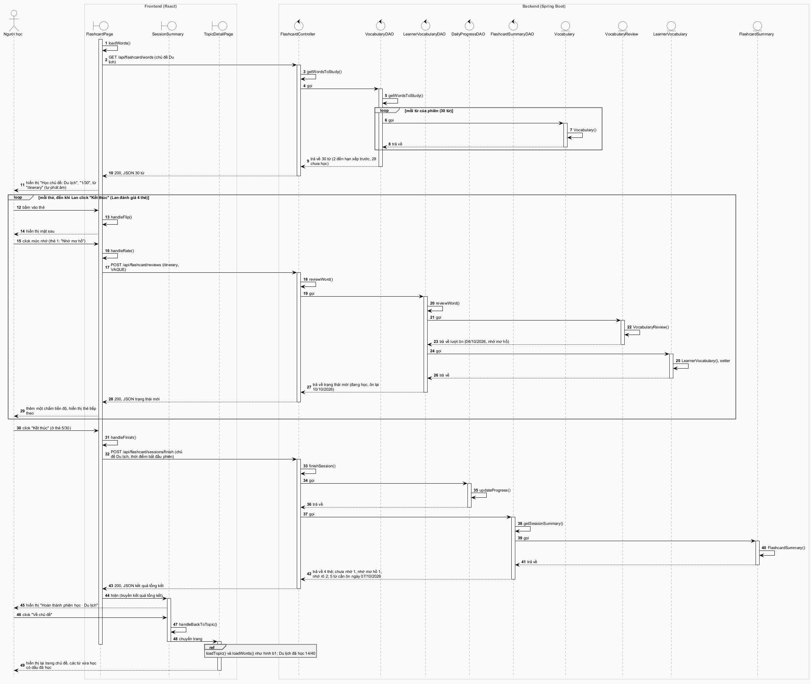
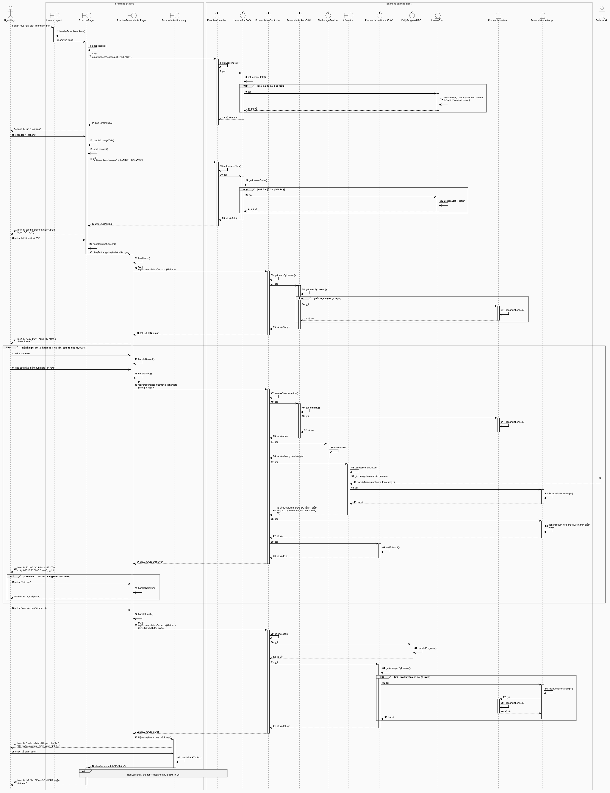
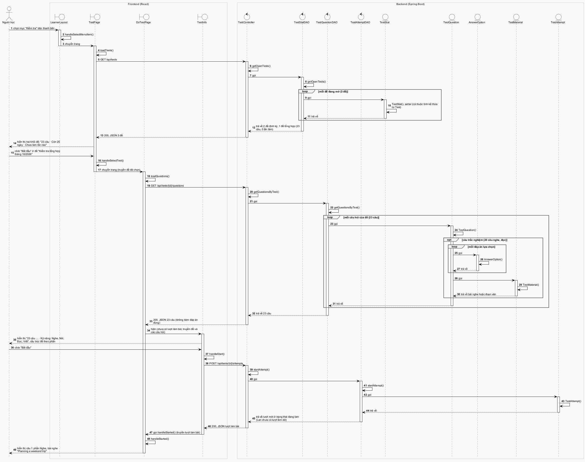
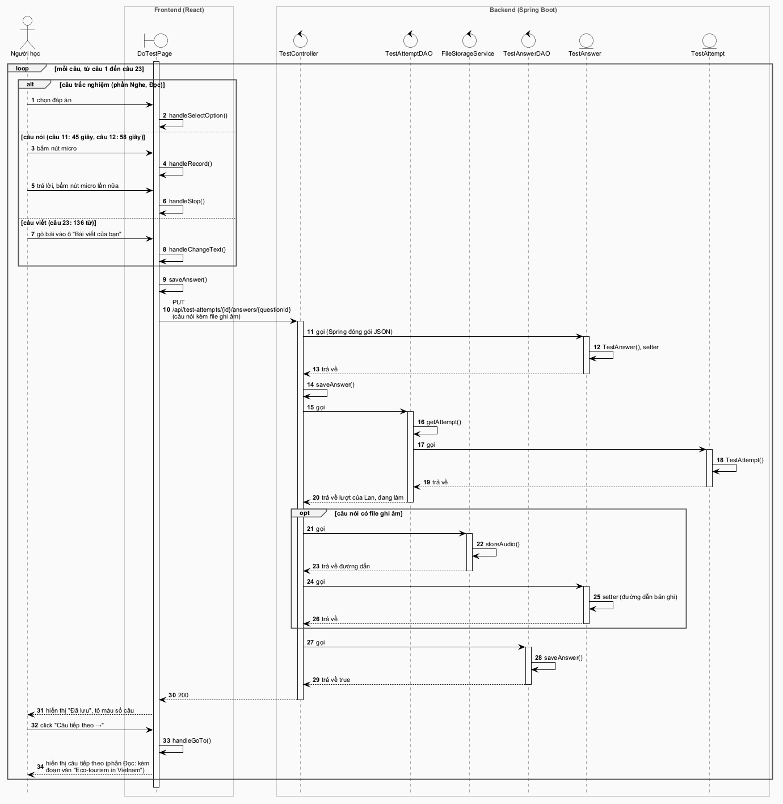
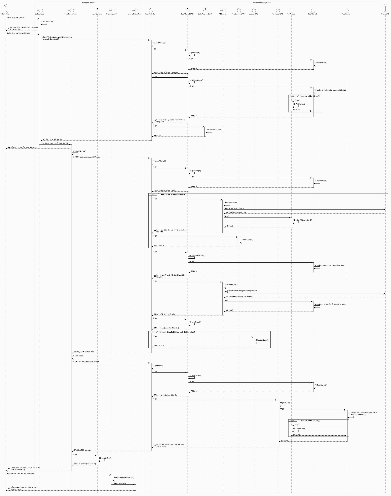
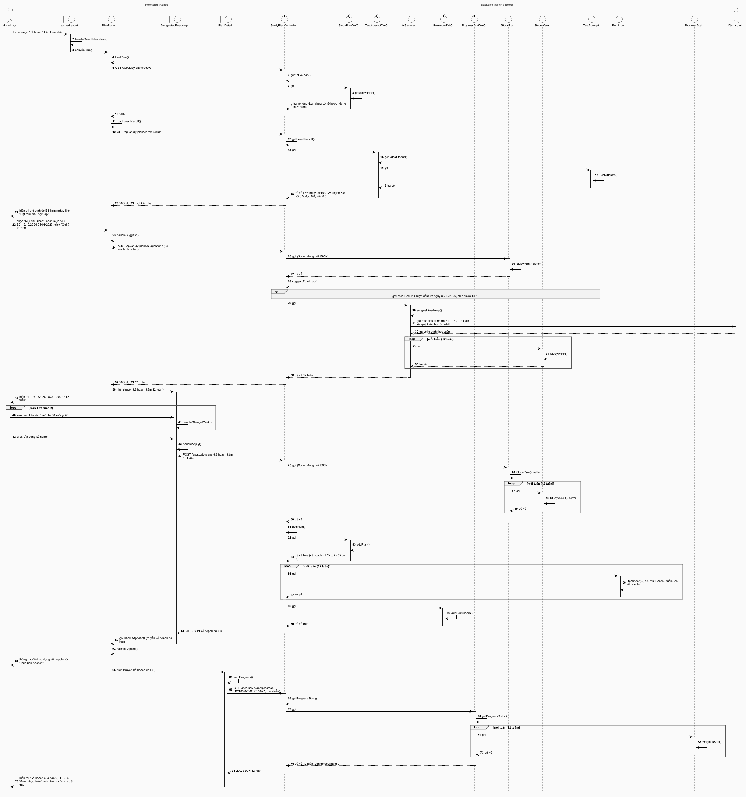

# Biểu đồ tuần tự (thiết kế)

Mỗi chức năng tiêu biểu có một **kịch bản phiên bản 3**: kịch bản phiên bản 2 (`Analysis/SequenceDiagram.md`) được viết lại theo các lớp và phương thức của biểu đồ lớp thiết kế (`Design/ClassDiagram.md`), gồm trang và component React, controller, DAO, `AIService` và lớp thực thể. Biểu đồ tuần tự được vẽ theo kịch bản này. Dữ liệu giống kịch bản phiên bản 2: admin Lê Văn Hùng, người học Trần Thị Lan, ngày 06/10/2026. Tên nút và thông báo ghi đúng chữ trên giao diện của hệ thống đang chạy (cập nhật 01/10/2026).

## Quy ước

- **Biểu tượng.**
  - Trang và component React, cùng `AIService` (cổng ra Dịch vụ AI), dùng biểu tượng boundary.
  - Controller, DAO, các lớp hỗ trợ ở backend (`JwtService`, `JwtAuthFilter`, `FileStorageService`) và `AuthContext` ở frontend dùng biểu tượng control.
  - Lớp thực thể dùng biểu tượng entity. `LoginResponse` chỉ là lớp gói dữ liệu trả về, vẽ dạng hộp thường.
  - Hai khung **Frontend (React)** và **Backend (Spring Boot)** tách phía trình duyệt và phía server.
- **Thông điệp.** Mẫu dùng thông điệp "call" và phương thức tự gọi `actionPerformed()`. Ở đây, mỗi bước gồm:
  1. người dùng thao tác trên giao diện, giao diện tự gọi hàm xử lý (`handleXxx()`) hoặc hàm nạp dữ liệu (`loadXxx()`);
  2. giao diện gửi yêu cầu HTTP tới controller; nhãn ghi phương thức HTTP và URL;
  3. controller tự gọi phương thức xử lý rồi "gọi" DAO; DAO tự gọi phương thức của nó;
  4. DAO gọi lớp thực thể để đóng gói kết quả (hàm khởi tạo, setter), như mẫu;
  5. các mũi tên nét đứt là trả về; phản hồi HTTP ghi mã trạng thái, ví dụ `200, JSON 3 từ`.
- **Chuyển giao diện.** Thông điệp "chuyển trang" là chuyển sang một trang khác. Thông điệp "hiện" là trang cho hiện một component con của nó (ngăn kéo, thẻ tổng kết, khối nội dung), truyền dữ liệu qua props. Component con gọi lại hàm của trang chứa nó bằng thông điệp "gọi".
- **Cơ chế chung, không vẽ lại ở mọi hình:**
  - mọi yêu cầu từ giao diện đi qua `apiClient`, là nơi gắn token;
  - `JwtAuthFilter` chạy trước mọi controller. Nó chỉ được vẽ ở yêu cầu đầu tiên sau đăng nhập (hình a2, bước 7–18);
  - controller lấy người học đang đăng nhập từ Spring Security, và lấy ngày giờ hiện tại từ bean `Clock`.
- **Dữ liệu JSON gửi lên** được Spring (Jackson) đóng gói thành đối tượng thực thể trước khi phương thức controller chạy. Bước này được vẽ thành controller gọi lớp thực thể, nhãn "gọi (Spring đóng gói JSON)", giống bước Frm của mẫu gọi lớp Room để đóng gói dữ liệu vừa nhập.
- **Lớp thống kê kế thừa lớp thực thể** (VocabularyStat, TopicStat, CustomListStat, LessonStat, TestStat, TestReport). Mẫu vẽ RoomStat gọi lớp Room để đặt các thuộc tính kế thừa. Tuy nhiên, kế thừa không tạo ra đối tượng thứ hai, nên ở đây đối tượng lớp con tự đặt cả thuộc tính kế thừa, trong một thông điệp tự gọi.
- **Lớp thành phần** được đóng gói như mẫu: đối tượng chứa gọi lớp thành phần (VocabularyStat gọi Topic, TestQuestion gọi AnswerOption và TestMaterial), giống Booking gọi Client của mẫu.
- **Khung tương tác:**
  - `loop` cho đoạn lặp;
  - `opt` cho bước chỉ xảy ra khi thỏa điều kiện;
  - `alt` cho lựa chọn giữa các nhánh;
  - `ref` cho một đoạn giống hệt một đoạn đã vẽ (trong cùng hình hoặc ở hình khác).
- **Số hình.** Có 9 hình. Mỗi hình ứng với một hình của biểu đồ lớp thiết kế, riêng hình lớp 6 (chọn đề và làm bài kiểm tra) ứng với hai hình tuần tự d1 và d2 cho dễ đọc:

| Biểu đồ tuần tự | Biểu đồ lớp thiết kế |
|---|---|
| a1. Đăng nhập | Hình 1 |
| a2. Sửa từ vựng | Hình 2 |
| b1. Học flashcard – chọn chủ đề | Hình 3 |
| b2. Học flashcard – học thẻ và tổng kết | Hình 4 |
| c. Luyện phát âm | Hình 5 |
| d1. Kiểm tra tổng hợp – chọn đề và bắt đầu | Hình 6 |
| d2. Kiểm tra tổng hợp – trả lời từng câu | Hình 6 |
| d3. Kiểm tra tổng hợp – nộp bài, chấm và xem báo cáo | Hình 7 |
| e. Lập kế hoạch học cá nhân | Hình 8 |

## a. Sửa thông tin từ vựng

### Đăng nhập

Kịch bản phiên bản 3 (kịch bản 2, dùng tài khoản admin của kịch bản 19):

- Hùng nhập email admin01@englishapp.vn, mật khẩu rồi click nút "Đăng nhập →" trên LoginPage.
- Hàm `handleLogin()` của LoginPage được gọi.
- `handleLogin()` gửi yêu cầu `POST /api/auth/login` tới lớp AuthController.
- Phương thức `login()` của AuthController được gọi.
- `login()` gọi phương thức `checkLogin()` của lớp UserDAO.
- `checkLogin()` tìm người dùng theo email và so sánh mật khẩu với bản băm đã lưu.
- `checkLogin()` gọi lớp Admin để đóng gói kết quả. Lớp Admin gọi hàm khởi tạo và các setter, rồi trả đối tượng Admin (Lê Văn Hùng) về cho `checkLogin()`.
- `checkLogin()` trả đối tượng Admin về cho `login()`: mật khẩu khớp và tài khoản đang hoạt động.
- `login()` gọi phương thức `createToken()` của lớp JwtService. `createToken()` trả về token.
- `login()` gọi lớp LoginResponse để gói token và đối tượng Admin.
- AuthController trả phản hồi 200 kèm JSON gồm token và người dùng (vai trò ADMIN) về cho LoginPage.
- `handleLogin()` gọi phương thức `login()` của AuthContext để lưu token và người dùng.
- `handleLogin()` chuyển sang AdminHomePage (trong khung AdminLayout), vì người dùng có vai trò ADMIN.
- AdminHomePage hiển thị trang "Tổng quan hệ thống" cho Hùng.

### Sửa từ vựng

Kịch bản phiên bản 3 (kịch bản 19):

- Hùng chọn mục "Từ vựng" trên thanh bên. Hàm `handleSelectMenuItem()` của AdminLayout được gọi và chuyển sang ManageVocabularyPage.
- ManageVocabularyPage hiển thị trang "Từ vựng" cho Hùng.
- Hùng gõ "lugg" vào ô "Tìm từ trong toàn bộ kho". Hàm `handleChangeKeyword()` được gọi; sau khi Hùng ngừng gõ, hàm gửi yêu cầu `GET /api/admin/vocabulary?q=lugg`, kèm token.
- Yêu cầu đi qua JwtAuthFilter trước:
  - Phương thức `doFilterInternal()` của JwtAuthFilter được gọi.
  - `doFilterInternal()` gọi `parseUserId()` của JwtService để đọc id của Hùng từ token.
  - `doFilterInternal()` gọi `getUserById()` của UserDAO. `getUserById()` gọi lớp Admin đóng gói người dùng, rồi trả về đối tượng Admin đang hoạt động.
  - JwtAuthFilter chuyển tiếp yêu cầu tới lớp VocabularyAdminController.
- Phương thức `searchVocabulary()` của VocabularyAdminController được gọi.
- `searchVocabulary()` gọi phương thức `searchVocabulary()` của lớp VocabularyStatDAO.
- `searchVocabulary()` của VocabularyStatDAO gọi lớp VocabularyStat để đóng gói từng từ tìm được (luggage, hand luggage, luggage rack), gồm cả thuộc tính kế thừa từ Vocabulary và số người học. Với mỗi từ, lớp VocabularyStat gọi lớp Topic để đóng gói chủ đề Du lịch.
- VocabularyStatDAO trả 3 từ về cho controller. Controller trả phản hồi 200 kèm 3 từ về cho ManageVocabularyPage.
- ManageVocabularyPage hiển thị bảng "Kết quả tìm kiếm" cho Hùng.
- Hùng click "Sửa" ở dòng từ "luggage" (mã 105).
- Hàm `handleSelectVocabulary()` được gọi và hiện EditVocabularyDrawer, truyền từ 105.
- Khi mở, EditVocabularyDrawer gọi `loadTopics()`. Hàm này gửi `GET /api/admin/topics`.
- Phương thức `getTopics()` của VocabularyAdminController được gọi. Phương thức này gọi `getTopics()` của lớp TopicDAO.
- `getTopics()` của TopicDAO gọi lớp Topic để đóng gói từng chủ đề (4 chủ đề), rồi trả 4 chủ đề về cho controller. Controller trả phản hồi 200 về cho EditVocabularyDrawer.
- EditVocabularyDrawer hiển thị ngăn kéo "Sửa từ “luggage”" với thông tin hiện tại của từ cho Hùng.
- Khung `opt` (không có trong kịch bản chuẩn, vì Hùng không đổi file): nếu Hùng chọn file mới ở nút "Thay file", hàm `handleChooseFile()` gửi `POST /api/admin/media?kind=AUDIO` kèm nội dung file. Phương thức `uploadMedia()` của VocabularyAdminController gọi `storeAudio()` của FileStorageService rồi trả về đường dẫn file (mã 201); ngăn kéo hiện file mới để Hùng nghe thử trước khi lưu.
- Hùng sửa nghĩa thành "hành lý (va li, túi xách mang theo khi đi xa)", sửa câu ví dụ thành "How many pieces of luggage are you checking in?" rồi click nút "Lưu".
- Hàm `handleSave()` được gọi. Hàm kiểm tra từ và nghĩa không trống, rồi gửi yêu cầu `PUT /api/vocabulary/105` kèm từ đã sửa (không có file mới, nên không có yêu cầu tải file `POST /api/admin/media`).
- Spring gọi lớp Vocabulary để đóng gói dữ liệu JSON thành đối tượng từ 105 đã sửa; lớp Vocabulary gọi lớp Topic để đóng gói chủ đề.
- Phương thức `updateVocabulary()` của VocabularyAdminController được gọi.
- `updateVocabulary()` gọi phương thức `checkWordExists()` của VocabularyDAO. Phương thức trả về false: trong chủ đề Du lịch không có từ "luggage" nào khác.
- `updateVocabulary()` gọi setter của Vocabulary để gán ngày cập nhật 06/10/2026.
- `updateVocabulary()` gọi phương thức `updateVocabulary()` của VocabularyDAO. Phương thức lưu thay đổi và trả về true.
- Controller trả phản hồi 200 kèm từ đã sửa về cho EditVocabularyDrawer.
- EditVocabularyDrawer gọi hàm `handleSaved()` của ManageVocabularyPage, truyền từ đã sửa.
- ManageVocabularyPage đóng ngăn kéo, thay dòng "luggage" trong bảng kết quả bằng nghĩa mới, và hiển thị thông báo "Đã lưu · Nghĩa và câu ví dụ của “luggage” đã được cập nhật." ở góc màn hình cho Hùng.

## b. Học flashcard theo chủ đề

### Chọn chủ đề

Kịch bản phiên bản 3, bỏ qua bước đăng nhập (kịch bản 5, bước 1–6):

- Sau khi Lan đăng nhập, LearnerHomePage mở ra và gọi hàm `loadDueList()`.
- `loadDueList()` gửi yêu cầu `GET /api/flashcard/due-words` tới lớp FlashcardController.
- Phương thức `getDueList()` của FlashcardController được gọi.
- `getDueList()` gọi phương thức `getDueList()` của lớp LearnerVocabularyDAO.
- `getDueList()` của DAO gọi lớp LearnerVocabulary để đóng gói từng từ đến hạn (itinerary, passport). Lớp LearnerVocabulary gọi lớp Vocabulary để đóng gói từ vựng tương ứng.
- DAO trả 2 từ về cho controller. Controller trả phản hồi 200 kèm 2 từ về cho LearnerHomePage.
- LearnerHomePage hiển thị trang "Tiến độ" với thẻ "Từ cần ôn hôm nay · 2 · Ôn tập ngay →" cho Lan.
- Lan chọn mục "Từ vựng" trên thanh bên. Hàm `handleSelectMenuItem()` của LearnerLayout được gọi và chuyển sang VocabularyPage.
- Khi mở, VocabularyPage gọi hàm `loadData()`.
- `loadData()` gửi yêu cầu `GET /api/flashcard/topics`.
- Phương thức `getTopicStats()` của FlashcardController được gọi. Phương thức này gọi `getTopicStats()` của lớp TopicStatDAO, không kèm chủ đề nào.
- `getTopicStats()` của DAO gọi lớp TopicStat để đóng gói từng chủ đề, gồm cả thuộc tính kế thừa từ Topic.
- DAO trả 4 chủ đề (Du lịch 12/40, Công việc 20/35, Gia đình 30/30, Thức ăn 25/45) về cho controller. Controller trả phản hồi 200 về cho VocabularyPage.
- `loadData()` gửi tiếp yêu cầu `GET /api/flashcard/custom-lists`.
- Phương thức `getCustomListStats()` của FlashcardController được gọi. Phương thức này gọi `getCustomListStats()` của lớp CustomListStatDAO.
- `getCustomListStats()` của DAO gọi lớp CustomListStat để đóng gói danh sách "Từ khó tuần này" (2/6). Kết quả được trả về tới VocabularyPage.
- `loadData()` gửi tiếp yêu cầu `GET /api/flashcard/due-words`; backend lấy 2 từ đến hạn như các bước đầu của hình (khung `ref`).
- VocabularyPage hiển thị trang "Từ vựng" cho Lan: dòng "Đã học 87 / 150 từ · 4 chủ đề", dải "Bạn có 2 từ cần ôn hôm nay", tab "Chủ đề có sẵn" với 4 thẻ chủ đề và nhãn tab "Danh sách của tôi (1)".
- Lan click thẻ chủ đề "Du lịch". Hàm `handleSelectTopic()` được gọi và chuyển sang TopicDetailPage, truyền chủ đề Du lịch.
- Khi mở, TopicDetailPage gọi hàm `loadTopic()`. Hàm này gửi yêu cầu `GET /api/flashcard/topics?topicId=…` với chủ đề Du lịch.
- Phương thức `getTopicStats()` của FlashcardController gọi `getTopicStats()` của TopicStatDAO, kèm chủ đề Du lịch. DAO gọi lớp TopicStat để đóng gói chủ đề này: đã học 12/40, 2 từ đến hạn ôn. Kết quả được trả về tới TopicDetailPage.
- TopicDetailPage gọi hàm `loadWords()`. Hàm này gửi yêu cầu `GET /api/flashcard/topics/{id}/words?page=0`.
- Phương thức `getWordsByTopic()` của FlashcardController được gọi. Phương thức này gọi `getWordsByTopic()` của lớp LearnerVocabularyDAO với vị trí 0 và 20 từ.
- `getWordsByTopic()` của DAO gọi lớp LearnerVocabulary để đóng gói từng từ (20 từ đầu, sắp từ A1 đến C2) kèm trạng thái học của Lan; lớp LearnerVocabulary gọi lớp Vocabulary để đóng gói từ vựng.
- DAO trả 20 từ về cho controller. Controller trả phản hồi 200 về cho TopicDetailPage.
- TopicDetailPage hiển thị trang chủ đề "Du lịch" cho Lan: mô tả, danh sách từ có dấu đã học, nút "Học 30 từ →" (2 từ đến hạn ôn + 40 − 12 từ chưa học).
- Lan click nút "Học 30 từ →". Hàm `handleStudy()` được gọi và chuyển sang FlashcardPage, truyền chủ đề Du lịch.

### Học thẻ và tổng kết

Kịch bản phiên bản 3 (kịch bản 5, bước 7–15):

- Khi mở, FlashcardPage ghi lại thời điểm bắt đầu phiên và gọi hàm `loadWords()`.
- `loadWords()` gửi yêu cầu `GET /api/flashcard/words` với chủ đề Du lịch.
- Phương thức `getWordsToStudy()` của FlashcardController được gọi. Phương thức này gọi `getWordsToStudy()` của lớp VocabularyDAO.
- `getWordsToStudy()` của DAO gọi lớp Vocabulary để đóng gói từng từ của phiên, rồi trả 30 từ về cho controller: 2 từ đến hạn xếp trước, 28 từ chưa học xếp sau.
- Controller trả phản hồi 200 kèm 30 từ về cho FlashcardPage.
- FlashcardPage hiển thị giao diện "Học chủ đề: Du lịch" cho Lan: bộ đếm "1/30", mặt trước của từ "itinerary", và tự phát âm từ này một lần.
- Các bước sau lặp lại cho từng thẻ; Lan đánh giá 4 thẻ:
  - Lan bấm vào thẻ. Hàm `handleFlip()` được gọi và hiển thị mặt sau.
  - Lan click một mức nhớ (thẻ 1: "Nhớ mơ hồ"). Hàm `handleRate()` được gọi.
  - `handleRate()` gửi yêu cầu `POST /api/flashcard/reviews` kèm từ itinerary và mức nhớ VAGUE.
  - Phương thức `reviewWord()` của FlashcardController được gọi. Phương thức này gọi `reviewWord()` của lớp LearnerVocabularyDAO.
  - `reviewWord()` của DAO gọi lớp VocabularyReview để tạo lượt ôn (06/10/2026, nhớ mơ hồ).
  - `reviewWord()` của DAO gọi lớp LearnerVocabulary để đặt trạng thái mới: đang học, ngày ôn tiếp theo 10/10/2026.
  - DAO trả trạng thái mới về cho controller. Controller trả phản hồi 200 về cho FlashcardPage.
  - FlashcardPage thêm một chấm vào thanh tiến độ và hiển thị thẻ tiếp theo.
- Ở thẻ "5/30", Lan click nút "Kết thúc".
- Hàm `handleFinish()` được gọi và gửi yêu cầu `POST /api/flashcard/sessions/finish`, kèm chủ đề Du lịch và thời điểm bắt đầu phiên.
- Phương thức `finishSession()` của FlashcardController được gọi.
- `finishSession()` tính số phút học của phiên, rồi gọi phương thức `updateProgress()` của lớp DailyProgressDAO để cộng vào tiến độ ngày 06/10/2026.
- `finishSession()` gọi phương thức `getSessionSummary()` của lớp FlashcardSummaryDAO.
- `getSessionSummary()` gọi lớp FlashcardSummary để đóng gói kết quả: 4 thẻ đã học; chưa nhớ 1, nhớ mơ hồ 1, nhớ rõ 2; 5 từ cần ôn ngày 07/10/2026.
- Controller trả phản hồi 200 kèm kết quả tổng kết về cho FlashcardPage.
- FlashcardPage hiện SessionSummary, truyền kết quả tổng kết.
- SessionSummary hiển thị thẻ "Hoàn thành phiên học · Du lịch" cho Lan.
- Lan click nút "Về chủ đề". Hàm `handleBackToTopic()` được gọi và chuyển sang TopicDetailPage.
- TopicDetailPage nạp lại số liệu chủ đề và danh sách từ như ở hình b1 (khung `ref`): Du lịch đã học 14/40, các từ vừa học có dấu đã học.
- TopicDetailPage hiển thị lại trang chủ đề cho Lan.

Lan click "← Chủ đề" để về tab "Chủ đề có sẵn"; VocabularyPage nạp lại lưới chủ đề như ở hình b1 và thẻ Du lịch ghi "40 từ · 35% đã học". Đoạn này giống hình b1 nên không vẽ lại.

## c. Luyện phát âm

Kịch bản phiên bản 3, bỏ qua bước đăng nhập (kịch bản 12):

- Lan chọn mục "Bài tập" trên thanh bên. Hàm `handleSelectMenuItem()` của LearnerLayout được gọi và chuyển sang ExercisePage.
- Khi mở, ExercisePage gọi hàm `loadLessons()` cho tab đầu tiên "Đọc hiểu". Hàm này gửi yêu cầu `GET /api/exercises/lessons?skill=READING` tới lớp ExerciseController.
- Phương thức `getLessonStats()` của ExerciseController gọi `getLessonStats()` của lớp LessonStatDAO. DAO gọi lớp LessonStat để đóng gói 5 bài đọc hiểu. Kết quả được trả về tới ExercisePage.
- ExercisePage hiển thị trang "Bài tập" ở tab "Đọc hiểu" cho Lan.
- Lan chọn tab "Phát âm". Hàm `handleChangeTab()` được gọi rồi gọi `loadLessons()`. Hàm này gửi yêu cầu `GET /api/exercises/lessons?skill=PRONUNCIATION`.
- Phương thức `getLessonStats()` của ExerciseController được gọi. Phương thức này gọi `getLessonStats()` của lớp LessonStatDAO.
- `getLessonStats()` của DAO gọi lớp LessonStat để đóng gói từng bài, gồm cả thuộc tính kế thừa từ ExerciseLesson, rồi trả 3 bài về cho controller.
- Controller trả phản hồi 200 kèm 3 bài về cho ExercisePage. Trang hiển thị các bài theo cột CEFR cho Lan; thẻ "Âm /θ/ và /ð/" ghi "Đã luyện 0/5 mục".
- Lan click thẻ "Âm /θ/ và /ð/". Hàm `handleSelectLesson()` được gọi và chuyển sang PracticePronunciationPage.
- Khi mở, PracticePronunciationPage ghi lại thời điểm bắt đầu luyện và gọi hàm `loadItems()`. Hàm này gửi yêu cầu `GET /api/pronunciation/lessons/{id}/items`.
- Phương thức `getItemsByLesson()` của PronunciationController được gọi. Phương thức này gọi `getItemsByLesson()` của lớp PronunciationItemDAO.
- `getItemsByLesson()` của DAO gọi lớp PronunciationItem để đóng gói từng mục, rồi trả 5 mục về. Controller trả phản hồi 200 về cho PracticePronunciationPage.
- PracticePronunciationPage hiển thị mục 1 (nhãn "Câu 1/5") "Thank you for the three tickets." cho Lan.
- Các bước sau lặp lại cho mỗi lần ghi âm; có 9 lần: mục 1 ghi âm hai lần, sau đó các mục 2–5:
  - Lan bấm nút micro. Hàm `handleRecord()` được gọi và bắt đầu ghi.
  - Lan đọc câu mẫu rồi bấm nút micro lần nữa. Hàm `handleStop()` được gọi.
  - `handleStop()` gửi yêu cầu `POST /api/pronunciation/items/{id}/attempts` kèm bản ghi 3 giây.
  - Phương thức `assessPronunciation()` của PronunciationController được gọi.
  - `assessPronunciation()` gọi phương thức `getItemById()` của PronunciationItemDAO. Phương thức này gọi lớp PronunciationItem đóng gói mục 1 rồi trả về.
  - `assessPronunciation()` gọi phương thức `storeAudio()` của lớp FileStorageService. Phương thức lưu bản ghi và trả về đường dẫn.
  - `assessPronunciation()` gọi phương thức `assessPronunciation()` của lớp AIService.
  - AIService gửi bản ghi âm và văn bản mẫu đến Dịch vụ AI. Dịch vụ AI trả về điểm và nhận xét theo từng từ.
  - AIService gọi lớp PronunciationAttempt để đóng gói kết quả, rồi trả lượt luyện chưa lưu về cho controller. Lần 1: điểm tổng 72, độ chính xác 68, độ trôi chảy 80.
  - Controller gọi các setter của PronunciationAttempt để gán người học, mục luyện và thời điểm luyện.
  - Controller gọi phương thức `addAttempt()` của lớp PronunciationAttemptDAO. Phương thức lưu lượt luyện và trả về true.
  - Controller trả phản hồi 200 kèm lượt luyện về cho PracticePronunciationPage.
  - PracticePronunciationPage hiển thị vòng điểm 72/100, dòng "Chính xác 68 · Trôi chảy 80", tô đỏ hai từ "the" và "three" và hiện gợi ý cải thiện.
  - Nếu Lan click "Tiếp tục", hàm `handleNextItem()` được gọi và hiển thị mục kế tiếp.
- Ở mục 5, Lan click "Xem kết quả". Hàm `handleFinish()` được gọi và gửi yêu cầu `POST /api/pronunciation/lessons/{id}/finish`, kèm thời điểm bắt đầu luyện.
- Phương thức `finishLesson()` của PronunciationController được gọi.
- `finishLesson()` tính số phút luyện, rồi gọi phương thức `updateProgress()` của DailyProgressDAO.
- `finishLesson()` gọi phương thức `getAttemptsByLesson()` của PronunciationAttemptDAO.
- `getAttemptsByLesson()` gọi lớp PronunciationAttempt để đóng gói từng lượt luyện của bài (9 lượt). Lớp PronunciationAttempt gọi lớp PronunciationItem để đóng gói mục luyện của lượt.
- DAO trả 9 lượt về cho controller. Controller trả phản hồi 200 kèm 9 lượt về cho PracticePronunciationPage.
- PracticePronunciationPage hiện PronunciationSummary, truyền các mục và 9 lượt.
- PronunciationSummary hiển thị thẻ "Hoàn thành bài luyện phát âm" cho Lan: "Đã luyện 5/5 mục · điểm trung bình 84" và số lần thử, điểm cao nhất của từng mục.
- Lan click "Về danh sách". Hàm `handleBackToList()` được gọi và chuyển sang ExercisePage ở tab "Phát âm".
- ExercisePage nạp lại các bài phát âm như trên (khung `ref`) và hiển thị thẻ "Âm /θ/ và /ð/" với dòng "Đã luyện 5/5 mục".

## d. Làm kiểm tra tổng hợp

### Chọn đề và bắt đầu làm bài

Kịch bản phiên bản 3, bỏ qua bước đăng nhập (kịch bản 15, bước 1–5):

- Lan chọn mục "Kiểm tra" trên thanh bên. Hàm `handleSelectMenuItem()` của LearnerLayout được gọi và chuyển sang TestPage.
- Khi mở, TestPage gọi hàm `loadTests()`. Hàm này gửi yêu cầu `GET /api/tests` tới lớp TestController.
- Phương thức `getOpenTests()` của TestController được gọi. Phương thức này gọi `getOpenTests()` của lớp TestStatDAO, với cả hai loại đề.
- `getOpenTests()` của DAO gọi lớp TestStat để đóng gói từng đề đang mở, gồm cả thuộc tính kế thừa từ Test. DAO trả về 3 đề: 2 đề định kỳ và đề tổng hợp "Kiểm tra tổng hợp tháng 10/2026" (23 câu, Lan chưa làm lần nào).
- Controller trả phản hồi 200 kèm 3 đề về cho TestPage. Trang chia đề vào hai khối và hiển thị cho Lan; thẻ đề tổng hợp ghi "23 câu · Còn 25 ngày · Chưa làm lần nào".
- Lan click nút "Bắt đầu" ở thẻ "Kiểm tra tổng hợp tháng 10/2026". Hàm `handleSelectTest()` được gọi và chuyển sang DoTestPage, truyền đề đã chọn.
- Khi mở, DoTestPage gọi hàm `loadQuestions()`. Hàm này gửi yêu cầu `GET /api/tests/{id}/questions`.
- Phương thức `getQuestionsByTest()` của TestController được gọi. Phương thức này gọi `getQuestionsByTest()` của lớp TestQuestionDAO.
- `getQuestionsByTest()` của DAO gọi lớp TestQuestion để đóng gói từng câu hỏi (23 câu). Với 20 câu trắc nghiệm nghe và đọc, lớp TestQuestion gọi lớp AnswerOption để đóng gói từng đáp án lựa chọn, và gọi lớp TestMaterial để đóng gói bài nghe hoặc đoạn văn.
- DAO trả 23 câu về cho controller. Controller trả phản hồi 200 kèm 23 câu, **không kèm đáp án đúng**, về cho DoTestPage.
- Lan chưa có lượt làm bài nên DoTestPage hiện TestInfo, truyền đề và các câu hỏi.
- TestInfo hiển thị màn giới thiệu đề cho Lan: "23 câu … · Kỹ năng: Nghe, Nói, Đọc, Viết", cấu trúc đề theo phần (nghe 10 câu, nói 2 đề, đọc 10 câu, viết 1 đề) và các lưu ý.
- Lan click nút "Bắt đầu". Hàm `handleStart()` của TestInfo được gọi và gửi yêu cầu `POST /api/tests/{id}/attempts`.
- Phương thức `startAttempt()` của TestController được gọi. Phương thức này gọi `startAttempt()` của lớp TestAttemptDAO.
- Lan chưa có lượt làm dở, nên `startAttempt()` của DAO tạo lượt mới ở trạng thái đang làm. DAO gọi lớp TestAttempt đóng gói lượt này, rồi trả về cho controller.
- Controller trả phản hồi 200 kèm lượt làm bài về cho TestInfo.
- TestInfo gọi hàm `handleStarted()` của DoTestPage, truyền lượt làm bài.
- DoTestPage hiển thị câu 1 của phần Nghe cho Lan, với bài nghe chung "Planning a weekend trip" và dãy số câu chia theo phần.

### Trả lời từng câu

Kịch bản phiên bản 3 (kịch bản 15, bước 6–10):

- Các bước sau lặp lại cho mỗi câu, từ câu 1 đến câu 23:
  - Lan trả lời câu đang hiện:
    - câu trắc nghiệm (phần Nghe, Đọc): Lan chọn một đáp án, hàm `handleSelectOption()` được gọi;
    - câu nói (câu 11, 12): Lan bấm nút micro, hàm `handleRecord()` được gọi; Lan trả lời (45 giây, 58 giây) rồi bấm lần nữa, hàm `handleStop()` được gọi;
    - câu viết (câu 23): Lan gõ bài 136 từ, hàm `handleChangeText()` được gọi và cập nhật bộ đếm số từ.
  - DoTestPage gọi hàm `saveAnswer()` và hiện "Đang lưu…". Hàm gửi yêu cầu `PUT /api/test-attempts/{id}/answers/{questionId}` kèm câu trả lời (với câu nói, kèm file ghi âm).
  - Spring gọi lớp TestAnswer để đóng gói câu trả lời.
  - Phương thức `saveAnswer()` của TestController được gọi.
  - `saveAnswer()` gọi phương thức `getAttempt()` của lớp TestAttemptDAO. `getAttempt()` gọi lớp TestAttempt đóng gói lượt làm bài, rồi trả về lượt của Lan đang ở trạng thái đang làm.
  - Với câu nói, controller gọi phương thức `storeAudio()` của FileStorageService để lưu file ghi âm, rồi gọi setter của TestAnswer để gán đường dẫn bản ghi.
  - `saveAnswer()` gọi phương thức `saveAnswer()` của lớp TestAnswerDAO. Phương thức lưu câu trả lời và trả về true.
  - Controller trả phản hồi 200 về cho DoTestPage. Trang hiển thị "Đã lưu" và tô màu số câu đó.
  - Lan click "Câu tiếp theo →". Hàm `handleGoTo()` được gọi và hiển thị câu tiếp theo; khi sang phần Đọc, phía trên câu hỏi hiện đoạn văn chung "Eco-tourism in Vietnam".

### Nộp bài, chấm và xem báo cáo

Kịch bản phiên bản 3 (kịch bản 15, bước 11–19):

- Lan click "Nộp bài" ở câu 23. Hàm `handleSubmit()` được gọi và hiển thị hộp thoại "Nộp bài kiểm tra?" với dòng "Bạn đã trả lời tất cả các câu. Sau khi nộp, bạn không sửa được câu trả lời nữa."
- Lan click "Nộp bài" trong hộp thoại. `handleSubmit()` gửi yêu cầu `POST /api/test-attempts/{id}/submit`, kèm thời điểm bắt đầu làm bài.
- Phương thức `submitAttempt()` của TestController được gọi.
- `submitAttempt()` gọi `getAttempt()` của TestAttemptDAO. Phương thức gọi lớp TestAttempt đóng gói lượt làm bài, rồi trả về lượt của Lan đang ở trạng thái đang làm.
- `submitAttempt()` gọi phương thức `submitAttempt()` của TestAttemptDAO. Phương thức ghi thời điểm nộp, chuyển lượt sang trạng thái đã nộp và chấm các câu trắc nghiệm theo đáp án. Nó gọi lớp TestAttempt để đặt các thuộc tính mới; lớp TestAttempt gọi lớp TestAnswer để đóng gói 23 câu trả lời. DAO trả về lượt đã nộp: nghe đúng 7/10, đọc đúng 8/10.
- `submitAttempt()` tính số phút làm bài, rồi gọi `updateProgress()` của DailyProgressDAO.
- Controller trả phản hồi 200 kèm lượt đã nộp về cho DoTestPage.
- DoTestPage chuyển sang TestReportPage, truyền lượt đã nộp.
- TestReportPage hiển thị trang "Kết quả kiểm tra" với tiêu đề "Đang chấm phần Nói, Viết" cho Lan, rồi gọi hàm `gradeAttempt()`.
- `gradeAttempt()` gửi yêu cầu `POST /api/test-attempts/{id}/grade`.
- Phương thức `gradeAttempt()` của TestController được gọi. Phương thức gọi `getAttempt()` của TestAttemptDAO và nhận lượt của Lan ở trạng thái đã nộp.
- Các bước sau lặp lại cho mỗi câu nói và câu viết (3 câu):
  - `gradeAttempt()` gọi phương thức `gradeAnswer()` của lớp AIService.
  - AIService gửi câu trả lời và đề bài đến Dịch vụ AI. Dịch vụ AI trả về điểm và nhận xét.
  - AIService gọi các setter của TestAnswer để gán điểm và nhận xét, rồi trả câu đã chấm về cho controller: đề nói 1 được 6.0, đề nói 2 được 7.0, bài viết được 6.5.
  - `gradeAttempt()` gọi `saveAnswer()` của TestAnswerDAO để lưu ngay câu đã chấm.
- `gradeAttempt()` gọi phương thức `calculateScores()` của TestAttemptDAO. Phương thức gọi các setter của TestAttempt và trả về: nghe 7.0, nói 6.5, đọc 8.0, viết 6.5, tổng 7.0.
- `gradeAttempt()` gọi phương thức `classifyLevel()` của AIService.
- AIService gửi điểm bốn kỹ năng và trình độ hiện tại A2 đến Dịch vụ AI. Dịch vụ AI trả về trình độ và lộ trình đề xuất.
- AIService gọi các setter của TestAttempt để gán trình độ đề xuất B1 và lộ trình 12 tuần, rồi trả về cho controller.
- `gradeAttempt()` gọi phương thức `saveResult()` của TestAttemptDAO. Phương thức lưu kết quả, chuyển lượt sang trạng thái đã chấm và trả về true.
- Vì trình độ đề xuất B1 khác trình độ hiện tại A2, `gradeAttempt()` gọi phương thức `updateLevel()` của lớp LearnerDAO để thêm bản ghi lịch sử trình độ.
- Controller trả phản hồi 200 kèm lượt đã chấm về cho TestReportPage.
- Lượt đã chấm nên TestReportPage gọi hàm `loadReport()`. Hàm này gửi yêu cầu `GET /api/test-attempts/{id}/report`.
- Phương thức `getReport()` của TestController được gọi. Phương thức gọi `getAttempt()` của TestAttemptDAO để kiểm tra lượt thuộc Lan và đã chấm xong.
- `getReport()` gọi phương thức `getReport()` của lớp TestReportDAO.
- `getReport()` của DAO gọi lớp TestReport để đóng gói báo cáo, gồm cả thuộc tính kế thừa từ TestAttempt. Lớp TestReport gọi lớp TestAnswer để đóng gói 23 câu trả lời kèm câu hỏi và đáp án đúng.
- DAO trả báo cáo về cho controller: trình độ trước khi làm bài A2, tổng điểm 7.0, trình độ đề xuất B1. Controller trả phản hồi 200 kèm báo cáo về cho TestReportPage.
- TestReportPage gọi phương thức `updateUser()` của AuthContext để đặt trình độ hiện tại của Lan là B1.
- TestReportPage hiển thị báo cáo cho Lan: tổng điểm 7.0/10, trình độ đề xuất B1, khối "Lộ trình đề xuất", bảng điểm theo kỹ năng và khối "Xem lại bài làm".
- Lan chọn mục "Tiến độ" trên thanh bên. Hàm `handleSelectMenuItem()` của LearnerLayout được gọi và chuyển sang LearnerHomePage.
- LearnerHomePage hiển thị trang "Tiến độ" cho Lan; khối "Trình độ hiện tại" ở thanh bên ghi B1.

## e. Lập kế hoạch học cá nhân

Kịch bản phiên bản 3, bỏ qua bước đăng nhập (kịch bản 17):

- Lan chọn mục "Kế hoạch" trên thanh bên. Hàm `handleSelectMenuItem()` của LearnerLayout được gọi và chuyển sang PlanPage.
- Khi mở, PlanPage gọi hàm `loadPlan()`. Hàm này gửi yêu cầu `GET /api/study-plans/active` tới lớp StudyPlanController.
- Phương thức `getActivePlan()` của StudyPlanController được gọi. Phương thức này gọi `getActivePlan()` của lớp StudyPlanDAO.
- `getActivePlan()` của DAO trả về rỗng, vì Lan chưa có kế hoạch đang thực hiện. Controller trả phản hồi 204 về cho PlanPage.
- PlanPage gọi hàm `loadLatestResult()`. Hàm này gửi yêu cầu `GET /api/study-plans/latest-result`.
- Phương thức `getLatestResult()` của StudyPlanController được gọi. Phương thức này gọi `getLatestResult()` của lớp TestAttemptDAO.
- `getLatestResult()` của DAO gọi lớp TestAttempt để đóng gói lượt kiểm tra ngày 06/10/2026 (nghe 7.0, nói 6.5, đọc 8.0, viết 6.5), rồi trả về. Controller trả phản hồi 200 về cho PlanPage.
- PlanPage hiển thị trang "Kế hoạch học cá nhân" cho Lan: thẻ trình độ B1 (lấy từ AuthContext) kèm radar bốn kỹ năng, khối "Đặt mục tiêu học tập".
- Lan chọn "Mục tiêu khác", nhập mô tả "Đạt B2 để phỏng vấn học bổng vào tháng 1/2027", chọn trình độ mục tiêu B2, ngày bắt đầu 12/10/2026, ngày kết thúc 03/01/2027 rồi click nút "Gợi ý lộ trình".
- Hàm `handleSuggest()` được gọi. Hàm kiểm tra dữ liệu, rồi gửi yêu cầu `POST /api/study-plans/suggestions` kèm kế hoạch chưa lưu.
- Spring gọi lớp StudyPlan để đóng gói kế hoạch.
- Phương thức `suggestRoadmap()` của StudyPlanController được gọi và kiểm tra lại dữ liệu.
- `suggestRoadmap()` gọi phương thức `getLatestResult()` của lớp TestAttemptDAO và nhận lại lượt kiểm tra ngày 06/10/2026, như trên (khung `ref`).
- `suggestRoadmap()` gọi phương thức `suggestRoadmap()` của lớp AIService.
- AIService gửi mục tiêu, trình độ B1 → B2, thời gian 12 tuần và kết quả kiểm tra gần nhất đến Dịch vụ AI. Dịch vụ AI trả về lộ trình theo tuần.
- AIService gọi lớp StudyWeek để đóng gói từng tuần, rồi trả 12 tuần về cho controller.
- Controller trả phản hồi 200 kèm 12 tuần về cho PlanPage.
- PlanPage hiện SuggestedRoadmap dưới khối mục tiêu, truyền kế hoạch kèm 12 tuần.
- SuggestedRoadmap hiển thị khối xem trước "12/10/2026 – 03/01/2027 · 12 tuần" cho Lan.
- Lan sửa mục tiêu số từ mới của tuần 1 và tuần 2 từ 50 xuống 40. Mỗi lần sửa, hàm `handleChangeWeek()` được gọi.
- Lan click nút "Áp dụng kế hoạch". Hàm `handleApply()` được gọi và gửi yêu cầu `POST /api/study-plans` kèm kế hoạch và 12 tuần.
- Spring gọi lớp StudyPlan để đóng gói kế hoạch; lớp StudyPlan gọi lớp StudyWeek để đóng gói từng tuần.
- Phương thức `addPlan()` của StudyPlanController được gọi.
- `addPlan()` gọi phương thức `addPlan()` của StudyPlanDAO. Phương thức lưu kế hoạch và 12 tuần, gán id vừa sinh rồi trả về true.
- `addPlan()` của controller gọi lớp Reminder để tạo 12 nhắc nhở loại kế hoạch, mỗi nhắc nhở vào 8:00 thứ Hai đầu một tuần.
- `addPlan()` gọi phương thức `addReminders()` của lớp ReminderDAO. Phương thức lưu 12 nhắc nhở và trả về true.
- Controller trả phản hồi 200 kèm kế hoạch đã lưu về cho SuggestedRoadmap.
- SuggestedRoadmap gọi hàm `handleApplied()` của PlanPage, truyền kế hoạch đã lưu.
- PlanPage hiển thị thông báo xanh "Đã áp dụng kế hoạch mới. Chúc bạn học tốt!" và hiện PlanDetail thay cho khối mục tiêu, truyền kế hoạch.
- Khi hiện ra, PlanDetail gọi hàm `loadProgress()`. Hàm này gửi yêu cầu `GET /api/study-plans/progress` với khoảng thời gian 12/10/2026–03/01/2027, chia theo tuần.
- Phương thức `getProgressStats()` của StudyPlanController được gọi. Phương thức này gọi `getProgressStats()` của lớp ProgressStatDAO.
- `getProgressStats()` của DAO gọi lớp ProgressStat để đóng gói tiến độ từng tuần, rồi trả 12 tuần (đều bằng 0) về cho controller.
- Controller trả phản hồi 200 về cho PlanDetail.
- PlanDetail hiển thị khối "Kế hoạch của bạn" cho Lan: trình độ B1 → B2, nhãn "Đang thực hiện", tuần hiện tại "chưa bắt đầu", dòng "Nhắc nhở: 8:00 thứ Hai đầu mỗi tuần".

## Khác biệt so với biểu đồ tuần tự phân tích

Các khác biệt sau đến từ các quyết định ở bước biểu đồ lớp thiết kế (mục **Thay đổi so với bước phân tích** của `Design/ClassDiagram.md`):

- **Sửa từ vựng:** kiểm tra từ trùng và lưu từ nằm trong một yêu cầu. Ở bước phân tích, lớp giao diện gọi hai phương thức này lần lượt. Tìm kiếm chạy khi admin ngừng gõ, không có nút tìm kiếm.
- **Học flashcard:** `updateProgress()` được gọi một lần trong `finishSession()`, không gọi sau mỗi thẻ. Dữ liệu tổng kết được trả về cùng yêu cầu kết thúc phiên, nên SessionSummary không gọi backend.
- **Luyện phát âm:**
  - `finishLesson()` do PracticePronunciationPage gửi khi người học click "Xem kết quả", gồm cộng thời gian luyện và lấy các lượt luyện;
  - server tự lấy mục luyện bằng `getItemById()` và lưu bản ghi bằng `storeAudio()` trước khi gửi Dịch vụ AI.
- **Kiểm tra tổng hợp:**
  - mỗi câu trả lời được lưu bằng một yêu cầu `saveAnswer()`;
  - nộp bài (`submitAttempt()`) và chấm bằng AI (`gradeAttempt()`) là hai yêu cầu; trang kết quả gửi yêu cầu chấm và hiện "Đang chấm phần Nói, Viết" trong lúc chờ;
  - `updateProgress()` được gọi ngay khi nộp, vì thời gian làm bài không phụ thuộc Dịch vụ AI;
  - mọi yêu cầu lưu, nộp, chấm, xem báo cáo đều kiểm tra lượt làm bài bằng `getAttempt()`.
- **Lập kế hoạch:**
  - lấy kết quả kiểm tra gần nhất và xin lộ trình từ Dịch vụ AI nằm trong một yêu cầu; trang vẫn nạp kết quả này riêng để vẽ radar;
  - lưu kế hoạch và tạo nhắc nhở nằm trong một yêu cầu, chạy trong một giao dịch; controller tự tạo các đối tượng Reminder.

## Kiểm chứng

Một script đối chiếu 9 biểu đồ tuần tự với 8 biểu đồ lớp thiết kế (chạy lại ngày 01/10/2026) cho kết quả sau:

- mọi lifeline đều là lớp có trong biểu đồ lớp thiết kế;
- mọi thông điệp tự gọi đều là phương thức của đúng lớp đó; trên lớp thực thể, thông điệp tự gọi chỉ là hàm khởi tạo hoặc setter;
- mọi lời gọi giữa hai lớp đều có liên kết tương ứng trong biểu đồ lớp, kể cả liên kết kế thừa từ lớp cha (ví dụ VocabularyStat gọi Topic nhờ liên kết Vocabulary – Topic). Lời gọi đóng gói đối tượng cũng được chấp nhận khi kiểu của đối tượng có trong chữ ký phương thức hoặc thuộc tính của lớp gọi. Yêu cầu đi qua JwtAuthFilter (chuỗi filter của Spring) không cần liên kết;
- cả 27 phương thức controller, mọi phương thức DAO và 4 phương thức của `AIService` đều xuất hiện ít nhất một lần.

Các hàm của giao diện không xuất hiện là hàm của nhánh ngoại lệ hoặc use case khác, không nằm trong kịch bản chuẩn:

- `handleCancel()`, `handlePlayAudio()`, `handlePlaySample()`, `handlePlayRecording()`, `handleSkip()`;
- `handleSelectCustomList()`, `handleChangeTab()` của VocabularyPage, `handleMoreWords()`, `handleBack()` của TopicDetailPage, `handleContinue()`;
- `handleSelectSuggestedGoal()`, `handleApplyRoadmap()`, `handleBackToList()` của TestReportPage, `handleToggleSchedule()`, `handleAdjustPlan()`, `handleAskChatbot()`, `handleLogout()`.
