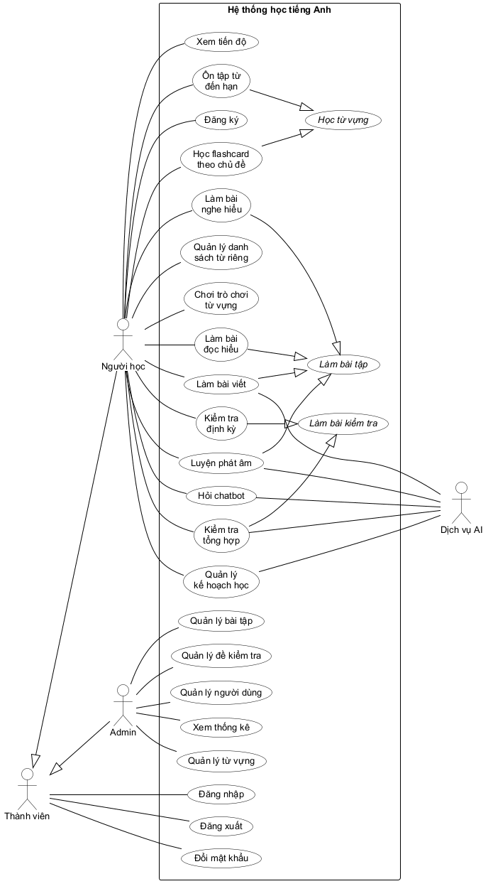
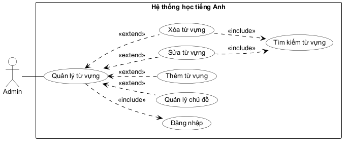
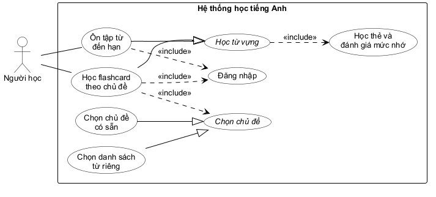
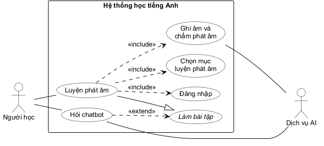
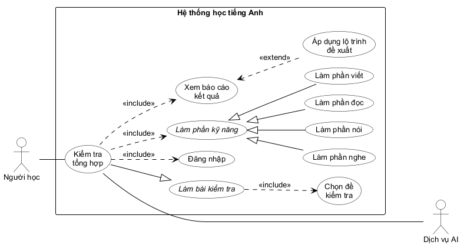
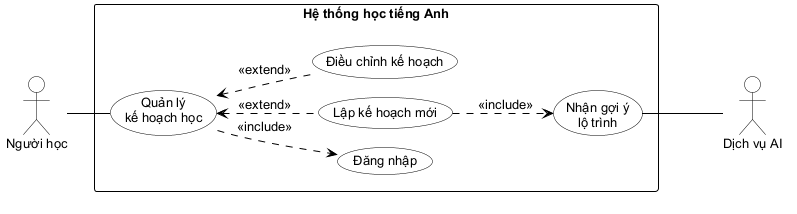

# Mô tả hệ thống bằng UML: Use case

## Các bước xây dựng biểu đồ use case tổng quát

- Bước 1: Đề xuất actor. Mỗi loại người dùng có thể được đề xuất thành một actor của hệ thống. Nếu nhiều loại người dùng có chung một số đặc điểm, ta đề xuất một actor trừu tượng cho tất cả, các actor tương ứng kế thừa actor trừu tượng này. Cần xét thêm các người dùng hoặc hệ thống gián tiếp có thể khởi phát hoặc tham gia vào một số chức năng của hệ thống.
- Bước 2: Đề xuất use case. Mỗi chức năng của một actor được đề xuất thành một use case.
- Bước 3: Tinh chỉnh use case. Nếu có ít nhất hai use case tương tự nhau, ta gom chúng thành một. Nếu việc gom làm hiểu sai về số actor liên quan, ta dùng một use case trừu tượng làm cha chung cho chúng.

## Các bước xây dựng biểu đồ use case chi tiết cho từng chức năng

- Bước 1: Tách phần use case của chức năng từ biểu đồ use case tổng quát.
- Bước 2: Đề xuất các use case con: mỗi (hoặc một vài) giao diện có tương tác với actor có thể là một use case con.
- Bước 3: Xác định quan hệ giữa từng use case con với use case chính: generalization, include hoặc extend.
- Bước 4: Gom một số use case con tương tự nhau thành một use case tổng quát hơn nếu cần.

## Xây dựng biểu đồ use case tổng quát

### Bước 1: Actor

- Actor trực tiếp: người học, admin. Cả hai đều là thành viên của hệ thống và cùng dùng các chức năng đăng nhập, đăng xuất, đổi mật khẩu, nên ta đề xuất actor trừu tượng Thành viên; Người học và Admin kế thừa Thành viên.
- Actor gián tiếp: Dịch vụ AI (hệ thống bên ngoài). Dịch vụ AI không tự khởi phát chức năng nào nhưng tham gia vào các chức năng: làm bài viết (chấm câu viết dựa trên đề bài và câu trả lời mẫu), luyện phát âm (nhận diện giọng nói, chấm điểm), hỏi chatbot (trả lời câu hỏi), kiểm tra tổng hợp (chấm phần nói/viết, phân loại trình độ CEFR), lập kế hoạch học (gợi ý lộ trình).
- Người chưa có tài khoản chỉ dùng được chức năng đăng ký, và tài khoản đăng ký luôn là tài khoản người học. Vì vậy chức năng đăng ký được gắn cho actor Người học, không đề xuất thêm actor riêng cho khách.

### Bước 2 và 3: Use case

- Mọi thành viên dùng được các chức năng:
  - Đăng nhập -> đăng nhập,
  - Đăng xuất -> đăng xuất,
  - Đổi mật khẩu -> đổi mật khẩu.
- Người học dùng được các chức năng:
  - Đăng ký tài khoản mới -> đăng ký,
  - Học flashcard theo chủ đề hoặc danh sách từ riêng -> học flashcard theo chủ đề,
  - Ôn tập các từ đến hạn theo lịch lặp lại ngắt quãng -> ôn tập từ đến hạn,
  - Tạo, sửa, xóa danh sách từ riêng -> quản lý danh sách từ riêng,
  - Chơi trò chơi từ vựng -> chơi trò chơi từ vựng,
  - Làm bài tập đọc hiểu (trắc nghiệm ngữ pháp, điền chỗ trống, trắc nghiệm câu hỏi về bài đọc) -> làm bài đọc hiểu,
  - Làm bài tập viết (dịch câu, viết lại câu, viết câu theo từ khóa) có AI chấm điểm -> làm bài viết,
  - Làm bài tập nghe hiểu -> làm bài nghe hiểu,
  - Luyện phát âm có AI chấm điểm -> luyện phát âm,
  - Hỏi chatbot AI giải thích khi làm bài tập -> hỏi chatbot,
  - Làm kiểm tra định kỳ theo tuần/tháng -> kiểm tra định kỳ,
  - Làm kiểm tra tổng hợp 4 kỹ năng -> kiểm tra tổng hợp,
  - Xem tiến độ học tập và huy hiệu -> xem tiến độ,
  - Lập và điều chỉnh kế hoạch học cá nhân -> quản lý kế hoạch học.
- Admin dùng được các chức năng:
  - Thêm, sửa, xóa chủ đề và từ vựng -> quản lý từ vựng,
  - Thêm, sửa, xóa bài tập đọc hiểu, bài tập viết, bài tập nghe hiểu, bài luyện phát âm -> quản lý bài tập,
  - Thêm, sửa, xóa đề kiểm tra -> quản lý đề kiểm tra,
  - Xem, tìm kiếm, khóa/mở khóa tài khoản người học -> quản lý người dùng,
  - Xem thống kê toàn hệ thống -> xem thống kê.
- Học flashcard theo chủ đề và ôn tập từ đến hạn đều là học bằng flashcard: lật thẻ, tự đánh giá mức độ nhớ, cập nhật lịch ôn. Hai chức năng chỉ khác nhau ở cách chọn thẻ (ôn tập lấy các từ đến hạn của mọi chủ đề và không cần chọn chủ đề), nên vẫn giữ riêng và đề xuất một use case trừu tượng làm cha chung: học từ vựng.
- Làm bài đọc hiểu, làm bài viết, làm bài nghe hiểu, luyện phát âm cùng là làm bài tập, nhưng chỉ làm bài viết và luyện phát âm có Dịch vụ AI tham gia. Nếu gom thành một use case sẽ hiểu sai rằng Dịch vụ AI tham gia vào mọi loại bài tập, nên ta giữ bốn use case và đề xuất use case trừu tượng: làm bài tập.
- Làm bài đọc hiểu và làm bài nghe hiểu có cùng dạng câu hỏi (trắc nghiệm, điền từ) và cùng không có Dịch vụ AI tham gia, nhưng nội dung và giao diện khác nhau: bài đọc hiểu hiện đoạn văn, bài nghe hiểu có trình phát âm thanh, phụ đề và chỉnh tốc độ. Vì vậy ta vẫn giữ riêng hai use case.
- Tương tự, kiểm tra định kỳ và kiểm tra tổng hợp có use case trừu tượng: làm bài kiểm tra (chỉ kiểm tra tổng hợp có Dịch vụ AI tham gia).
- Quản lý từ vựng, quản lý bài tập, quản lý đề kiểm tra có cùng actor và cùng dạng thêm/sửa/xóa, nhưng thao tác trên các loại nội dung có cấu trúc rất khác nhau, nên vẫn giữ là ba use case riêng.
- Hỏi chatbot chỉ được mở khi người học đang làm bài tập. Quan hệ extend giữa hỏi chatbot và làm bài tập được thể hiện ở biểu đồ use case chi tiết của chức năng luyện phát âm.

Biểu đồ use case tổng quát thu được như sau (tên use case in nghiêng là use case trừu tượng):

Mô tả các use case:

- Đăng ký: use case này cho phép một người chưa có tài khoản tạo tài khoản người học mới.
- Đăng nhập: use case này cho phép thành viên đăng nhập vào hệ thống bằng email và mật khẩu.
- Đăng xuất: use case này cho phép thành viên thoát khỏi phiên làm việc hiện tại.
- Đổi mật khẩu: use case này cho phép thành viên đổi mật khẩu tài khoản của mình.
- Học từ vựng: use case trừu tượng, cho phép người học học từ vựng bằng flashcard: lật thẻ, tự đánh giá mức độ nhớ và nhận lịch ôn mới cho từng từ.
- Học flashcard theo chủ đề: use case này cho phép người học học các từ của một chủ đề có sẵn hoặc của một danh sách từ riêng.
- Ôn tập từ đến hạn: use case này cho phép người học ôn lại các từ đã đến hạn ôn theo lịch cá nhân, không phân biệt chủ đề.
- Quản lý danh sách từ riêng: use case này cho phép người học tạo, sửa, xóa danh sách từ riêng và thêm từ vào danh sách.
- Chơi trò chơi từ vựng: use case này cho phép người học chơi một ván ghép từ, trắc nghiệm nhanh hoặc đoán nghĩa để luyện ghi nhớ từ.
- Làm bài tập: use case trừu tượng, cho phép người học làm một bài tập và nhận kết quả chấm.
- Làm bài đọc hiểu: use case này cho phép người học làm bài tập đọc hiểu (trắc nghiệm ngữ pháp, điền chỗ trống, trắc nghiệm câu hỏi về bài đọc), xem đúng/sai và giải thích cho từng câu.
- Làm bài viết: use case này cho phép người học làm bài tập viết (dịch câu tiếng Việt sang tiếng Anh, viết lại câu giữ nguyên nghĩa, viết câu theo từ khóa gợi ý) và nhận điểm, nhận xét do Dịch vụ AI chấm dựa trên đề bài và câu trả lời mẫu.
- Làm bài nghe hiểu: use case này cho phép người học nghe một bài nghe, trả lời câu hỏi, xem đáp án và bản dịch.
- Luyện phát âm: use case này cho phép người học ghi âm giọng đọc từ/câu mẫu và nhận điểm, gợi ý cải thiện từ Dịch vụ AI.
- Hỏi chatbot: use case này cho phép người học hỏi chatbot AI về bài tập đang làm.
- Làm bài kiểm tra: use case trừu tượng, cho phép người học chọn một đề kiểm tra đang mở, làm bài và nộp bài.
- Kiểm tra định kỳ: use case này cho phép người học làm bài kiểm tra theo tuần/tháng và xem kết quả ngay sau khi nộp.
- Kiểm tra tổng hợp: use case này cho phép người học làm bài kiểm tra 4 kỹ năng, xem báo cáo, trình độ CEFR và lộ trình học đề xuất.
- Xem tiến độ: use case này cho phép người học xem biểu đồ tiến độ học tập theo ngày/tuần/tháng và các huy hiệu đã đạt.
- Quản lý kế hoạch học: use case này cho phép người học lập, xem và điều chỉnh kế hoạch học cá nhân.
- Quản lý từ vựng: use case này cho phép admin quản lý chủ đề và từ vựng trong kho nội dung.
- Quản lý bài tập: use case này cho phép admin quản lý bài tập đọc hiểu (kèm bài đọc), bài tập viết, bài tập nghe hiểu (kèm bài nghe) và bài luyện phát âm (kèm mục luyện phát âm).
- Quản lý đề kiểm tra: use case này cho phép admin quản lý đề kiểm tra định kỳ và đề kiểm tra tổng hợp.
- Quản lý người dùng: use case này cho phép admin tìm kiếm, xem, khóa và mở khóa tài khoản người học.
- Xem thống kê: use case này cho phép admin xem các chỉ số sử dụng hệ thống và nội dung được học nhiều nhất theo khoảng thời gian.

## Use case sửa từ vựng (quản lý từ vựng)

Xem lại mô tả của chức năng này: Admin đăng nhập vào hệ thống -> Giao diện chính của admin hiện ra với các lựa chọn: quản lý từ vựng, quản lý bài tập, quản lý đề kiểm tra, quản lý người dùng, xem thống kê -> Admin chọn quản lý từ vựng -> Giao diện quản lý từ vựng hiện ra với bốn lựa chọn: quản lý chủ đề, thêm từ, sửa từ, xóa từ -> Admin click chọn sửa từ -> Giao diện tìm kiếm từ vựng hiện ra với một ô nhập từ khóa, một danh sách chọn chủ đề (mặc định là tất cả chủ đề) và một nút tìm kiếm -> Admin nhập từ khóa là một phần của từ tiếng Anh cần sửa, có thể chọn thêm chủ đề, rồi click nút tìm kiếm -> Danh sách tất cả các từ có chứa từ khóa (trong chủ đề đã chọn) hiện ra dưới dạng bảng, mỗi dòng tương ứng với một từ gồm: mã, từ, phiên âm, nghĩa, chủ đề, mức CEFR -> Admin click vào dòng của từ cần sửa -> Giao diện sửa từ vựng hiện ra với các ô nhập đã điền sẵn giá trị hiện tại của từ: từ, phiên âm, nghĩa, câu ví dụ, chủ đề (danh sách chọn), mức CEFR (danh sách chọn từ A1 đến C2), file âm thanh phát âm, hình minh họa (riêng mã từ chỉ hiển thị, không sửa được) -> Admin sửa một số thông tin rồi click nút lưu -> Hệ thống kiểm tra dữ liệu hợp lệ, lưu thay đổi, thông báo sửa thành công và quay về giao diện chính của admin.

Như vậy cần các giao diện với các tương tác sau: đăng nhập. Quản lý từ vựng có bốn chức năng con: quản lý chủ đề, thêm từ, sửa từ, xóa từ; đây là các lựa chọn tùy admin nên được nối với quản lý từ vựng bằng quan hệ extend. Sửa từ và xóa từ cần thêm một thao tác bắt buộc: tìm kiếm từ cần sửa/xóa (quan hệ include). Ta có biểu đồ use case như sau:

Mô tả use case:

- Quản lý chủ đề: use case này cho phép admin thêm, sửa, xóa chủ đề từ vựng.
- Thêm từ vựng: use case này cho phép admin thêm một từ mới vào một chủ đề.
- Sửa từ vựng: use case này cho phép admin sửa thông tin của một từ đã có trong hệ thống.
- Xóa từ vựng: use case này cho phép admin xóa một từ khỏi hệ thống. Nếu từ đã được người học học hoặc có câu hỏi kiểm tra tham chiếu, hệ thống cảnh báo và chỉ ẩn từ đối với các lượt học mới.
- Tìm kiếm từ vựng: use case này cho phép admin tìm từ theo từ khóa (và lọc theo chủ đề) để sửa hoặc xóa.

## Use case học flashcard theo chủ đề

Xem lại mô tả của chức năng này: Người học đăng nhập vào hệ thống -> Giao diện chính của người học hiện ra với các lựa chọn: học từ vựng, làm bài tập, làm bài kiểm tra, tiến độ và kế hoạch; nếu có từ đã đến hạn ôn, giao diện hiện thêm thông báo "Bạn có N từ cần ôn hôm nay" -> Người học chọn học từ vựng -> Giao diện học từ vựng hiện ra với bốn lựa chọn: học theo chủ đề, ôn tập từ đến hạn, danh sách từ của tôi, trò chơi từ vựng -> Người học chọn học theo chủ đề -> Giao diện chọn chủ đề hiện ra gồm hai phần: các chủ đề có sẵn của hệ thống và các danh sách từ riêng của người học, mỗi chủ đề hiển thị: hình minh họa, tên chủ đề, mô tả, số từ đã học/tổng số từ -> Người học click vào một chủ đề -> Giao diện flashcard hiện ra với vị trí thẻ hiện tại/tổng số thẻ của phiên (các từ đến hạn ôn xếp trước, các từ chưa học xếp sau); mặt trước của thẻ gồm: từ, phiên âm, nút nghe phát âm, nút lật thẻ và nút kết thúc -> Người học click nút lật thẻ -> Mặt sau của thẻ hiện ra với: nghĩa, câu ví dụ, hình minh họa (nếu có) và ba nút đánh giá mức độ nhớ: "Chưa nhớ", "Nhớ mơ hồ", "Nhớ rõ" -> Người học click một nút đánh giá -> Hệ thống ghi nhận lượt ôn, cập nhật trạng thái học của từ, tính lại ngày ôn tiếp theo rồi chuyển sang thẻ tiếp theo -> Người học lặp lại việc lật thẻ và đánh giá cho đến khi hết thẻ hoặc click nút kết thúc -> Giao diện tổng kết phiên học hiện ra với: số thẻ đã học, số thẻ theo từng mức độ nhớ, số từ cần ôn vào ngày mai -> Người học click nút quay lại để trở về giao diện học từ vựng.

Như vậy, để học flashcard theo chủ đề, người học phải: đăng nhập, chọn chủ đề (là chủ đề có sẵn hoặc danh sách từ riêng), sau đó học từng thẻ: lật thẻ và đánh giá mức độ nhớ. Việc học thẻ và đánh giá mức độ nhớ cũng được dùng ở chức năng ôn tập từ đến hạn, nên được đặt thành use case con được include bởi use case trừu tượng học từ vựng. Chọn chủ đề có hai trường hợp (chủ đề có sẵn, danh sách từ riêng) nên được tách thành use case trừu tượng với hai use case con. Giao diện tổng kết phiên học chỉ hiển thị kết quả, không có tương tác mới, nên được tích hợp vào use case chính. Ta có biểu đồ use case như sau:

Mô tả use case:

- Chọn chủ đề: use case trừu tượng, cho phép người học chọn nguồn từ vựng để bắt đầu phiên học.
- Chọn chủ đề có sẵn: use case này cho phép người học chọn một chủ đề từ vựng có sẵn của hệ thống.
- Chọn danh sách từ riêng: use case này cho phép người học chọn một danh sách từ riêng do mình tạo để học như một chủ đề.
- Học thẻ và đánh giá mức nhớ: use case này cho phép người học xem mặt trước của thẻ, nghe phát âm, lật thẻ và tự đánh giá mức độ nhớ để hệ thống tính lịch ôn mới.

## Use case luyện phát âm

Xem lại mô tả của chức năng này: Người học đăng nhập vào hệ thống -> Giao diện chính của người học hiện ra -> Người học chọn làm bài tập -> Giao diện làm bài tập hiện ra với bốn lựa chọn: đọc hiểu, viết, nghe hiểu, phát âm -> Người học chọn phát âm -> Giao diện danh sách bài luyện phát âm hiện ra với một danh sách chọn mức CEFR để lọc và một bảng các bài học, mỗi dòng tương ứng với một bài gồm: tên bài, chủ đề, mức CEFR, số mục luyện, số mục đã luyện -> Người học click vào một bài -> Giao diện luyện phát âm hiện ra với danh sách các mục luyện (từ hoặc câu mẫu) của bài; mục đầu tiên được chọn sẵn và hiển thị: văn bản mẫu, phiên âm IPA, nút nghe mẫu, nút ghi âm -> Người học click nút nghe mẫu, hệ thống phát âm thanh mẫu -> Người học click nút ghi âm, đọc theo văn bản mẫu rồi click nút dừng -> Hệ thống hiện trạng thái "đang chấm" và gửi bản ghi âm cùng văn bản mẫu đến dịch vụ AI -> Dịch vụ AI trả về kết quả so sánh với phát âm chuẩn -> Hệ thống lưu lượt luyện và hiển thị kết quả gồm: điểm tổng (thang 0–100), điểm độ chính xác, điểm độ trôi chảy, văn bản mẫu được tô màu theo từng từ, gợi ý cải thiện; kèm ba nút: ghi âm lại, mục tiếp theo, hỏi chatbot -> Người học click ghi âm lại để thử lại hoặc click mục tiếp theo để chuyển sang mục kế tiếp -> Sau mục cuối cùng, hệ thống hiện bảng tổng kết bài, mỗi dòng tương ứng với một mục gồm: văn bản mẫu, số lần thử, điểm cao nhất -> Người học click nút quay lại để về giao diện làm bài tập.

Như vậy, để luyện phát âm, người học phải: đăng nhập, chọn bài và mục luyện phát âm (kèm nghe âm mẫu), ghi âm và nhận kết quả chấm từ Dịch vụ AI. Ghi âm lại chỉ là thực hiện lại việc ghi âm và chấm phát âm nên không tách thành use case riêng. Người học có thể hỏi chatbot khi đang làm bất kỳ loại bài tập nào (đọc hiểu, viết, nghe hiểu, phát âm), đây là lựa chọn tùy ý nên hỏi chatbot extend use case trừu tượng làm bài tập. Ta có biểu đồ use case như sau:

Mô tả use case:

- Chọn mục luyện phát âm: use case này cho phép người học chọn một bài luyện phát âm, chọn mục (từ hoặc câu mẫu) cần luyện và nghe âm thanh mẫu.
- Ghi âm và chấm phát âm: use case này cho phép người học ghi âm giọng đọc, gửi bản ghi đến Dịch vụ AI và nhận điểm cùng gợi ý cải thiện.
- Hỏi chatbot: use case này cho phép người học mở khung chat trong khi làm bài tập, đặt câu hỏi kèm ngữ cảnh câu đang làm và nhận câu trả lời từ Dịch vụ AI.

## Use case kiểm tra tổng hợp

Xem lại mô tả của chức năng này: Người học đăng nhập vào hệ thống -> Giao diện chính của người học hiện ra -> Người học chọn làm bài kiểm tra -> Giao diện kiểm tra hiện ra với ba lựa chọn: kiểm tra định kỳ, kiểm tra tổng hợp, lịch sử kiểm tra -> Người học chọn kiểm tra tổng hợp -> Danh sách các đề kiểm tra tổng hợp đang mở hiện ra dưới dạng bảng, mỗi dòng tương ứng với một đề gồm: tên đề, số câu hỏi, ngày mở, ngày đóng, số lần người học đã làm -> Người học click vào một đề -> Giao diện thông tin đề hiện ra với: tên đề, số câu của từng phần nghe/nói/đọc/viết, hướng dẫn làm bài và nút bắt đầu -> Người học click nút bắt đầu -> Hệ thống tạo một lượt làm bài và hiện phần nghe gồm trình phát âm thanh và các câu hỏi trắc nghiệm -> Người học nghe, chọn đáp án rồi click nút phần tiếp theo -> Phần nói hiện ra với các đề bài nói, mỗi đề có một nút ghi âm -> Người học ghi âm câu trả lời rồi click nút phần tiếp theo -> Phần đọc hiện ra với đoạn văn và các câu hỏi trắc nghiệm -> Người học trả lời rồi click nút phần tiếp theo -> Phần viết hiện ra với đề bài viết và một ô soạn thảo -> Người học viết bài rồi click nút nộp bài -> Hệ thống hiện hộp xác nhận kèm số câu chưa trả lời -> Người học click xác nhận -> Hệ thống chấm phần nghe và phần đọc, gửi phần nói và phần viết đến dịch vụ AI để chấm, rồi gửi điểm 4 kỹ năng đến dịch vụ AI để phân loại trình độ CEFR và đề xuất lộ trình học -> Hệ thống lưu kết quả, cập nhật trình độ hiện tại của người học -> Giao diện báo cáo kết quả hiện ra với: tổng điểm, điểm từng kỹ năng, trình độ CEFR đề xuất, nhận xét từng kỹ năng, lộ trình học đề xuất và bảng chi tiết từng câu; kèm hai nút: áp dụng lộ trình vào kế hoạch học, về trang chủ -> Người học click nút về trang chủ (hoặc click nút áp dụng lộ trình để chuyển sang chức năng lập kế hoạch học).

Như vậy, trong use case này người học phải: đăng nhập, chọn đề kiểm tra, làm lần lượt 4 phần kỹ năng, nộp bài và xem báo cáo kết quả. Chọn đề kiểm tra là bước chung của cả kiểm tra định kỳ và kiểm tra tổng hợp nên được include bởi use case trừu tượng làm bài kiểm tra. Mỗi phần kỹ năng có một giao diện với cách tương tác khác nhau (nghe âm thanh, ghi âm, đọc đoạn văn, soạn thảo văn bản) nên được tách thành bốn use case con của use case trừu tượng làm phần kỹ năng. Nộp bài chỉ là một nút xác nhận nên được tích hợp vào use case chính. Người học có thể chọn áp dụng lộ trình đề xuất sau khi xem báo cáo (tùy chọn). Ta có biểu đồ use case như sau:

Mô tả use case:

- Chọn đề kiểm tra: use case này cho phép người học xem danh sách đề đang mở và chọn một đề để làm.
- Làm phần kỹ năng: use case trừu tượng, cho phép người học làm một phần kỹ năng của bài kiểm tra.
- Làm phần nghe: use case này cho phép người học nghe âm thanh và trả lời các câu hỏi trắc nghiệm của phần nghe.
- Làm phần nói: use case này cho phép người học ghi âm câu trả lời cho các đề bài nói.
- Làm phần đọc: use case này cho phép người học đọc đoạn văn và trả lời các câu hỏi trắc nghiệm của phần đọc.
- Làm phần viết: use case này cho phép người học soạn bài viết theo đề bài.
- Xem báo cáo kết quả: use case này cho phép người học xem điểm từng kỹ năng, trình độ CEFR, nhận xét và lộ trình đề xuất của một lượt kiểm tra đã chấm. Nếu phần nói/viết chưa chấm xong, người học xem báo cáo sau qua lịch sử kiểm tra.
- Áp dụng lộ trình đề xuất: use case này cho phép người học dùng lộ trình đề xuất trong báo cáo để lập kế hoạch học (chuyển sang use case quản lý kế hoạch học với lộ trình được điền sẵn).

## Use case lập kế hoạch học (quản lý kế hoạch học)

Xem lại mô tả của chức năng này: Người học đăng nhập vào hệ thống -> Giao diện chính của người học hiện ra -> Người học chọn tiến độ và kế hoạch -> Giao diện hiện ra với hai lựa chọn: tiến độ của tôi, kế hoạch học của tôi -> Người học chọn kế hoạch học của tôi -> Vì người học chưa có kế hoạch nào đang thực hiện, giao diện lập kế hoạch hiện ra với: ô nhập mô tả mục tiêu, trình độ hiện tại (chỉ hiển thị), danh sách chọn trình độ mục tiêu (A1 đến C2), ô chọn ngày bắt đầu, ô chọn ngày kết thúc và nút gợi ý lộ trình -> Người học nhập mục tiêu, chọn trình độ mục tiêu, ngày bắt đầu, ngày kết thúc rồi click nút gợi ý lộ trình -> Hệ thống gửi mục tiêu, trình độ hiện tại và kết quả kiểm tra tổng hợp gần nhất (nếu có) đến dịch vụ AI -> Dịch vụ AI trả về lộ trình chia theo tuần -> Giao diện lộ trình đề xuất hiện ra dưới dạng bảng, mỗi dòng tương ứng với một tuần gồm: tuần thứ, mô tả nội dung học, mục tiêu số từ mới, mục tiêu số bài tập (hai ô mục tiêu cho phép sửa); kèm hai nút: gợi ý lại, xác nhận -> Người học sửa mục tiêu của một vài tuần rồi click nút xác nhận -> Hệ thống lưu kế hoạch cùng lịch trình từng tuần, tạo các nhắc nhở học theo lịch và thông báo lập kế hoạch thành công -> Giao diện chi tiết kế hoạch hiện ra với: mục tiêu, thời gian, tuần hiện tại, tiến độ từng tuần và nút điều chỉnh kế hoạch. Nếu người học đã có kế hoạch đang thực hiện, hệ thống mở ngay giao diện chi tiết kế hoạch này.

Như vậy, trong use case này người học phải đăng nhập, sau đó tùy tình huống: lập kế hoạch mới (khi chưa có kế hoạch đang thực hiện) hoặc điều chỉnh kế hoạch hiện có; cả hai đều là nhánh có điều kiện nên được nối với quản lý kế hoạch học bằng quan hệ extend. Lập kế hoạch mới luôn cần nhận gợi ý lộ trình từ Dịch vụ AI (quan hệ include). Xác nhận kế hoạch chỉ là một nút bấm nên được tích hợp vào lập kế hoạch mới; giao diện chi tiết kế hoạch được tích hợp vào use case chính. Ta có biểu đồ use case như sau:

Mô tả use case:

- Lập kế hoạch mới: use case này cho phép người học nhập mục tiêu, trình độ mục tiêu, thời gian học và xác nhận một kế hoạch học mới.
- Điều chỉnh kế hoạch: use case này cho phép người học sửa mục tiêu các tuần còn lại, tạm dừng hoặc kết thúc kế hoạch đang thực hiện.
- Nhận gợi ý lộ trình: use case này cho phép người học nhận lộ trình học chia theo tuần do Dịch vụ AI đề xuất dựa trên mục tiêu và trình độ hiện tại.
